# Bab 2 — Panduan Pelanggan

| | |
|---|---|
| **Versi** | 0.1 (draf) |
| **Tanggal** | 2026-10-10 |
| **Klasifikasi** | Publik/Pelanggan |
| **Peran** | Pelanggan (kode: CUSTOMER) |
| **Bahasa** | Indonesia |

> **Catatan status.** Panduan ini disusun dari pembacaan kode dan dokumen. Belum ada pengujian yang dijalankan oleh penulis. Tag bukti: **[V]** terverifikasi di kode · **[D]** disimpulkan · **[K]** perlu konfirmasi bisnis (nilai berbeda per depot atau berasal dari pengaturan) · **[B]** diketahui bermasalah atau tidak konsisten.
> Fitur yang tidak ada ditulis "Tidak tersedia".

---

## 1. Gambaran Peran

Anda adalah pelanggan Hydromart. Lewat aplikasi atau situs, Anda bisa memesan galon dan air minum dari depot terdekat, membayar, melacak pesanan sampai tiba, dan mengumpulkan poin. Anda juga bisa membuat langganan isi ulang rutin.

Yang bisa dilakukan **tanpa masuk**: melihat beranda, menelusuri produk, membuka halaman promo dan bantuan, melacak pesanan lewat tautan khusus, dan membaca kebijakan. Yang **harus masuk**: keranjang, checkout, pesanan, poin, langganan, dan akun. Pembelian tanpa akun (tamu) Tidak tersedia. **[V]**

## 2. Tujuan dan Tanggung Jawab

| Anda dapat | Anda bertanggung jawab untuk |
|---|---|
| Memesan dan membayar | Mengisi alamat dan titik lokasi dengan benar |
| Membatalkan pesanan sebelum kurir ditugaskan | Menyiapkan galon kosong bila ada penukaran |
| Menilai pesanan | Menjaga kerahasiaan kode OTP |
| Mengelola alamat, langganan, dan data pribadi | Memastikan nomor telepon di akun masih aktif |

## 3. Prasyarat Akses

- Nomor seluler Indonesia yang aktif dan bisa menerima SMS. Contoh format: `081234567890`. **[V]**
- Browser modern atau aplikasi Android "Hydromart". Tidak ada daftar browser resmi (lihat Panduan Umum, bagian 5). **[K]**
- Tidak perlu kata sandi. **[V]**
- Untuk memesan: alamat yang berada di area layanan depot. Bila alamat di luar jangkauan semua depot, pesanan tidak bisa dibuat. **[V]**

## 4. Masuk dan Pengaturan Awal

### Prosedur: Mendaftar akun baru

**Tujuan:** Membuat akun Hydromart. **Peran:** Pelanggan (calon). **Prasyarat:** Nomor seluler aktif. **Titik awal:** Halaman `/register` (tautan "Daftar sekarang" di halaman masuk).

| Langkah | Tindakan pengguna | Respons sistem yang diharapkan |
|---|---|---|
| 1 | Isi **Nomor telepon** (wajib). Awalan +62 sudah ada; ketik misalnya `81234567890`. | Kolom menerima nomor Indonesia. Format `08…`, `62…`, `+62…` juga diterima. |
| 2 | Isi **Nama lengkap** (opsional, maksimal 120 huruf). | — **[B]** Pada uji di lingkungan lokal (2026-10-11), nama yang diketik di `/register` tidak terlihat sesudahnya: halaman Akun menampilkan "—" sebagai nama dan "?" sebagai avatar (Gambar 4.2a). Isi ulang nama lewat **Ubah** di Akun bila perlu. |
| 3 | Isi **Email** (opsional, harus berformat email, maksimal 160 huruf, belum dipakai akun lain). | — |
| 4 | Isi **Kode referral** (opsional; tertulis "Punya kode teman?"). | — |
| 5 | Centang **"Saya menyetujui Kebijakan Privasi dan Ketentuan Layanan Hydromart."** (wajib). Tautan membuka kebijakan di lembar yang tampil di tempat. | Tombol **Kirim kode verifikasi** aktif hanya setelah dicentang. |
| 6 | Centang **"Saya bersedia menerima info promo dan penawaran (opsional)."** bila mau. Kotak ini tidak pernah tercentang otomatis. | — |
| 7 | Tekan **Kirim kode verifikasi**. | SMS berisi 6 digit kode dikirim. Layar pindah ke halaman verifikasi. |
| 8 | Ketik 6 digit kode. | Setelah digit ke-6, layar memverifikasi otomatis. Anda masuk dan akun aktif. |

Tautan **Lewati** di pojok kanan atas membawa Anda ke halaman berikutnya tanpa mendaftar (bawaan: daftar produk). **[V]**

**Cara mengenali sukses:** Anda diarahkan ke halaman tujuan atau toko, dan menerima pemberitahuan "Selamat datang di Hydromart". Kode referral yang diisi ditebus otomatis setelah verifikasi; bila gagal, tidak ada pesan. **[V]**

**Masalah umum:**

| Pesan di layar | Arti | Solusi |
|---|---|---|
| Nomor HP Indonesia tidak valid. Contoh: 081234567890. | Nomor bukan seluler Indonesia atau salah ketik | Perbaiki nomor |
| Email ini sudah dipakai akun lain. | Email terpakai nomor lain | Pakai email lain atau kosongkan |
| Kamu harus menyetujui Kebijakan Privasi untuk mendaftar. | Persetujuan belum dicentang | Centang kotak persetujuan |
| Tidak bisa memulai pendaftaran. | Gagal umum | Coba lagi nanti |
| Terlalu banyak permintaan kode. Tunggu sebentar, lalu minta kode lagi. | Terlalu sering meminta kode | Tunggu satu menit |
| Kode belum bisa dikirim sekarang. Coba lagi. | SMS gagal dikirim | Coba lagi sebentar |

Bila nomor sudah punya akun aktif, Anda dialihkan ke halaman masuk dengan nomor terisi. **[V]**

**Izin dan batasan:** Satu nomor satu akun. Persetujuan privasi wajib agar akun bisa dibuat. **[V]**

**Daftar periksa:**
- [ ] Nomor aktif dan bisa menerima SMS
- [ ] Persetujuan privasi dan ketentuan dicentang
- [ ] Kode dimasukkan dalam 5 menit

> **[SCREENSHOT REQUIRED: SS-customer-01 — Halaman `/register` lengkap: Nomor telepon, Nama lengkap, Email, Kode referral, dua kotak centang, tombol "Kirim kode verifikasi".]**
> *Gambar 4.1 — Formulir pendaftaran.*

### Prosedur: Masuk dengan kode OTP

**Tujuan:** Masuk ke akun yang sudah ada. **Peran:** Pelanggan. **Prasyarat:** Akun aktif. **Titik awal:** `/login`.

| Langkah | Tindakan pengguna | Respons sistem yang diharapkan |
|---|---|---|
| 1 | Isi **Nomor telepon**. Pada layar uji terlihat subjudul "Masuk dengan nomor teleponmu — kami kirim kode sekali pakai.", awalan +62, dan contoh isian 81234567890. (Teks "Nomor yang kamu daftarkan" tidak terlihat pada layar uji.) | — |
| 2 | Tekan **Kirim kode**. | Layar verifikasi muncul: "Verifikasi nomormu", "Masuk ke akunmu. Masukkan kode yang kami kirim ke {nomor}." disertai tautan **Kembali ke masuk**. |
| 3 | Ketik 6 digit kode dari SMS. | Verifikasi otomatis. Tombol **Verifikasi & lanjut** juga tersedia. |
| 4 | Tunggu. | Anda masuk dan diarahkan ke halaman tujuan atau toko. |

Hitung mundur "Kode berlaku {m:ss} lagi." menunjukkan sisa waktu (awal 5:00; terlihat pada Gambar 4.2). Setelah habis: "Kode kedaluwarsa. Minta kode baru." **[V]** **[B]** Tombol kirim ulang tampil sebagai "Kirim ulang dalam 1d": "d" berarti detik, tetapi singkatannya tidak dijelaskan di layar. Menurut catatan uji, nomor di halaman verifikasi juga tampil tanpa +62 atau 0 (tidak terlihat pada gambar karena disamarkan).

**Masalah umum:**

| Pesan di layar | Arti | Solusi |
|---|---|---|
| Kode verifikasi salah. | Kode keliru | Ketik ulang (maksimal 5 kali per kode) |
| Terlalu banyak percobaan. Minta kode baru. | 5 kali salah. Kotak terkunci | Tekan **Kirim ulang kode** |
| Kode verifikasi sudah kedaluwarsa. Minta kode baru. | Lewat 5 menit | Tekan **Kirim ulang kode** |
| Kode baru bisa diminta sebentar lagi. Cek SMS yang sudah masuk dulu. | Belum 60 detik sejak kode terakhir | Tunggu; tombol menampilkan "Kirim ulang dalam {n}d" |
| Akun ini tidak aktif. Hubungi dukungan Hydromart. | Akun ditangguhkan atau dihapus | Lihat bagian 8 (Bantuan) |

Bila Anda memasukkan nomor yang belum terdaftar di halaman masuk, sistem menjalankan pendaftaran dan menampilkan "Selesaikan pendaftaran." **[V]** Jika ingin mengisi nama dan email, mulai dari halaman daftar.

**Hasil akhir:** Anda masuk. **Catatan:** Tidak ada "lupa kata sandi" karena tidak ada kata sandi. **[V]**

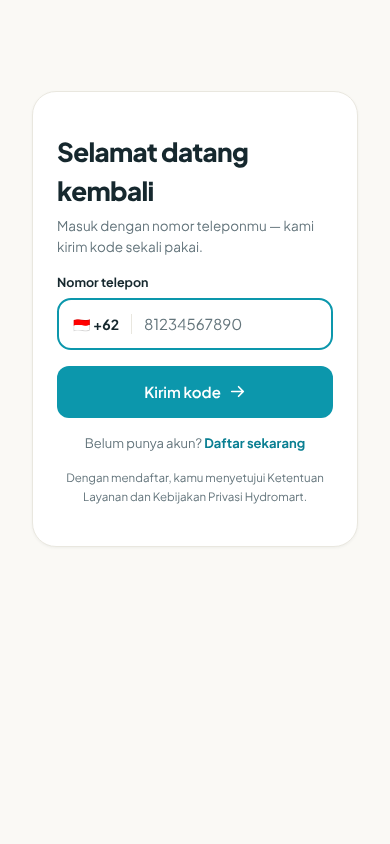
*Gambar 4.1a — Halaman `/login` (ponsel): "Selamat datang kembali", kolom Nomor telepon kosong dengan awalan +62, tombol "Kirim kode", tautan "Daftar sekarang". Gambar yang sama dengan Gambar 6.1 di Panduan Umum (SS-umum-02). Lingkungan uji lokal, 2026-10-11.*

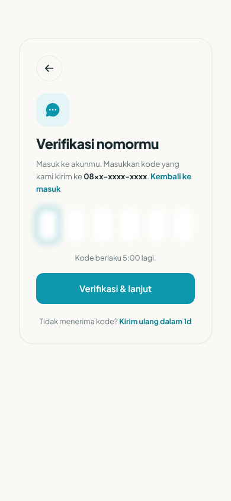
*Gambar 4.2 — Halaman `/verify` untuk alur masuk: enam kotak kode (sengaja diburamkan), "Kode berlaku 5:00 lagi.", tombol "Verifikasi & lanjut", dan "Kirim ulang dalam 1d". Nomor tersamar. Ini alur masuk ("Masuk ke akunmu."), bukan alur pendaftaran ("Selesaikan pendaftaran." tidak terlihat di gambar ini). Lingkungan uji lokal, data sintetis, 2026-10-11.*

### Prosedur: Mengelola profil

**Tujuan:** Mengubah nama, email, foto, tanggal lahir. **Titik awal:** Akun (`/account`) → ubah profil (`/account/edit`).

| Langkah | Tindakan pengguna | Respons sistem yang diharapkan |
|---|---|---|
| 1 | Buka **Akun** lalu ubah profil. | Formulir profil muncul. |
| 2 | Ubah **Nama** (maks. 120), **Email** (valid, maks. 160; dapat dikosongkan), **Foto** (maks. 5 MB), **Tanggal lahir** (opsional). | Teks bantu: "Opsional. Dipakai untuk hadiah ulang tahun; bisa dikosongkan kapan saja." |
| 3 | Simpan. | "Profil diperbarui." |

Pada layar **Akun** tombol untuk membuka formulir ini berlabel **Ubah** (di kartu profil bagian atas). Kartu profil menampilkan nama, avatar, dan tingkat keanggotaan ("Regular member"). **[V]** (tangkapan layar nyata)

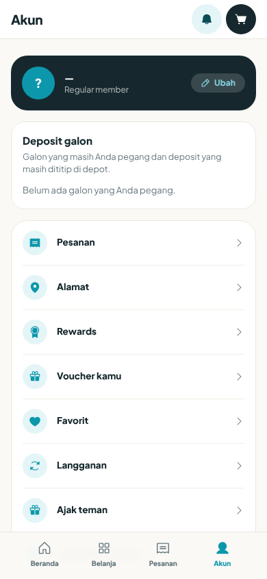
*Gambar 4.2a — Halaman `/account` pelanggan baru: kartu profil dengan nama "—", avatar "?", teks "Regular member", dan tombol **Ubah**; kartu "Deposit galon" berisi "Belum ada galon yang Anda pegang."; menu Pesanan, Alamat, Rewards, Voucher kamu, Favorit, Langganan, Ajak teman. Bagian "Data pribadi saya", perangkat, dan persetujuan berada di bawah dan tidak terlihat pada gambar ini. Nama kosong adalah temuan uji (lihat catatan [B] di prosedur pendaftaran). Lingkungan uji lokal, data sintetis, 2026-10-11.*

Kesalahan: "Gagal menyimpan profil." atau "Foto melebihi 5MB." **[V]** Hadiah ulang tahun dijanjikan teks di layar; belum ada kode yang diverifikasi untuk itu. **[D]**

### Prosedur: Mengganti nomor telepon

**Tujuan:** Memakai nomor baru untuk masuk. **Titik awal:** `/account/edit` → **Ganti nomor**.

| Langkah | Tindakan pengguna | Respons sistem |
|---|---|---|
| 1 | Baca peringatan: "Nomor ini yang dipakai untuk masuk. Menggantinya mengeluarkanmu dari semua perangkat." | — |
| 2 | Isi **Nomor HP baru**, tekan **Kirim kode**. | Kode dikirim ke nomor **baru**. |
| 3 | Isi **Kode verifikasi**, tekan **Konfirmasi ganti nomor**. | "Nomor berhasil diganti. Masuk lagi dengan nomor barumu." Semua perangkat keluar. |

Nomor lama menerima SMS pemberitahuan bahwa nomor akun berubah. **[V]**

| Pesan | Arti | Solusi |
|---|---|---|
| Isi nomor HP barunya dulu. | Kolom kosong | Isi nomor |
| Isi kode yang dikirim ke nomor barumu. | Kode kosong | Isi kode |
| Nomor itu sudah menjadi nomor akun ini. | Sama dengan nomor sekarang | Pakai nomor lain |
| Nomor ini sudah terdaftar. Silakan masuk. | Nomor dipakai akun lain | Pakai nomor lain |
| Tidak ada permintaan ganti nomor yang menunggu. Mulai lagi dari awal. | Permintaan tidak ada atau kedaluwarsa | Ulangi dari langkah 2 |
| Gagal mengirim kode ke nomor itu. / Gagal mengganti nomor. | Gagal umum | Coba lagi |

### Prosedur: Mengelola alamat

**Tujuan:** Menyimpan alamat antar. **Titik awal:** `/addresses` ("Tambah alamat").

| Langkah | Tindakan pengguna | Respons sistem |
|---|---|---|
| 1 | Tekan **Tambah alamat**. | Formulir muncul. |
| 2 | Isi **Label** (wajib, maks. 50), **Nama penerima** (wajib, maks. 120), **Nomor telepon** (wajib, maks. 20), **Alamat** (wajib, maks. 255), **Kota** (wajib, maks. 100). Opsional: Patokan/catatan (maks. 255), Provinsi, Kode pos (maks. 10). | — |
| 3 | Tekan **Gunakan lokasi saya** untuk mengisi titik peta (wajib). | Titik terisi. Tanpa titik: "Titik peta wajib diisi — tekan "Gunakan lokasi saya"." |
| 4 | Simpan. | Alamat tersimpan. Alamat pertama otomatis menjadi utama. |

Pada daftar alamat (Gambar 4.3a), kartu alamat utama menampilkan lencana **Utama** dan **Tersemat** (ikon pin; artinya belum dikonfirmasi, kemungkinan alamat sudah bertitik peta **[D]**) serta tombol **Ubah** dan **Hapus**; tombol **Jadikan utama** tidak terlihat pada alamat utama. Tindakan lain: **Ubah**, **Jadikan utama**, **Hapus** ("Hapus alamat?" / "Alamat "{label}" akan dihapus permanen."). Maksimal 20 alamat; lebih dari itu ditolak dengan pesan Inggris "You can save at most 20 addresses." (artinya: maksimal 20 alamat). **[V][B]** Bila alamat utama dihapus, alamat terbaru menjadi utama.

Kesalahan lain: "Gagal menyimpan alamat.", "Gagal memperbarui alamat. Coba lagi.", "Lengkapi semua kolom yang wajib diisi.", "Titik peta tidak valid: lintang harus antara -90 dan 90.", "… bujur harus antara -180 dan 180."

> **[SCREENSHOT REQUIRED: SS-customer-03 — Halaman `/addresses` dengan formulir alamat dan tombol "Gunakan lokasi saya".]**
> *Gambar 4.3 — Buku alamat.*

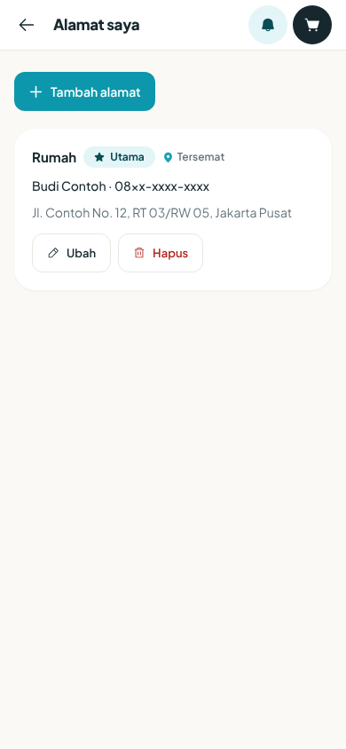
*Gambar 4.3a — Halaman `/addresses` ("Alamat saya") berisi satu alamat contoh berlabel "Rumah": penerima "Budi Contoh" (nama contoh sintetis), nomor telepon tersamar, "Jl. Contoh No. 12, RT 03/RW 05, Jakarta Pusat", tombol **Tambah alamat**. Formulir alamat dan tombol "Gunakan lokasi saya" tidak terlihat pada gambar ini, sehingga placeholder Gambar 4.3 dipertahankan. Lingkungan uji lokal, 2026-10-11.*

### Pengaturan awal lain

- **Lokasi pengiriman:** di header, buka pemilih lokasi ("Pilih lokasi pengiriman"). Pilih **Gunakan lokasi saya** atau **Atau pilih kota depot**. Ini menentukan depot yang ditampilkan. **[V]**
- **Notifikasi:** di Akun, atur **Notifikasi pesanan** ("Update status antar & kurir.") dan **Info promo & penawaran** ("Kabar diskon dari depotmu. Matikan kapan saja."). **[V]**
- **Bahasa dan tema:** pilih **Bahasa** (Indonesia atau Inggris) dan **Tema** (Terang, Gelap, Sistem). **[V]**
- **Tur perkenalan:** tiga slide tampil sekali ("Atur lokasi antar", "Pesan galon & air", "Lacak sampai depan pintu"); tekan **Lewati** atau **Lanjut** lalu **Mulai**. **[V]**

## 5. Menu dan Modul Tersedia

| Label | Rute | Bukti |
|---|---|---|
| Beranda | `/` | [V] |
| Belanja / Produk | `/products` | [V] |
| Detail produk | `/products/detail?id=…` | [V] |
| Keranjang | `/cart` | [V] |
| Checkout | `/checkout` | [V] |
| Pesanan | `/orders` | [V] |
| Detail pesanan | `/orders/detail?id=…` | [V] |
| Nilai pesanan | `/orders/detail/review?id=…` | [V] |
| Lacak Pesanan (publik) | `/track?token=…` | [V] |
| Notifikasi | `/notifications` | [V] |
| Favorit | `/favorites` | [V] |
| Promo | `/promo` | [V] |
| Voucher kamu | `/vouchers` | [V] |
| Ajak teman | `/referral` | [V] |
| Rewards (Tukar poin, Voucher, Riwayat) | `/rewards` | [V] |
| Langganan | `/subscriptions` | [V] |
| Akun | `/account` | [V] |
| Ubah profil | `/account/edit` | [V] |
| Alamat | `/addresses` | [V] |
| Bantuan | `/help` | [V] |
| Ajukan waralaba (publik) | `/waralaba` | [V] |
| Hapus akun (informasi publik) | `/hapus-akun` | [V] |
| Kebijakan privasi, Syarat & ketentuan | `/kebijakan-privasi`, `/syarat-ketentuan` | [V] |
| Status agen (hanya pelanggan agen) | `/agen` | [V] |

Bilah bawah ponsel: Beranda, Belanja, Pesanan, Akun. Bilah atas web: Belanja, Pesanan, keranjang, lonceng notifikasi, Akun. **[V]** Halaman `/resellers` adalah halaman petugas internal dan tidak untuk pelanggan.

## 6. Prosedur Langkah demi Langkah

### Prosedur: Menjelajah dan mencari produk

**Tujuan:** Menemukan galon atau air kemasan. **Prasyarat:** Tidak perlu masuk. **Titik awal:** **Belanja** (`/products`, judul "Pesan air").

| Langkah | Tindakan pengguna | Respons sistem yang diharapkan |
|---|---|---|
| 1 | (Disarankan) Atur lokasi lewat pemilih lokasi di header. | Subjudul menampilkan depot dan jaraknya: "diantar dari {depot} — {km} km". |
| 2 | Ketik di kolom **Cari produk…** atau pilih chip kategori ("Semua" atau kategori lain). | Daftar produk menyesuaikan. Tanpa hasil: "Tidak ada hasil untuk “{kata}”" dengan tombol **Bersihkan pencarian**. |
| 3 | Tekan **Muat lebih banyak** untuk produk berikutnya (12 per halaman). | Produk bertambah. |
| 4 | Tekan sebuah produk. | Halaman detail: harga, satuan, "Dikirim dari {depot}", status depot (Buka / Istirahat / Tutup), foto, dan "Sering dibeli bersama". |

Bila depot tutup: "Depot sedang tutup. Pesanan diproses saat depot buka lagi." Bila alamat di luar jangkauan: "Depot terdekat, {depot}, belum mengantar ke alamat ini ({km} km)." **[V]**

Harga di daftar bisa berupa perkiraan: "Harga perkiraan — harga depot dipakai saat pesanan dibuat". **[V]**

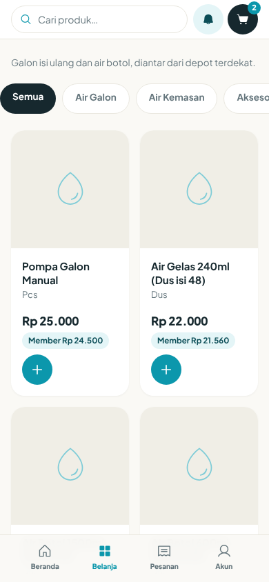
*Gambar 6.1 — Halaman `/products` pada ponsel: kolom "Cari produk…", chip kategori "Semua", "Air Galon", "Air Kemasan", "Aksesoris", dan kartu produk (mis. "Pompa Galon Manual" Rp 25.000, "Air Gelas 240ml (Dus isi 48)" Rp 22.000) dengan tombol + dan lencana "Member Rp …". Foto produk berupa gambar pengganti (ikon tetes) pada lingkungan uji. Subjudul yang terlihat berbunyi "Galon isi ulang dan air botol, diantar dari depot terdekat." tanpa nama depot dan jarak, dan judul "Pesan air" tidak terlihat di bagian atas gambar. Lingkungan uji lokal, data sintetis, 2026-10-11.*

**[D][K]** Lencana "Member Rp 24.500" (sekitar 2% di bawah harga Rp 25.000) tampil pada akun berstatus REGULAR, padahal tabel tier di bawah menyebut diskon REGULAR 0%. Arti lencana ini belum terkonfirmasi.

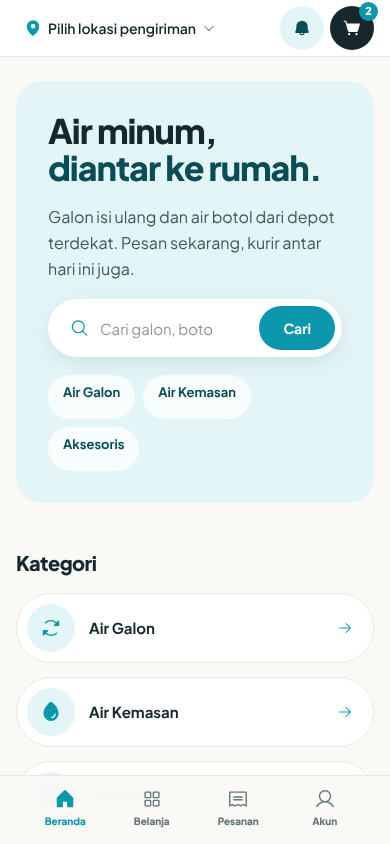
*Gambar 6.1a — Beranda `/` setelah masuk: pemilih "Pilih lokasi pengiriman", lonceng, keranjang berlencana jumlah, judul "Air minum, diantar ke rumah.", kolom pencarian "Cari galon, boto…" dengan tombol **Cari**, chip kategori, daftar "Kategori" (Air Galon, Air Kemasan), dan bilah bawah Beranda, Belanja, Pesanan, Akun. Teks "kurir antar hari ini juga" tertulis tetap di layar dan tidak dijamin sistem **[D]**. Ini beranda setelah masuk, bukan tampilan tamu. Lingkungan uji lokal, 2026-10-11.*

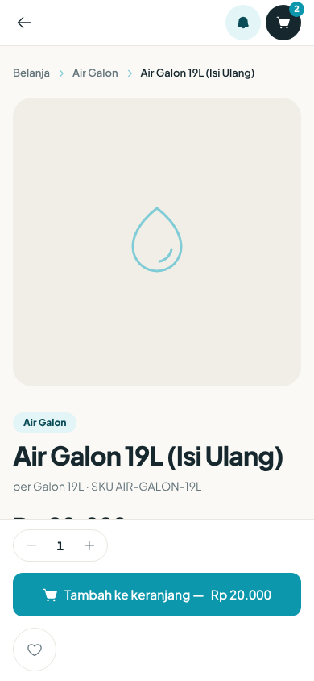
*Gambar 6.1b — Detail produk "Air Galon 19L (Isi Ulang)": jejak "Belanja > Air Galon", keterangan "per Galon 19L · SKU AIR-GALON-19L", pemilih jumlah (1), tombol **Tambah ke keranjang — Rp 20.000**, dan ikon hati (favorit). Harga, "Dikirim dari {depot}", status depot, dan "Sering dibeli bersama" tidak terlihat pada gambar (tertutup bilah bawah atau di bawah layar). Lingkungan uji lokal, 2026-10-11.*

### Prosedur: Memasukkan ke keranjang

**Tujuan:** Mengumpulkan barang. **Prasyarat:** Sudah masuk. **Titik awal:** Detail produk.

| Langkah | Tindakan pengguna | Respons sistem |
|---|---|---|
| 1 | Pilih jumlah, lalu tekan **Tambah ke keranjang —**. | Bila belum masuk, Anda diminta masuk dulu; setelah masuk, barang ditambahkan otomatis. Tombol berubah menjadi "Ditambahkan" dan tersedia **Ke keranjang →**. |
| 2 | Buka **Keranjang**. | Daftar barang, ringkasan, Subtotal, dan "Estimasi total". |
| 3 | Ubah jumlah (1 sampai 999 per barang) atau hapus barang. | Total diperbarui. |
| 4 | (Opsional) Tambah barang dari "Sekalian, biar sekali antar". | Barang masuk keranjang. |
| 5 | Tekan **Checkout**. | Pindah ke `/checkout`. |

Hal yang perlu dipahami di keranjang:
- Promo otomatis tampil sebagai "Promo", "Diskon belanja", atau "Gratis {jumlah}× {nama}" (hadiah dikirim bersama pesanan jika stok tersedia). **[V]**
- "Diskon member ({persen}%)" otomatis sesuai tier. **[V]**
- "Ongkir dihitung saat checkout, setelah depot ditentukan." **[V]**
- Barang yang sudah tidak dijual dikeluarkan otomatis: "{nama} tidak lagi dijual dan sudah dikeluarkan dari keranjang." **[V]**
- **Kosongkan keranjang** meminta konfirmasi dan tidak bisa dibatalkan. **[V]**
- Keranjang kosong: "Keranjang masih kosong" dengan tombol **Mulai belanja**.

Kesalahan: "Gagal menambah ke keranjang." **[V]**

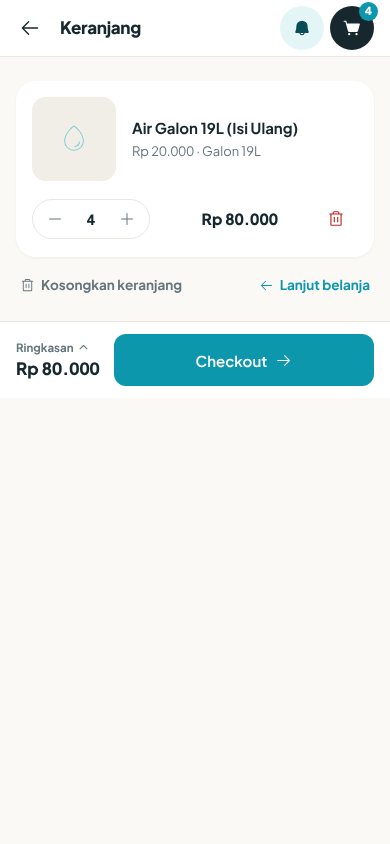
*Gambar 6.1c — Halaman `/cart` ("Keranjang"): satu baris "Air Galon 19L (Isi Ulang)" Rp 20.000, jumlah 4 (Rp 80.000), ikon hapus, tautan **Kosongkan keranjang** dan **Lanjut belanja**, bilah bawah "Ringkasan Rp 80.000" dan tombol **Checkout**. Rincian ringkasan (Subtotal, Estimasi total) tertutup pada gambar. Lingkungan uji lokal, 2026-10-11.*

**[B]** Pada uji, jumlah di keranjang menjadi 4 galon setelah penambahan berulang pada dua sesi (catatan temuan runtime: penambahan dari halaman detail bersifat menambah jumlah di sisi server). Periksa jumlah di keranjang sebelum **Checkout**.

### Prosedur: Checkout (membuat pesanan)

**Tujuan:** Mengubah keranjang menjadi pesanan. **Peran:** Pelanggan. **Prasyarat:** Sudah masuk; keranjang berisi; alamat dengan titik lokasi atau depot yang dipilih. **Titik awal:** **Checkout** di keranjang (`/checkout`).

| Langkah | Tindakan pengguna | Respons sistem yang diharapkan |
|---|---|---|
| 1 | Di **Alamat pengiriman**, pilih alamat tersimpan atau **+ Alamat baru**. Alamat baru: **Nama penerima**, **Telepon**, **Alamat** ("Jalan, nomor, RT/RW"), **Kota** (semuanya wajib), titik lokasi lewat **Gunakan lokasi saya**, dan opsional **Catatan untuk kurir**. Centang **Simpan alamat ini ke buku alamat** dan isi **Label alamat** bila mau. | Bila ada yang kurang: "Lengkapi alamat pengiriman dulu." |
| 2 | Bila alamat tidak punya titik peta, pilih **Pilih depot pengantar**. | Wajib bila tanpa titik: "Pilih depot dulu untuk melanjutkan." |
| 3 | Pilih **Waktu pengiriman**: **Antar sekarang** atau **Atau jadwalkan**. Antar sekarang menampilkan "Estimasi {min}–{maks} menit" dan biaya tambahan (bawaan Rp5.000, bisa berbeda per depot **[K]**). Jadwal: pilih tanggal (Hari ini, Besok, dan dua hari berikutnya) lalu jam; bawaan 09.00-11.00, 11.00-13.00, 13.00-15.00, 15.00-17.00, 17.00-19.00 (bisa berbeda per depot **[K]**). | Antar sekarang tidak tersedia saat depot tutup atau istirahat: "Depot sedang tutup — antar sekarang tidak tersedia. Pesanan terjadwal tetap bisa." |
| 4 | Pilih **Metode pembayaran** (lihat prosedur Pembayaran). Baris ini membuka lembar "Metode pembayaran" dengan tombol **Selesai** (Gambar 6.2a). | Metode yang tidak tersedia di depot diganti otomatis dengan pesan "Metode bayar diganti — periksa sebelum memesan." |
| 5 | (Opsional) Isi **Voucher** lalu **Terapkan**, atau pilih dari "Bisa dipakai sekarang". | Potongan harga tampil di ringkasan. |
| 6 | Periksa ringkasan: subtotal, diskon, ongkir, total. | "Harga diverifikasi ulang oleh depot saat pesanan dibuat — kamu tidak akan ditagih lebih." |
| 7 | Tekan **Buat pesanan**. Total tampil di sisi kiri bilah bawah ("Ringkasan pesanan", mis. Rp 84.000); tombolnya sendiri berlabel "Buat pesanan" tanpa angka. | Pesanan dibuat dan Anda dibawa ke rincian pesanan. |

**Cara mengenali sukses:** banner "Pesanan berhasil dibuat!" dan "Depot sedang menyiapkan pesananmu. Kami kabari saat kurir berangkat." Halaman juga menampilkan "Estimasi tiba ±30–45 menit". Itu teks tetap, bukan hitungan sistem. **[B]** Aplikasi bisa meminta izin notifikasi setelah pesanan pertama.

**Yang diperiksa sistem sebelum pesanan dibuat** **[V]**:
- Keranjang tidak kosong.
- Alamat berada dalam jangkauan depot (bawaan radius 5 km **[K]**).
- Harga dihitung ulang dari harga depot, bukan dari layar.
- Minimum pesanan depot dipenuhi (dihitung dari subtotal sebelum promo).
- Stok dicadangkan.
- Voucher sah, dan tidak dipakai bersama harga agen.

Ongkir = biaya antar depot × jumlah **galon**; barang selain galon tidak menambah ongkir. Biaya antar sekarang sudah masuk total saat pesanan dibuat, walaupun teks "Biaya antar sekarang ditambahkan saat depot mengonfirmasi." **[B]**

Tombol **Buat pesanan** nonaktif bila: depot harus dipilih, alamat di luar area, antar sekarang dipilih saat depot tutup/istirahat, atau di bawah minimum ("Minimum pesanan di depot ini Rp {min}. Kurang Rp {kurang} lagi."). Nilai minimum berbeda per depot. **[K]**

**Bila gagal:**

| Pesan di layar | Arti | Solusi |
|---|---|---|
| Titik alamat ini di luar radius antar semua depot kami. Pilih alamat lain, atau ubah titik petanya ke lokasi yang kami layani. | Di luar area layanan | Pilih alamat lain atau geser titik peta |
| Pilih depot dulu untuk melanjutkan. | Alamat tanpa titik peta | Pilih depot pengantar |
| Minimum pesanan di depot ini Rp {min}. Tambah barang lagi ya. | Di bawah minimum | Tambah barang |
| Keranjangmu kosong. Tambahkan produk sebelum checkout. | Keranjang kosong | Tambah produk |
| Katalog produk sedang sibuk. Tunggu sebentar, lalu coba lagi. | Katalog sibuk | Coba lagi |
| Depot pengantar belum bisa ditentukan, jadi harga dan ongkir di layar ini masih harga katalog. Coba muat ulang sebelum memesan. | Depot belum ditentukan | Tekan **Coba lagi** / muat ulang |
| Pesanan sudah dibuat, tapi pembayarannya belum bisa dimulai. Tekan lagi untuk mencoba — pesanan yang sama yang dipakai, bukan pesanan baru. | Pembayaran gagal dimulai | Tekan tombol lagi; tidak akan membuat pesanan ganda |
| Pesanan berhasil dibuat, tapi alamatnya tidak tersimpan ke buku alamat. | Alamat gagal disimpan | Tambahkan alamat dari menu Alamat |
| Tidak bisa membuat pesanan. | Gagal umum | Coba lagi |
| Diskon reseller berlaku otomatis. Voucher tidak bisa dipakai bersama harga reseller. | Pelanggan agen memakai voucher | Hapus voucher |
| Some items are out of stock at the fulfilling depot. (arti: sebagian barang habis di depot) | Stok kurang | Kurangi jumlah atau pilih barang lain |
| Insufficient stock at the fulfilling depot: {kode produk} (need {n}, have {m}). (arti: stok kurang; butuh n, tersedia m) | Stok kurang untuk produk itu | Kurangi jumlah ke angka "have" |
| This depot is not taking express deliveries right now. Please pick a time slot. (arti: depot tidak menerima antar sekarang; pilih jadwal) | Express tidak tersedia | Pilih **Atau jadwalkan** |
| That depot is not available right now. Please pick another one. (arti: depot tidak tersedia; pilih depot lain) | Depot nonaktif | Pilih depot lain |
| Could not confirm stock right now. Please try again. (arti: stok belum bisa dipastikan; coba lagi) | Pengecekan stok terganggu | Coba lagi |
| Product {id} is no longer available. (arti: produk tidak lagi tersedia) | Produk ditarik | Hapus dari keranjang |

Pesan Inggris di atas ditampilkan apa adanya dari server. **[B]** Tombol checkout mengirim satu kunci unik sehingga menekan dua kali tidak membuat dua pesanan. **[V]**

**Hasil akhir:** Pesanan berstatus "Dipesan"; keranjang kosong; pembayaran dimulai otomatis sesuai metode yang dipilih; depot menerima pesanan baru. **[V]**

**Izin dan batasan:** Harus masuk. Satu voucher per pesanan. Keterangan waktu jadwal tersimpan sebagai teks dan tanggalnya tidak disimpan oleh sistem; sebutkan kebutuhan penting lewat **Catatan untuk kurir** atau hubungi depot. **[B]**

**Daftar periksa:**
- [ ] Alamat dan titik lokasi benar
- [ ] Nama dan nomor penerima benar
- [ ] Waktu pengiriman dipilih
- [ ] Metode bayar sesuai
- [ ] Total diperiksa

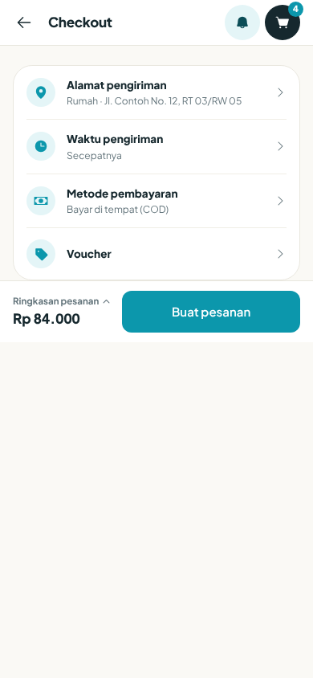
*Gambar 6.2 — Halaman `/checkout`: empat baris berpanah — "Alamat pengiriman" (Rumah · Jl. Contoh No. 12, RT 03/RW 05), "Waktu pengiriman" (Secepatnya), "Metode pembayaran" (Bayar di tempat (COD)), "Voucher" (kosong) — dan bilah bawah "Ringkasan pesanan Rp 84.000" dengan tombol **Buat pesanan**. Layar dalam keadaan ringkas; rincian tiap baris tidak terlihat. Total Rp 84.000 = barang Rp 80.000 + ongkir Rp 4.000 (angka ini terlihat pada rincian pesanan, Gambar 6.5). Lingkungan uji lokal, data sintetis, 2026-10-11.*

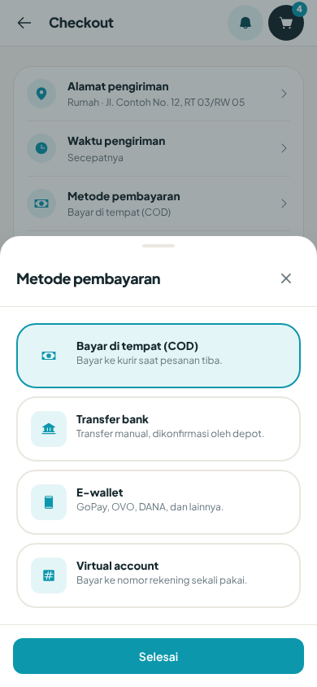
*Gambar 6.2a — Lembar "Metode pembayaran" di checkout: **Bayar di tempat (COD)** ("Bayar ke kurir saat pesanan tiba.", terpilih), **Transfer bank** ("Transfer manual, dikonfirmasi oleh depot."), **E-wallet** ("GoPay, OVO, DANA, dan lainnya."), **Virtual account** ("Bayar ke nomor rekening sekali pakai."), dan tombol **Selesai**. Opsi **QRIS** tidak tampil pada depot uji ini. Lingkungan uji lokal, 2026-10-11.*

**[K]** Daftar metode bergantung pada depot. Pada depot uji, E-wallet dan Virtual account tampil sebagai pilihan dan QRIS tidak; ini tidak membuktikan ketersediaan di produksi.

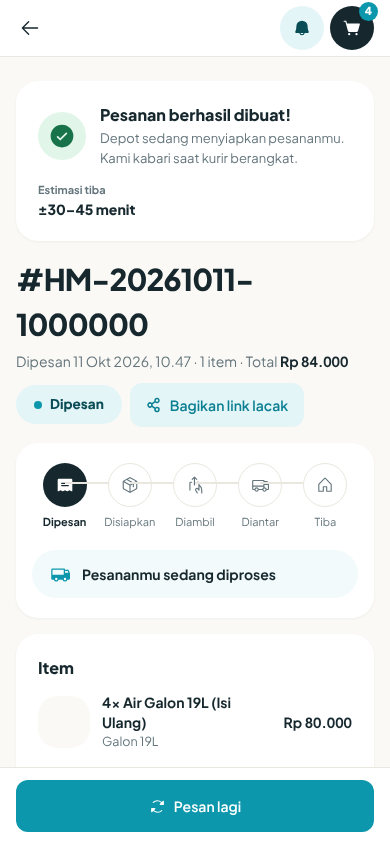
*Gambar 6.3 — Rincian pesanan sesaat setelah **Buat pesanan**: banner "Pesanan berhasil dibuat!" dengan "Depot sedang menyiapkan pesananmu. Kami kabari saat kurir berangkat.", "Estimasi tiba ±30–45 menit" (teks tetap), nomor pesanan #HM-20261011-1000000, "Dipesan 11 Okt 2026, 10.47 · 1 item · Total Rp 84.000", chip status **Dipesan**, tombol **Bagikan link lacak**, bilah kemajuan (Dipesan, Disiapkan, Diambil, Diantar, Tiba), banner "Pesananmu sedang diproses", daftar Item (4× Air Galon 19L (Isi Ulang) Rp 80.000), dan tombol **Pesan lagi**. "1 item" tampaknya menghitung baris produk, bukan jumlah galon **[D]**. Lingkungan uji lokal, data sintetis, 2026-10-11.*

### Prosedur: Memakai voucher dan poin

**Tujuan:** Mendapat potongan. **Titik awal:** **Voucher kamu** (`/vouchers`) atau kolom Voucher di checkout.

| Langkah | Tindakan pengguna | Respons sistem |
|---|---|---|
| 1 | Buka `/vouchers`. | Daftar voucher dengan status: Bisa dipakai, Sudah dipakai, Kedaluwarsa, Belum berlaku, Kuota habis. |
| 2 | Tekan **Salin** untuk menyalin kode, atau **Pakai**. | **Pakai** membuka checkout dengan kode terisi. |
| 3 | Di checkout tekan **Terapkan**. | Potongan tampil. |

Aturan voucher **[V]**: satu kode per pesanan; kode tidak peka huruf besar/kecil; dihitung dari subtotal setelah promo otomatis; bisa terbatas pada depot tertentu, produk tertentu, minimal belanja, masa berlaku, dan kuota. Jenis potongan: persen (dengan batas maksimum), nominal tetap, atau gratis ongkir (maksimum sebesar ongkir). Voucher yang khusus untuk penerima tertentu tidak bisa dipakai orang lain. Pelanggan agen tidak boleh memakai voucher.

| Pesan | Arti | Solusi |
|---|---|---|
| Voucher itu tidak bisa dipakai. | Gagal umum | Periksa kode |
| Voucher not found. (arti: voucher tidak ditemukan) | Kode salah | Periksa ketikan |
| This voucher has expired. (arti: voucher kedaluwarsa) | Lewat masa berlaku | Pakai voucher lain |
| This voucher is not valid yet. (arti: belum berlaku) | Belum mulai | Tunggu tanggal mulai |
| This voucher is no longer active. (arti: voucher sudah tidak aktif) | Dinonaktifkan | Pakai voucher lain |
| Your order must be at least {angka} to use this voucher. (arti: pesanan minimal sebesar angka itu) | Belum mencapai minimal belanja | Tambah barang |
| This voucher has reached its usage limit. (arti: kuota habis) | Kuota terpakai | Pakai voucher lain |
| You have already used this voucher the maximum number of times. (arti: sudah dipakai sebanyak batas) | Batas per pelanggan | Pakai voucher lain |
| This voucher has spent its full discount budget. (arti: anggaran diskon habis) | Anggaran habis | Pakai voucher lain |
| Voucher ini hanya berlaku di depot tertentu. | Depot tidak cocok | Pilih depot yang berlaku |
| Voucher ini hanya berlaku untuk produk tertentu yang tidak ada di keranjang. | Produk tidak cocok | Tambah produk yang berlaku |
| Voucher ini khusus untuk pelanggan yang menerimanya. | Bukan milik Anda | Pakai voucher sendiri |

**Poin dan tier** **[V]**: poin = subtotal pesanan ÷ Rp1.000, dibulatkan ke bawah (bawaan, bisa berbeda per depot **[K]**), masuk setelah pesanan berstatus Selesai. Subtotal yang dipakai adalah sebelum diskon dan ongkir. Tier berdasarkan total poin sepanjang waktu: REGULAR 0 poin (diskon 0%), SILVER 1.000 poin (2%), GOLD 5.000 poin (5%), PLATINUM 15.000 poin (8%). Angka ini bawaan kode dan bisa disetel **[K]**. Menukar poin mengurangi saldo, bukan tier. Poin dapat habis masa berlaku 12 bulan sejak diperoleh, tetapi penyapuan otomatis mati secara bawaan **[K]**; teks di layar "Poin hangus setelah 12 bulan tanpa aktivitas" tidak sama persis dengan kode **[B]**.

### Prosedur: Membayar pesanan

**Tujuan:** Melunasi pesanan. **Titik awal:** Rincian pesanan (`/orders/detail?id=…`), panel pembayaran.

Pembayaran dimulai otomatis dengan metode yang dipilih saat checkout. **[V]**

| Metode | Keterangan di layar | Cara kerja |
|---|---|---|
| **Bayar di tempat (COD)** | "Bayar ke kurir saat pesanan tiba." | Siapkan uang tunai. Status Menunggu sampai kurir mengonfirmasi |
| **Transfer bank** | "Transfer manual, dikonfirmasi oleh depot." | Rekening depot, nomor (dengan **Salin**), nama pemilik, dan **Nominal** tampil. Transfer, lalu unggah bukti |
| **QRIS** | "Pindai untuk bayar lewat aplikasi QRIS mana pun." | Gambar QRIS milik depot tampil. Bayar langsung ke depot, lalu unggah bukti |
| **E-wallet** | "GoPay, OVO, DANA, dan lainnya." | Hanya bila penyedia pembayaran diaktifkan. Kemungkinan belum tersedia di produksi **[D][K]** |
| **Virtual account** | "Bayar ke nomor rekening sekali pakai." | Sama seperti e-wallet **[D][K]** |

Metode yang benar-benar muncul di checkout bergantung pada depot. Dua depot disebut belum mengatur rekening/QRIS sehingga pelanggan hanya ditawari tunai **[K]**.

| Langkah | Tindakan pengguna | Respons sistem |
|---|---|---|
| 1 | Buka rincian pesanan. | Panel pembayaran: "Bayar via transfer" atau "Bayar via QRIS", dengan "Pembayaran masuk langsung ke {depot}." |
| 2 | Lakukan pembayaran dengan nominal **persis sama** dengan pesanan. | — |
| 3 | Di bagian **Bukti bayar**, tekan **Pilih foto bukti**. Format jpeg, png, atau webp, maksimal 5 MB. Gambar dikompres otomatis. | "Mengunggah…". Sukses bila foto tampil. Tombol berubah menjadi **Ganti foto bukti**. |
| 4 | Tunggu staf depot mengonfirmasi. | "Sudah transfer? Status berubah menjadi lunas setelah staf depot mengonfirmasi." Status menjadi PAID. |

Bila belum ada pembayaran aktif atau pembayaran gagal, panel menampilkan **Bayar pesanan ini** atau **Coba bayar lagi**, lalu **Bayar sekarang**. Hanya satu pembayaran aktif per pesanan. Pembayaran non-tunai yang belum dikonfirmasi gagal otomatis setelah 24 jam. **[V]**

| Pesan | Arti | Solusi |
|---|---|---|
| Depot belum mengatur rekening. Hubungi depot. | Depot belum punya data rekening | Hubungi depot (WhatsApp di Bantuan) |
| Depot belum mengatur QRIS. Hubungi depot. | Depot belum punya QRIS | Hubungi depot |
| Bukti bayar gagal diunggah. Coba lagi. | Unggahan gagal | Coba lagi, cek ukuran dan format |
| Penyimpanan bukti bayar sedang tidak tersedia. Coba lagi sebentar lagi. | Penyimpanan terganggu | Coba lagi nanti |
| unsupported file type (allowed: jpeg, png, webp) (arti: jenis berkas tidak didukung) | Format salah | Pakai jpeg, png, atau webp |
| Jumlah pembayaran tidak cocok dengan pesanan ini. | Nominal berbeda | Hubungi depot |
| This order already has an active payment. (arti: pesanan sudah punya pembayaran aktif) | Pembayaran ganda | Lanjutkan pembayaran yang ada |
| Could not reach the payment provider. Please try again. (arti: penyedia pembayaran tak terjangkau) | Gangguan penyedia | Coba lagi, atau pilih metode lain |

**Tampilan status pembayaran.** Di rincian pesanan, status dan metode tampil sebagai kode Inggris. **[B]** Artinya: PENDING = menunggu pembayaran atau konfirmasi; PAID = lunas; FAILED = gagal; CANCELLED = dibatalkan; REFUNDED = dikembalikan. Metode: CASH = tunai, TRANSFER = transfer, QRIS = QRIS, EWALLET = e-wallet, VA = virtual account. Petunjuk pembayaran juga bisa berbahasa Inggris, misalnya "Pay with cash to the driver on delivery." (bayar tunai ke kurir saat antar), "Transfer to the depot bank account and keep your receipt." (transfer ke rekening depot dan simpan bukti), "Scan the depot QRIS and show the payment proof to staff." (pindai QRIS depot dan tunjukkan bukti ke staf). **[B]**

Metode bayar tersimpan di Akun ("Metode pembayaran") hanya berupa label dan nomor akhir. Tampaknya tidak dipakai saat checkout. **[D]**

**Hasil akhir:** Pembayaran berstatus PAID; pesanan berstatus "Dikonfirmasi". **Daftar periksa:**
- [ ] Nominal sama persis
- [ ] Bukti bayar diunggah jelas (nominal, tanggal terbaca)
- [ ] Status diperiksa setelah staf mengonfirmasi

> **[SCREENSHOT REQUIRED: SS-customer-07 — Panel pembayaran transfer/QRIS di rincian pesanan, dengan rekening, tombol Salin, dan "Pilih foto bukti".]**
> *Gambar 6.4 — Pembayaran dan bukti bayar.*

### Prosedur: Melacak pesanan

**Tujuan:** Mengetahui posisi pesanan. **Titik awal:** **Pesanan** → pilih pesanan, atau tombol **Lacak kurir** di beranda.

| Langkah | Tindakan pengguna | Respons sistem |
|---|---|---|
| 1 | Buka **Pesanan** lalu pilih pesanan. | Bilah kemajuan: Dipesan, Disiapkan, Diambil, Diantar, Tiba. Banner status. |
| 2 | Lihat nama dan nomor kurir setelah ditugaskan. | Kartu kurir dengan tautan telepon. |
| 3 | Tunggu. Halaman menyegarkan diri tiap 15 detik selama pesanan aktif. | Status dan perkiraan tiba tampil saat dalam perjalanan. |

Arti status dan banner:

| Status | Banner untuk Anda |
|---|---|
| Dipesan, Dikonfirmasi | Pesananmu sedang diproses |
| Disiapkan | Pesananmu sedang disiapkan di depot |
| Kurir ditugaskan | Kurir sedang menuju depot |
| Diambil kurir | Pesananmu sudah diambil kurir |
| Dalam perjalanan | Pesananmu sedang dalam perjalanan |
| Tiba | Pesananmu sudah tiba |
| Selesai | Pesanan selesai — terima kasih! |
| Dibatalkan | Pesanan dibatalkan |

Pengantaran bisa dijadwalkan ulang oleh depot; status kembali ke Disiapkan dan Anda menerima notifikasi "Pengiriman dijadwalkan ulang". **[V]**

**Membagikan tautan lacak:** tekan **Bagikan link lacak** (tersedia bila pesanan punya tautan). Siapa pun yang memegang tautan `/track?token=…` dapat melihat nomor pesanan, status, kota, perkiraan tiba, nama depan kurir, dan riwayat status. Nama, nomor telepon, dan alamat Anda tidak ikut tampil. **[V]** Halaman itu berlabel Inggris (Order placed, Confirmed, Preparing, Driver assigned, Picked up, On the way, Delivered, Completed, Cancelled). **[B]** Tautan tidak lengkap: "Tidak ada nomor lacak"; tautan salah: "Link tidak ditemukan" (minta tautan baru dari depot).

Kartu "sedang diantar" di beranda tampil untuk semua pesanan terbuka, termasuk yang baru dibuat. **[B]** Peta kurir langsung: Tidak tersedia (lihat bagian 15).

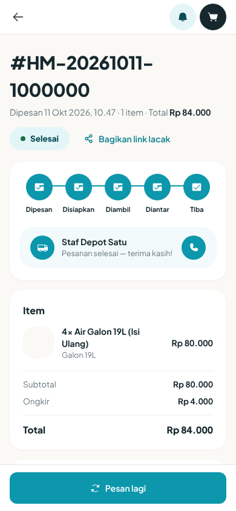
*Gambar 6.5 — Rincian pesanan dalam status **Selesai**: bilah kemajuan penuh (Dipesan, Disiapkan, Diambil, Diantar, Tiba), kartu kurir "Staf Depot Satu" dengan teks "Pesanan selesai — terima kasih!" dan tombol telepon, lalu Item, Subtotal Rp 80.000, Ongkir Rp 4.000, Total Rp 84.000. Kondisi berbeda dari keterangan placeholder: gambar menunjukkan pesanan yang sudah selesai, bukan sedang diantar. Nama kurir adalah data contoh sintetis. Lingkungan uji lokal, 2026-10-11.*

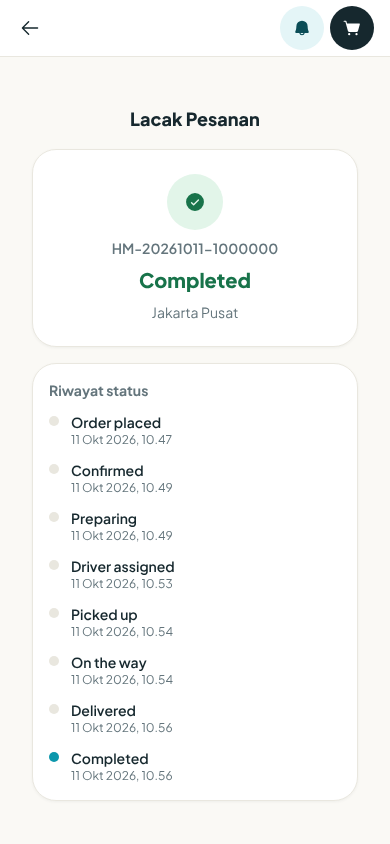
*Gambar 6.5a — Halaman `/track` (tanpa masuk) untuk pesanan selesai: judul "Lacak Pesanan", nomor HM-20261011-1000000, status "Completed", kota "Jakarta Pusat", dan "Riwayat status": Order placed, Confirmed, Preparing, Driver assigned, Picked up, On the way, Delivered, Completed (dengan jam). Token pada tautan tidak terlihat di gambar. Lingkungan uji lokal, data sintetis, 2026-10-11.*

**[B]** Terkonfirmasi pada uji: seluruh label status di `/track` berbahasa Inggris, sedangkan rincian pesanan (Gambar 6.5) berbahasa Indonesia. Arti: Order placed = Dipesan, Confirmed = Dikonfirmasi, Preparing = Disiapkan, Driver assigned = Kurir ditugaskan, Picked up = Diambil kurir, On the way = Dalam perjalanan, Delivered = Tiba, Completed = Selesai.

### Prosedur: Melihat riwayat dan memesan lagi

**Titik awal:** **Pesanan** (`/orders`, 20 per halaman).

| Langkah | Tindakan pengguna | Respons sistem |
|---|---|---|
| 1 | Buka **Pesanan**; geser untuk halaman berikutnya. | Daftar pesanan dan rel "Beli lagi". |
| 2 | Buka pesanan, tekan **Pesan lagi**. | Barang yang masih dijual masuk ke keranjang. |

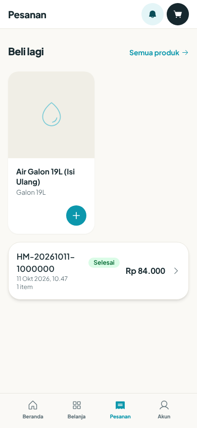
*Gambar 6.5b — Halaman `/orders` ("Pesanan"): rel "Beli lagi" dengan tautan **Semua produk** dan satu produk (Air Galon 19L (Isi Ulang)), lalu satu kartu pesanan HM-20261011-1000000, "11 Okt 2026, 10.47", "1 item", chip **Selesai**, Rp 84.000. Lingkungan uji lokal, data sintetis, 2026-10-11.*

Pesan: "Tidak ada barang pesanan ini yang masih dijual. atau "{n} barang tidak lagi dijual dan tidak ikut ditambahkan." Bonus gratis dari promo tidak ikut ditambahkan. **[V]**

### Prosedur: Menilai pesanan

**Tujuan:** Memberi ulasan. **Prasyarat:** Status Tiba atau Selesai, belum dinilai. **Titik awal:** Rincian pesanan → **Nilai pesanan**.

| Langkah | Tindakan pengguna | Respons sistem |
|---|---|---|
| 1 | Tekan **Nilai pesanan**. | Judul "Bagaimana pesananmu?" |
| 2 | Pilih bintang 1 sampai 5 (wajib). Keterangan: 1 Buruk, 2 Kurang, 3 Cukup, 4 Bagus!, 5 Luar biasa! | Tanpa bintang: "Pilih rating bintang dulu." |
| 3 | (Opsional) Pilih "Apa yang bagus?": Kecepatan antar, Kondisi galon, Keramahan kurir, Akurasi pesanan. | — |
| 4 | (Opsional) Tulis komentar, maksimal 500 huruf. | — |
| 5 | Tekan **Kirim ulasan**. | "Terima kasih atas ulasanmu!" |

Satu ulasan per pesanan. Pesan: "Pesanan ini sudah dinilai.", "Pesanan bisa dinilai setelah selesai.", "Gagal mengirim ulasan." Fitur tip untuk kurir: Tidak tersedia. **[V]** Sekitar 30 menit setelah pesanan tiba Anda bisa menerima notifikasi "Beri penilaian" (hanya sekali). **[V]**

### Prosedur: Membuat dan mengelola langganan

**Tujuan:** Pesanan galon rutin otomatis. **Titik awal:** **Langganan** (`/subscriptions`, "Galon rutin, tanpa perlu ingat").

| Langkah | Tindakan pengguna | Respons sistem |
|---|---|---|
| 1 | Pilih **Produk**. | — |
| 2 | Isi **Jumlah** (bawaan 2, minimal 1). | — |
| 3 | Pilih **Frekuensi**: Mingguan (tiap 7 hari), 2 minggu (tiap 14 hari), Bulanan (tiap 30 hari). | — |
| 4 | Pilih **Pengiriman pertama** (bawaan besok; tidak boleh tanggal lampau). | — |
| 5 | Pilih **Antar ke** (alamat tersimpan). | Alamat harus punya titik peta, kalau tidak: "Alamat ini belum punya titik peta, jadi langganan tidak bisa dijadwalkan. Buka alamat itu dan tekan "Gunakan lokasi saya" dulu." |
| 6 | Tekan **Mulai langganan**. | "Langganan dibuat." |

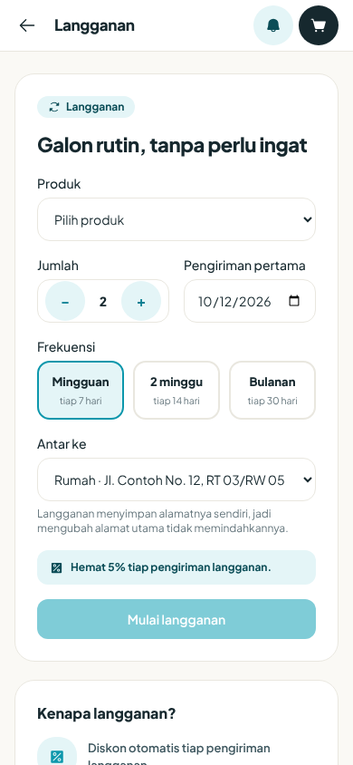
*Gambar 6.5c — Halaman `/subscriptions` ("Langganan", "Galon rutin, tanpa perlu ingat"): kolom Produk ("Pilih produk"), Jumlah (2), Pengiriman pertama (10/12/2026), pilihan Frekuensi (Mingguan terpilih; 2 minggu; Bulanan), Antar ke (alamat Rumah), teks "Langganan menyimpan alamatnya sendiri, jadi mengubah alamat utama tidak memindahkannya.", "Hemat 5% tiap pengiriman langganan.", dan tombol **Mulai langganan** yang tampak nonaktif karena produk belum dipilih **[D]**. Hanya formulir pembuatan yang terlihat; belum ada langganan tersimpan pada akun uji. Format tanggal mengikuti browser uji (10/12/2026 dibaca 12 Okt 2026, besok **[D]**). Lingkungan uji lokal, 2026-10-11.*

Diskon langganan: "Hemat {persen}% tiap pengiriman langganan. (bawaan 5%, berbeda per depot, maksimal 50%). **[K]** Tiap jadwal, sistem membuat pesanan otomatis dengan harga depot dan ongkir per galon, dan Anda menerima notifikasi "Pesanan diterima". Pembayaran pesanan langganan tidak dimulai otomatis; bayar dari rincian pesanan atau lewat tunai. **[D]**

Tindakan: **Jeda**, **Lanjutkan**, **Batalkan** ("Batalkan langganan ini?"; tidak bisa dibuka kembali), **Ganti alamat**. Setelah dibatalkan, langganan tidak bisa diubah: "A cancelled subscription can no longer be changed." (arti: langganan yang dibatalkan tidak bisa diubah lagi). **[V]** Bila tiga pembuatan pesanan berturut-turut gagal, langganan dijeda otomatis dan Anda diberi tahu; tidak ada tagihan saat dijeda. **[V]**

Status: Aktif, Dijeda, Dibatalkan. Melewati satu jadwal saja: Tidak tersedia (lihat bagian 15).

### Prosedur: Favorit

Tekan ikon hati pada produk untuk menyimpan; lihat daftar di **Favorit** (`/favorites`). **[V]** Bila produk tidak ada lagi: "Produk tidak ditemukan." **[V]**

### Prosedur: Mengajak teman (referral)

**Titik awal:** **Ajak teman** (`/referral`) atau kotak referral di `/rewards`.

| Langkah | Tindakan pengguna | Respons sistem |
|---|---|---|
| 1 | Buka `/referral`. | **Kode referral kamu** (8 karakter huruf besar dan angka) dan statistik: Diundang, Berhasil, Poin. |
| 2 | Bagikan kode ke teman. | — |
| 3 | Teman memasukkan kode saat daftar, atau di `/rewards` ("Punya kode teman?" lalu **Pakai**). | Hanya untuk pelanggan baru yang belum pernah menyelesaikan pesanan. |

Poin diberikan setelah pesanan pertama teman selesai: pengundang 500 poin dan teman 250 poin (bawaan, bisa disetel **[K]**). Ini bukan potongan harga. Lencana "+50 poin" di formulir pendaftaran tidak sesuai dengan angka tersebut. **[B]** Kegagalan memakai kode ditampilkan umum: "Kode tidak dapat digunakan." Alasan sebenarnya bisa berupa: kode tidak ditemukan, kode sendiri, sudah pernah memakai kode, atau sudah pernah menyelesaikan pesanan ("Kode rujukan hanya untuk pelanggan baru — kamu sudah pernah menyelesaikan pesanan."). **[V]**

### Prosedur: Menukar poin dengan hadiah

**Tujuan:** Menukar poin. **Titik awal:** **Rewards** (`/rewards`) → tab **Tukar poin**.

| Langkah | Tindakan pengguna | Respons sistem |
|---|---|---|
| 1 | Lihat saldo dan kemajuan tier. | Tab: Tukar poin, Voucher, Riwayat. |
| 2 | Tekan **Tukar** pada hadiah. | Tombol berubah **Kurang** bila poin tak cukup, **Habis** bila stok nol. |
| 3 | Pilih depot di "Ambil hadiah di mana?". | "{nama} berhasil ditukar!" Penukaran muncul di "Penukaran saya" berstatus "Menunggu diambil" dengan kode. |
| 4 | Datang ke depot dan tunjukkan kode: "Tunjukkan kode ini ke petugas depot saat mengambil hadiah." | Petugas menyerahkan hadiah; status menjadi "Sudah diambil". |
| 5 | (Bila batal) Tekan **Batalkan** sebelum diambil. | "Penukaran dibatalkan, poin sudah dikembalikan." |

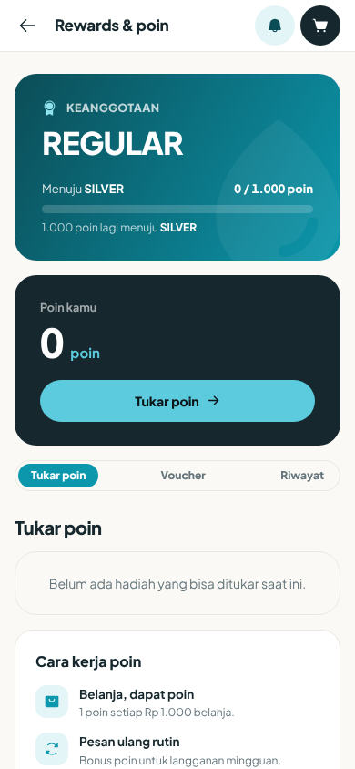
*Gambar 6.5d — Halaman `/rewards` ("Rewards & poin") akun baru: kartu keanggotaan "REGULAR" dengan "Menuju SILVER 0 / 1.000 poin", kartu "Poin kamu 0 poin" dengan tombol **Tukar poin**, tab **Tukar poin**, **Voucher**, **Riwayat**, daftar hadiah kosong ("Belum ada hadiah yang bisa ditukar saat ini."), dan "Cara kerja poin" ("Belanja, dapat poin — 1 poin setiap Rp 1.000 belanja." dan "Pesan ulang rutin — Bonus poin untuk langganan mingguan."). Saldo 0 berasal dari akun uji baru dan tidak membuktikan perilaku pemberian poin. Aturan bonus langganan mingguan hanya tertulis di layar dan belum diverifikasi **[D]**. Lingkungan uji lokal, 2026-10-11.*

Pembatalan hanya bisa selama belum diserahkan. Setelah diambil muncul pesan "Hadiah ini sudah diambil, jadi penukarannya tidak bisa dibatalkan." Tidak ada batas waktu lain. **[V]**

Pesan Inggris: "This reward is out of stock." (hadiah habis), "You do not have enough points to redeem this reward." (poin tidak cukup), "This reward is not available." (hadiah tidak tersedia). Layar menampilkan "Gagal menukar poin. Coba lagi." untuk kegagalan lain. **[V]**

### Prosedur: Notifikasi

**Titik awal:** Ikon lonceng / `/notifications`. Judul "Notifikasi". Tekan **Tandai dibaca** untuk menandai. Tanpa notifikasi: "Tidak ada notifikasi". **[V]**

Jenis pesan yang Anda terima:

| Judul | Kapan |
|---|---|
| Selamat datang di Hydromart | Setelah akun aktif |
| Pesanan diterima | Setelah checkout |
| Pesanan dikonfirmasi | Setelah dikonfirmasi |
| Kurir ditugaskan | Kurir ditugaskan. Isi pesan: setelah ini pesanan tidak bisa dibatalkan sendiri lewat aplikasi |
| Pesanan dalam perjalanan | Kurir berangkat. Siapkan galon kosong bila ada penukaran |
| Pesanan terkirim | Pesanan sampai |
| Pesanan selesai | Selesai, bila tidak lewat status Tiba |
| Pesanan dibatalkan | Dibatalkan oleh depot atau sistem (bukan bila Anda sendiri yang membatalkan) |
| Pengiriman dijadwalkan ulang | Jadwal diubah depot |
| Beri penilaian | ±30 menit setelah tiba, sekali saja |
| Saatnya isi ulang? | Bila 14 hari tanpa pesanan |
| Galon belum dikembalikan | Pengingat galon yang masih Anda pegang |
| Poin bertambah / Naik tier membership | Setelah pesanan selesai |
| Voucher baru | Voucher diberikan kepada Anda |
| Kabar dari Hydromart | Siaran umum atau promo |

Beberapa kejadian **tidak** memicu notifikasi: pembayaran dikonfirmasi, pembayaran gagal, refund selesai, keputusan permintaan data pribadi, dan balasan komplain. Periksa layar sendiri. **[B]** Isi pesan "Kurir ditugaskan" berbunyi "sudah diambil kurir", padahal status itu baru berarti kurir ditugaskan. **[B]**

Push bisa dimatikan di Akun. Kesalahan terkait: "Perangkat ini tidak mendukung notifikasi.", "Notifikasi diblokir. Izinkan Hydromart di setelan perangkat, lalu coba lagi.", "Gagal mendaftarkan perangkat untuk notifikasi. Coba lagi.", "Gagal menyimpan preferensi." **[V]**

> **[SCREENSHOT REQUIRED: SS-customer-09 — Halaman `/notifications` berisi beberapa notifikasi, sebagian belum dibaca.]**
> *Gambar 6.6 — Kotak masuk notifikasi.*

### Prosedur: Membatalkan pesanan dan refund

**Tujuan:** Membatalkan pesanan yang belum dikirim. **Prasyarat:** Status Dipesan, Dikonfirmasi, atau Disiapkan, dan kurir belum pernah ditugaskan untuk pesanan itu. **Titik awal:** Rincian pesanan.

| Langkah | Tindakan pengguna | Respons sistem |
|---|---|---|
| 1 | Buka rincian pesanan, tekan **Batalkan pesanan**. | Dialog "Batalkan pesanan?" |
| 2 | Pilih alasan: "Salah alamat / pesanan", "Berubah pikiran", "Terlalu lama", atau "Lainnya". | Alasan bersifat opsional (maks. 255 huruf). |
| 3 | Tekan **Batalkan pesanan** untuk konfirmasi. | Toast "Pesanan dibatalkan". Status menjadi Dibatalkan. |

Yang terjadi di belakang layar **[V]**: pembayaran dibatalkan atau di-refund lebih dulu, baru pesanan dibatalkan, lalu stok dikembalikan. Pembayaran yang belum lunas (PENDING) langsung menjadi gagal dan tidak ada yang perlu dikembalikan. Pembayaran yang sudah lunas masuk proses refund.

Setelah kurir ditugaskan, tombol hilang dan layar menampilkan: "Kurir sudah ditugaskan, jadi pesanan tidak bisa lagi dibatalkan dari sini. Depot masih bisa menghentikannya." dengan tombol **Hubungi depot** (WhatsApp ke depot bila ada nomor). Aturan ini juga berlaku bila pesanan dijadwalkan ulang setelah kurir sempat ditugaskan. **[V]**

Teks dialog menyebut "depot belum menyiapkan pesanan", padahal sistem mengizinkan pembatalan juga saat status Disiapkan. Syarat & Ketentuan Pasal 8 berbunyi lain (sebelum depot mulai menyiapkan). Jika ragu, hubungi depot sebelum membatalkan. **[B]**

| Pesan | Arti | Solusi |
|---|---|---|
| Tidak bisa membatalkan pesanan. | Gagal umum | Coba lagi, atau hubungi depot |
| An order in status {status} can no longer be cancelled. (arti: pesanan berstatus itu tidak bisa dibatalkan lagi) | Sudah lewat batas | Hubungi depot |

Pesanan juga bisa dibatalkan **otomatis** oleh sistem: bila belum dikonfirmasi lebih dari batas waktu (bawaan 60 menit **[K]**), atau tertahan di depot lebih dari 24 jam (bawaan **[K]**). Anda lalu menerima notifikasi "Pesanan dibatalkan". **[V]**

**Refund — yang perlu Anda ketahui:**
- Anda tidak bisa mengajukan refund sendiri; refund mengikuti pembatalan atau diproses petugas. **[V]**
- Refund sampai Rp100.000 (bawaan) diproses langsung; di atas itu perlu persetujuan kantor pusat lebih dulu. **[V][K]**
- Cara dan waktu uang kembali **tidak terdokumentasi pasti**. QRIS dan transfer dibayar langsung ke depot, sehingga pengembalian dilakukan depot secara manual. FAQ menyebut "1–3 hari kerja ke sumber dana yang sama", tetapi tidak ada aturan kode yang menjamin itu. **[B][K]**
- Status refund tidak tampil di layar pelanggan dan tidak ada notifikasi saat refund selesai. Hubungi depot atau ajukan komplain untuk menanyakan. **[B]**

> **[SCREENSHOT REQUIRED: SS-customer-10 — Dialog "Batalkan pesanan?" dengan empat pilihan alasan.]**
> *Gambar 6.7 — Pembatalan pesanan.*

### Prosedur: Mengelola perangkat dan persetujuan

**Titik awal:** **Akun** (`/account`).

| Bagian | Yang bisa dilakukan |
|---|---|
| **Perangkat & sesi** | Lihat perangkat yang sedang masuk (tampil jenis perangkat atau "Perangkat tidak dikenali", "Masuk {tanggal}", tanda "Perangkat ini"). Tekan **Keluarkan** untuk perangkat lain atau **Keluar dari sini** untuk perangkat ini. **Keluar dari semua perangkat** meminta konfirmasi: "Semua perangkat, termasuk yang ini, akan diminta masuk lagi. Lanjutkan?" |
| **Persetujuan** | **Syarat & ketentuan layanan** dan **Kebijakan privasi & pemrosesan data** bersifat wajib dan tidak bisa dicabut selama akun aktif; hentikan sepenuhnya dengan menghapus akun. **Promo dan penawaran** bisa dinyalakan atau dimatikan kapan saja ("Persetujuan diperbarui."). **Riwayat persetujuan** menampilkan catatannya. |
| **Keluar** | Tombol **Keluar** menutup sesi perangkat ini. |

Bila teks syarat diperbarui, muncul banner "Syarat & kebijakan sudah diperbarui" dengan tombol **Setujui teks terbaru**. Itu pemberitahuan saja; akun tetap aktif. **[V]**

Pesan: "Perangkat dikeluarkan.", "Semua perangkat dikeluarkan.", "Gagal mengeluarkan perangkat.", "Gagal keluar dari semua perangkat.", "Gagal memuat daftar perangkat.", "Tidak ada sesi aktif." "Persetujuan {tujuan} tidak dapat dicabut selama akun aktif. Ajukan penghapusan akun bila ingin berhenti sepenuhnya."

**Deposit galon:** Kartu "Deposit galon" di Akun menampilkan per depot jumlah galon yang Anda pegang dan deposit yang ditahan ("Deposit kembali saat galon dikembalikan ke depot yang sama."). Bila kosong: "Belum ada galon yang Anda pegang." **[V]** Nilai deposit bawaan Rp20.000 per galon **[K]**. Layar keranjang dan checkout tidak menampilkan baris deposit, walaupun Syarat & Ketentuan menyatakan nilainya ditampilkan sebelum membayar; cara pembayaran deposit belum jelas. **[B][K]**

### Prosedur: Meminta salinan data atau menghapus akun (UU PDP)

**Tujuan:** Menggunakan hak data pribadi. **Prasyarat:** Sudah masuk. **Titik awal:** **Akun** → bagian **Data pribadi saya**.

| Langkah | Tindakan pengguna | Respons sistem |
|---|---|---|
| 1 | Pilih **Minta salinan data** atau **Minta hapus akun**. | Untuk hapus akun muncul dialog: "Akun dan identitasmu dihapus permanen setelah disetujui. Riwayat pembayaran tetap disimpan tanpa identitas karena kewajiban pajak. Lanjutkan?" |
| 2 | Konfirmasi. | "Permintaan terkirim. Kantor pusat akan meninjau." Status: "Menunggu ditinjau". |
| 3 | Pantau status di bagian yang sama. | Tenggat tampil: "Dijawab paling lambat {tanggal}" atau "Lewat batas 3x24 jam". |
| 4 | Untuk salinan data yang disetujui: tekan **Unduh salinan data**. | Berkas JSON berisi akun, profil, alamat, dan riwayat persetujuan. |

Aturan penting **[V]**:
- Setiap jenis permintaan hanya boleh satu yang terbuka: "Permintaan sejenis masih diproses."
- Keputusan dibuat manual oleh kantor pusat (Disetujui atau Ditolak dengan alasan). Status akhir: Selesai atau Ditolak. Tidak ada notifikasi saat diputuskan. **[B]**
- Unduhan hanya berlaku **7 hari** sejak disetujui. Sebelum disetujui: "Ekspor data belum disetujui. Kirim permintaan dulu, kantor pusat akan meninjau." Setelah 7 hari: "Persetujuan ekspor sudah lewat 7 hari. Kirim permintaan baru untuk data terkini."
- Penghapusan akun **tidak dapat dibatalkan**. Data pribadi (nama, nomor, email, foto, tanggal lahir, metode bayar tersimpan, favorit, nama dan nomor di alamat) dihapus atau disamarkan. Langganan dibatalkan. Catatan pesanan dan pembayaran tetap disimpan 10 tahun untuk kewajiban pajak, termasuk salinan nama dan nomor penerima di pesanan. Foto bukti antar disimpan paling lama 12 bulan.
- Sebelum menghapus akun, pastikan tidak ada pesanan yang sedang berjalan atau refund yang ditunggu. Sistem tidak memeriksa pesanan aktif sebelum penghapusan. **[B]**
- Kesalahan: "Gagal mengirim permintaan." dan "Gagal mengunduh salinan data."

Halaman publik `/hapus-akun` menjelaskan kebijakan ini. Halaman itu masih menyebut "tautan akun Google" padahal masuk dengan Google sudah dihapus, dan menghitung 3x24 jam sejak verifikasi, sementara aplikasi menghitung sejak permintaan dikirim. **[B]** Alamat surel privasi di halaman itu belum tentu dapat menerima surat (lihat bagian 8).

> **[SCREENSHOT REQUIRED: SS-customer-11 — Bagian "Data pribadi saya" di Akun dengan dua tombol dan chip status permintaan.]**
> *Gambar 6.8 — Data pribadi saya.*

### Prosedur: Meminta bantuan dan mengajukan komplain

**Titik awal:** **Bantuan** (`/help`).

| Langkah | Tindakan pengguna | Respons sistem |
|---|---|---|
| 1 | Pilih topik: "Lacak & masalah pengiriman", "Pembayaran & refund", "Galon, deposit & tukar", atau "Akun & keamanan". Atau cari di FAQ. | Jawaban singkat tampil. |
| 2 | Tekan **Chat dengan CS** atau ikon telepon. | WhatsApp ke nomor depot Anda. Tombol hanya muncul bila depot punya nomor. |
| 3 | Untuk komplain tercatat, tekan **Ajukan komplain** (harus masuk). Isi **Ringkasan masalah** (wajib, 3–200 huruf), **Nomor pesanan (opsional)**, **Ceritakan yang terjadi** (wajib). | Pesan validasi: "Isi ringkasan masalahnya dulu.", "Ceritakan dulu yang terjadi." |
| 4 | Tekan **Kirim komplain**. | "Komplain terkirim. Kami menghubungimu lewat nomor akunmu." |
| 5 | Pantau di daftar komplain. | Status: Menunggu ditangani, Sedang ditangani, Selesai. Balasan tampil sebagai "Balasan Hydromart". |

**Izin dan batasan:** Komplain tidak memicu notifikasi balasan. Periksa daftar komplain secara berkala. **[B]** Jawaban FAQ "Bisakah ubah alamat setelah pesan?" yang menyebut mengubah alamat dari halaman Lacak pesanan tidak sesuai kenyataan (lihat bagian 15). **[B]**

### Prosedur: Mengajukan waralaba (opsional)

Siapa pun dapat membuka `/waralaba` untuk mengajukan calon depot. Isian utama: data pemohon (Nama lengkap, Nomor WhatsApp), calon depot (Kode depot usulan, Nama depot, Kota, Provinsi, titik lokasi), rencana keuangan (Nilai investasi, Proyeksi omzet per bulan), dan persetujuan data wajib. Setelah **Kirim pengajuan** Anda mendapat "Nomor tanda terima". Tim akan menghubungi lewat WhatsApp; tidak ada batas waktu respons yang terdokumentasi. **[V][K]**

## 7. Kolom Wajib dan Aturan Validasi (Ringkasan)

| Formulir | Kolom wajib | Batas dan format |
|---|---|---|
| Daftar | Nomor telepon; persetujuan privasi dan ketentuan | Nomor seluler Indonesia; nama maks. 120; email valid maks. 160; kode referral 8 karakter |
| Masuk / verifikasi | Nomor telepon; kode 6 digit | Kode hanya angka; berlaku 5 menit; maks. 5 salah; kirim ulang tiap 60 detik |
| Alamat (buku alamat) | Label, Nama penerima, Telepon, Alamat, Kota, titik peta | Label ≤50; nama ≤120; telepon ≤20; alamat ≤255; kota ≤100; kode pos ≤10; catatan ≤255; maks. 20 alamat |
| Alamat (checkout) | Nama penerima, Telepon, Alamat, Kota | Titik peta wajib bila ingin dirutekan otomatis; bila tidak, pilih depot |
| Keranjang | — | Jumlah 1–999 per barang |
| Voucher | — | Satu kode per pesanan; maks. 40 karakter |
| Bukti bayar | Foto | jpeg/png/webp; maks. 5 MB |
| Pembatalan | — | Alasan opsional, maks. 255 |
| Ulasan | Bintang 1–5 | Komentar ≤500; satu ulasan per pesanan |
| Langganan | Produk, Jumlah, Frekuensi, Pengiriman pertama, Alamat | Jumlah min. 1; tanggal tidak lampau; alamat bertitik peta |
| Profil | — | Nama ≤120; email ≤160; foto ≤5 MB |
| Ganti nomor | Nomor baru; kode | Kode dikirim ke nomor baru |
| Komplain | Ringkasan (3–200), Cerita | Nomor pesanan opsional |

Sumber: DTO layanan dan kamus bahasa. **[V]**

## 8. Kesalahan Umum dan Solusi

| Situasi | Penyebab | Solusi |
|---|---|---|
| SMS kode tidak datang | Gangguan atau kredit SMS penyedia | Tunggu 60 detik, **Kirim ulang kode**; bila terus gagal hubungi depot lewat **Bantuan** |
| Tidak bisa checkout karena "di luar radius" | Alamat di luar jangkauan depot (bawaan 5 km **[K]**) | Pilih alamat lain atau geser titik peta |
| Hanya "Bayar di tempat" yang tersedia | Depot belum mengatur rekening atau QRIS **[K]** | Pakai tunai atau hubungi depot |
| Pembayaran masih "PENDING" setelah transfer | Menunggu staf depot mengonfirmasi | Pastikan bukti diunggah; hubungi depot bila lama |
| Pembayaran tiba-tiba "FAILED" | Tidak dikonfirmasi dalam 24 jam | Gunakan **Coba bayar lagi** |
| Tombol **Batalkan pesanan** hilang | Kurir sudah ditugaskan | **Hubungi depot** |
| Pesan error berbahasa Inggris | Server belum diterjemahkan **[B]** | Gunakan terjemahan di panduan ini |
| Kode referral tidak bisa dipakai | Salah satu syarat tidak terpenuhi | Pastikan Anda pelanggan baru dan kodenya benar |
| Layar notifikasi kosong padahal ada pesanan | Notifikasi tertentu memang tidak dikirim | Periksa **Pesanan** |

Dukungan: lihat bagian 14 dan Panduan Umum bagian 15.

## 9. Batasan Peran

Sebagai pelanggan, Anda **tidak dapat**:
- Mengubah status pesanan selain membatalkannya (sebelum kurir ditugaskan) dan menilainya.
- Mengajukan refund sendiri, atau menyetujui pembayaran sendiri. Pelunasan non-tunai dikonfirmasi staf depot; tunai dikonfirmasi kurir.
- Memakai lebih dari satu voucher per pesanan, atau voucher bersama harga agen.
- Menyetujui atau menolak permintaan data pribadi Anda sendiri; keputusan di kantor pusat.
- Membuka halaman petugas (`/dashboard`, `/hq`, `/hr`, `/driver`, `/resellers`). Layar akses ditolak akan tampil.
- Mengubah alamat pesanan yang sudah dibuat (Tidak tersedia).
- Mencabut persetujuan syarat dan privasi selama akun aktif.

## 10. Pertimbangan Keamanan

- Jangan membagikan kode OTP. Hydromart tidak meminta kode lewat telepon atau chat. **[D]**
- Periksa nomor tujuan SMS: kode resmi memuat "HYDROMART" dan masa berlaku 5 menit. **[V]**
- Bila ponsel hilang atau dipinjam: masuk dari perangkat lain lalu **Keluar dari semua perangkat**.
- Tautan lacak bersifat rahasia kecil: siapa pun yang punya tautan dapat melihat status pesanan. Bagikan hanya kepada yang perlu. **[V]**
- Unggahan bukti bayar: tutup informasi yang tidak perlu (misalnya saldo) sebelum difoto.
- Jika menerima SMS penggantian nomor padahal bukan Anda: "Bukan kamu yang melakukannya? Segera hubungi depot." **[V]**
- Persetujuan promo tidak pernah tercentang otomatis dan bisa dicabut di Akun. **[V]**

## 11. Kegiatan Akhir Hari / Berkala

Untuk pelanggan, kegiatan berkala yang disarankan:
- Periksa status pesanan yang masih aktif di **Pesanan**.
- Kembalikan galon kosong ke depot bila sudah tidak dipakai agar deposit kembali (pengingat "Galon belum dikembalikan" akan dikirim).
- Periksa masa berlaku voucher di `/vouchers`.
- Periksa saldo poin dan tier di `/rewards`.
- Periksa langganan yang dijeda otomatis di `/subscriptions`.
- Tinjau perangkat yang masuk dan persetujuan di **Akun** secara berkala.

## 12. Skenario Praktis

**Skenario 1 — Pesan galon pertama kali.** (1) Buka situs, atur lokasi dengan **Gunakan lokasi saya**. (2) Buka **Belanja**, pilih galon, tekan **Tambah ke keranjang —**. (3) Masuk dengan nomor dan kode SMS; barang otomatis masuk keranjang. (4) Di **Keranjang** tekan **Checkout**. (5) Isi alamat, titik lokasi, pilih **Bayar di tempat (COD)**. (6) Tekan **Buat pesanan**. (7) Pantau di **Pesanan** sampai "Tiba". (8) Bayar tunai ke kurir, lalu **Nilai pesanan**.

**Skenario 2 — Salah alamat.** Pesanan masih berstatus "Dikonfirmasi" dan kurir belum ditugaskan. Alamat pesanan tidak dapat diubah, jadi buka rincian pesanan, tekan **Batalkan pesanan**, pilih "Salah alamat / pesanan", lalu pesan ulang dengan alamat benar (atau **Pesan lagi**). Jika pesanan sudah dibayar, tanyakan refund ke depot.

**Skenario 3 — Transfer sudah dilakukan tetapi status belum lunas.** Buka rincian pesanan, tekan **Pilih foto bukti**, unggah foto bukti. Tunggu staf depot. Bila lebih dari yang wajar, tekan **Chat dengan CS** di **Bantuan**.

**Skenario 4 — Langganan galon rutin.** Buka **Langganan**, pilih produk, jumlah 2, frekuensi Mingguan, tanggal besok, alamat bertitik peta, **Mulai langganan**. Jika bepergian, tekan **Jeda**; **Lanjutkan** saat kembali.

**Skenario 5 — Menutup akun.** Buka **Akun** → **Data pribadi saya** → **Minta salinan data** dahulu bila perlu; setelah disetujui, **Unduh salinan data** dalam 7 hari. Pastikan tidak ada pesanan atau refund tertunda, lalu **Minta hapus akun**.

## 13. Daftar Periksa Penyelesaian

- [ ] Akun terdaftar dan nomor telepon terverifikasi
- [ ] Setidaknya satu alamat tersimpan dengan titik peta
- [ ] Preferensi notifikasi sesuai keinginan
- [ ] Pesanan pertama dibuat dan dilacak sampai selesai
- [ ] Pesanan dinilai
- [ ] Kode referral dibagikan (opsional)
- [ ] Persetujuan promo ditinjau
- [ ] Perangkat lama dikeluarkan bila tidak dipakai

## 14. Inventaris Screenshot Bab Ini

| ID | Layar | Kondisi | Status |
|---|---|---|---|
| SS-customer-01 | `/register` | Semua kolom, dua kotak centang | Belum diambil |
| SS-customer-02 | `/verify` | Kotak kode dan hitung mundur | Diambil (2026-10-11, lingkungan uji lokal, data sintetis) — `umum-02-verify.png`; alur masuk, kotak kode diburamkan, nomor disamarkan |
| SS-customer-03 | `/addresses` | Formulir alamat dengan tombol lokasi | Belum diambil (hanya daftar alamat yang ada: SS-customer-13) |
| SS-customer-04 | `/products` | Pencarian, kategori, daftar produk | Diambil (2026-10-11, lingkungan uji lokal, data sintetis) — `customer-02-produk.png`; foto produk berupa gambar pengganti |
| SS-customer-05 | `/checkout` | Semua bagian terisi | Diambil (2026-10-11, lingkungan uji lokal, data sintetis) — `customer-05-checkout.png`; keadaan ringkas, rincian baris tidak terlihat |
| SS-customer-06 | Rincian pesanan | Banner "Pesanan berhasil dibuat!" | Diambil (2026-10-11, lingkungan uji lokal, data sintetis) — `customer-06-pesanan-dibuat.png` |
| SS-customer-07 | Panel pembayaran | Transfer/QRIS dengan unggah bukti | Belum diambil (pesanan uji memakai COD) |
| SS-customer-08 | Rincian pesanan | Bilah kemajuan dan kartu kurir | Diambil (2026-10-11, lingkungan uji lokal, data sintetis) — `customer-08-detail-pesanan.png`; pesanan berstatus Selesai, bukan sedang diantar |
| SS-customer-09 | `/notifications` | Beberapa notifikasi | Belum diambil |
| SS-customer-10 | Dialog pembatalan | Empat alasan | Belum diambil |
| SS-customer-11 | Data pribadi saya | Tombol dan chip status | Belum diambil (bagian ini tidak terlihat pada gambar Akun) |
| SS-customer-12 | `/account` | Halaman Akun, pelanggan baru | Diambil (2026-10-11, lingkungan uji lokal, data sintetis) — `customer-10-akun.png`; nama "—" dan avatar "?" |
| SS-customer-13 | `/addresses` | Daftar alamat dengan satu alamat | Diambil (2026-10-11, lingkungan uji lokal, data sintetis) — `customer-11-alamat.png`; nomor telepon disamarkan, nama contoh "Budi Contoh" |
| SS-customer-14 | `/` | Beranda setelah masuk | Diambil (2026-10-11, lingkungan uji lokal, data sintetis) — `customer-01-beranda.png` |
| SS-customer-15 | `/products/detail?id=…` | Detail produk Air Galon 19L | Diambil (2026-10-11, lingkungan uji lokal, data sintetis) — `customer-03-detail-produk.png` |
| SS-customer-16 | `/cart` | Keranjang berisi 4 galon | Diambil (2026-10-11, lingkungan uji lokal, data sintetis) — `customer-04-keranjang.png`; jumlah 4 (bukan 2) akibat penambahan berulang |
| SS-customer-17 | `/checkout` | Lembar Metode pembayaran terbuka | Diambil (2026-10-11, lingkungan uji lokal, data sintetis) — `customer-05b-checkout-pembayaran.png`; tanpa opsi QRIS |
| SS-customer-18 | `/track?token=…` | Pelacakan publik, pesanan selesai | Diambil (2026-10-11, lingkungan uji lokal, data sintetis) — `customer-09-lacak.png`; token tidak terlihat; label status Inggris |
| SS-customer-19 | `/orders` | Daftar pesanan | Diambil (2026-10-11, lingkungan uji lokal, data sintetis) — `customer-07-daftar-pesanan.png` |
| SS-customer-20 | `/subscriptions` | Formulir langganan | Diambil (2026-10-11, lingkungan uji lokal, data sintetis) — `customer-12-langganan.png`; hanya formulir, tanpa langganan tersimpan |
| SS-customer-21 | `/rewards` | Poin dan hadiah, akun baru | Diambil (2026-10-11, lingkungan uji lokal, data sintetis) — `customer-13-hadiah.png`; 0 poin, daftar hadiah kosong |

Gambar `umum-01-login.png` (SS-umum-02 di Panduan Umum) juga dipakai sebagai Gambar 4.1a.

Hasil pemeriksaan privasi: seluruh gambar `customer-*` dan `umum-*` yang dipasang diperiksa secara visual. Tidak ditemukan nomor telepon lengkap, kode OTP terbaca, token, surel, kunci, atau nama orang nyata (nomor disamarkan, kotak OTP diburamkan; "Budi Contoh" dan "Staf Depot Satu" adalah data sintetis).

Gunakan akun dan nomor telepon contoh (sintetis) untuk semua tangkapan layar.

## 15. Catatan Celah dan Hal yang Perlu Dikonfirmasi

### Hal yang perlu diketahui (fitur yang tidak tersedia atau tidak sesuai teks di layar)

| Hal | Yang tertulis di layar atau dokumen | Kenyataan | Tag |
|---|---|---|---|
| Lupa kata sandi | Tidak ada | Tidak ada kata sandi; masuk dengan OTP | Tidak tersedia |
| Pelacakan kurir real-time di peta | Tur: "Pantau kurir real-time" | Tidak tersedia. Yang ada: status, nama dan nomor kurir, perkiraan tiba, segar tiap 15 detik | [B] |
| Mengubah alamat setelah memesan | FAQ: bisa dari halaman Lacak pesanan | Tidak tersedia. Batalkan lalu pesan ulang bila kurir belum ditugaskan | [B] |
| Melewati (skip) satu jadwal langganan | Syarat & Ketentuan Pasal 10 | Tidak tersedia. Pakai **Jeda** dan **Lanjutkan** | [B] |
| Melihat status refund | FAQ menyebut refund 1–3 hari kerja | Tidak ada tampilan status refund dan tidak ada notifikasi selesai | [B] |
| Baris deposit galon di checkout | Syarat & Ketentuan Pasal 6: nilai deposit ditampilkan sebelum membayar | Tidak tampil di keranjang dan checkout | [B][K] |
| Batas pesan "sebelum 16.00, tiba hari ini" | Teks halaman produk | Tidak ada aturan batas jam di sistem; teks tetap | [B] |
| Estimasi "±30 mnt" / "±30–45 menit" | Beranda, keranjang, sukses pesanan | Teks tetap, bukan hitungan | [B] |
| Jam jadwal pengiriman tersimpan sebagai tanggal | Pilihan tanggal di checkout | Tanggal tidak disimpan; hanya teks jam | [B] |
| Tip untuk kurir | Pernah ada | Dihapus dari tampilan | Tidak tersedia |
| Pembayaran e-wallet dan virtual account | Teks pemasaran menyebut | Kemungkinan belum aktif di produksi | [D][K] |
| Metode bayar tersimpan dipakai di checkout | Menu Akun | Tampaknya hanya label | [D] |
| Notifikasi WhatsApp dan email | PRD | Tidak ada; hanya SMS, push, dan kotak masuk | Tidak tersedia |
| Notifikasi pembayaran, refund, balasan komplain, keputusan PDP | — | Tidak ada | [B] |
| Bonus "+50 poin" saat daftar | Lencana di formulir | Bonus kode referral sebenarnya 250 poin (bawaan) dan baru masuk setelah pesanan pertama selesai | [B] |
| Hadiah ulang tahun | Teks tanggal lahir | Belum ada kode yang diverifikasi | [D] |
| Masa berlaku poin | "Hangus setelah 12 bulan tanpa aktivitas" | Kode: 12 bulan sejak diperoleh, dan penyapuan otomatis mati secara bawaan | [B][K] |
| Belanja sebagai tamu | — | Tidak tersedia; masuk wajib untuk keranjang dan checkout | Tidak tersedia |
| Nama pendaftaran | Formulir `/register` memiliki kolom Nama lengkap | Pada uji 2026-10-11 nama tidak tersimpan/tampil: Akun menampilkan "—" dan avatar "?" | [B] |
| Label status di `/track` | Rincian pesanan berbahasa Indonesia | `/track` berbahasa Inggris (Completed, Order placed, dst.) | [B] |
| Hitung mundur kirim ulang | "Kirim ulang dalam {n}d" | Singkatan "d" (detik) tidak dijelaskan | [B] |
| Jumlah di keranjang | Tombol Tambah ke keranjang | Penambahan berulang menumpuk jumlah (4 galon pada uji) | [B] |
| Lencana "Member Rp …" di katalog | Tier REGULAR diskon 0% | Lencana tampil pada akun REGULAR dengan potongan sekitar 2% | [D][K] |
| Metode bayar di checkout | QRIS, e-wallet, virtual account disebut | Depot uji menampilkan COD, Transfer bank, E-wallet, Virtual account; tanpa QRIS | [K] |

### Hal yang perlu dikonfirmasi (rujuk ke 17-open-questions)

1. Nilai per depot: minimum pesanan, ongkir per galon, biaya antar sekarang, jam jadwal, radius layanan, diskon langganan. **[K]**
2. Cara dan waktu refund untuk tunai, transfer, dan QRIS. **[K]**
3. Cara pelanggan membayar dan mendapatkan kembali deposit galon. **[K]**
4. Ketersediaan e-wallet dan virtual account di produksi. **[K]**
5. Apakah penghapusan akun perlu diblokir bila ada pesanan aktif. **[B]**
6. Surel `privacy@hydromart-digital.com`: per 2026-09-25 domain tidak memiliki catatan MX sehingga surat berisiko tidak sampai. Cek ulang sebelum mencantumkannya ke pelanggan. **[B]**
7. Pesan Inggris yang masih tampil ke pelanggan (checkout, voucher, hadiah, langganan, alamat) perlu diterjemahkan. **[B]**
8. Daftar browser dan perangkat resmi. **[K]**
9. Nomor atau kanal dukungan pusat dan jam layanan. **[K]**

*Hak akses pelanggan tetap (satu peran). Catatan bahwa Super admin dapat mengubah hak akses saat berjalan berlaku untuk peran internal dan dijelaskan di Panduan Umum bagian 12.*
