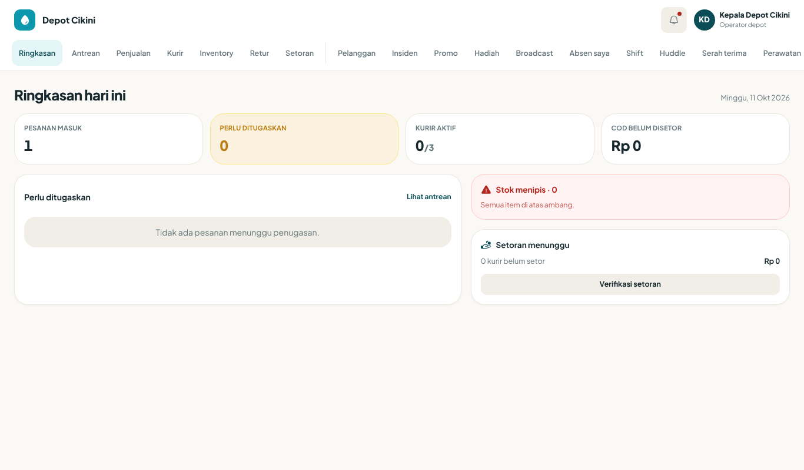
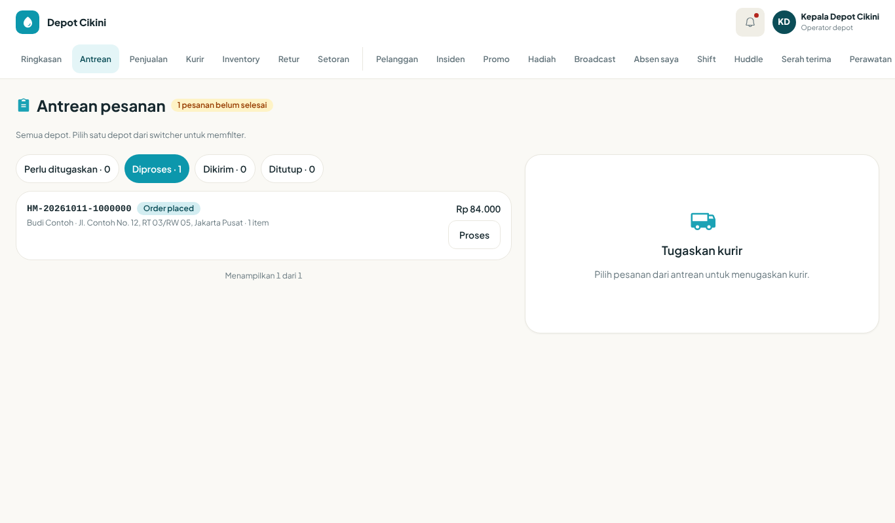
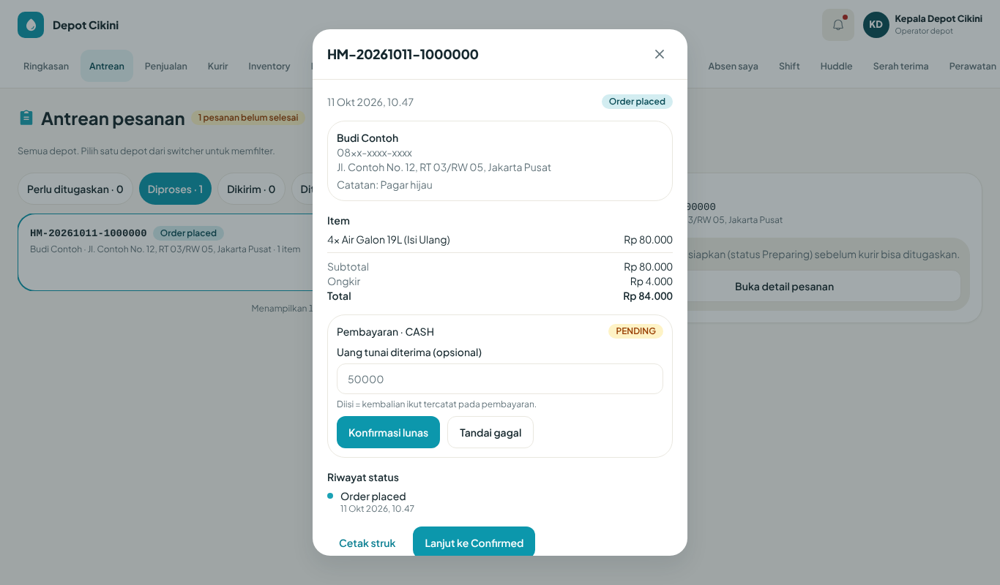
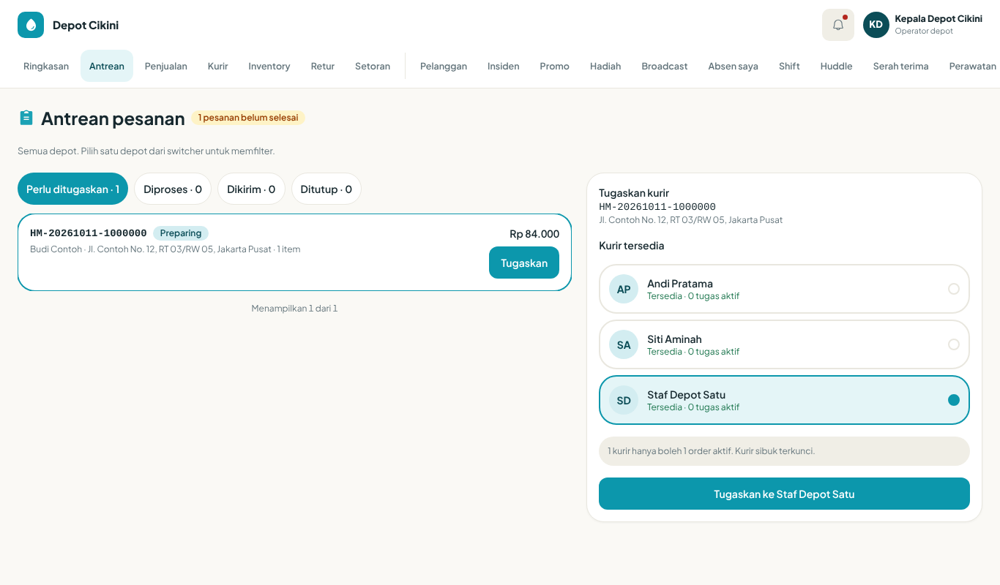
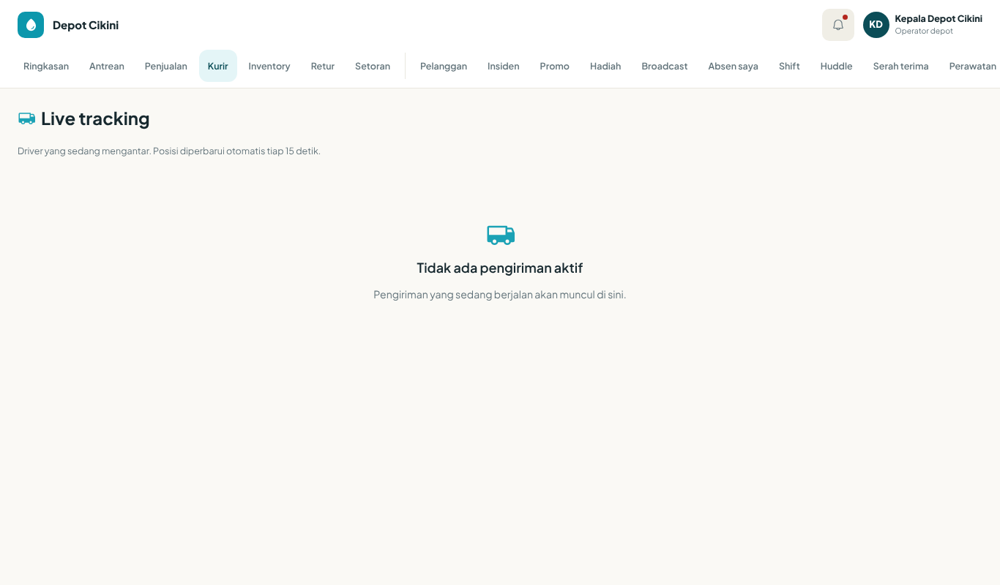
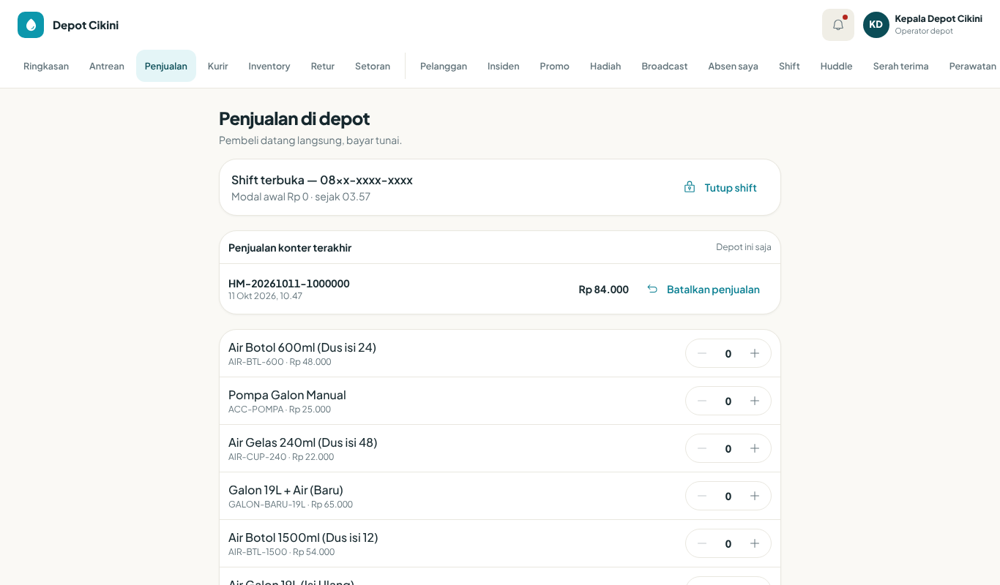
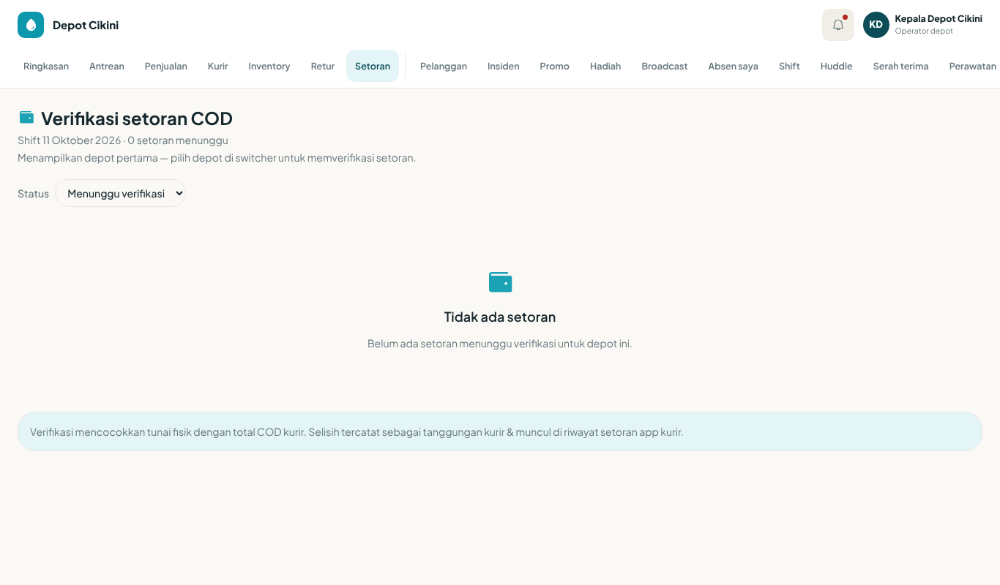
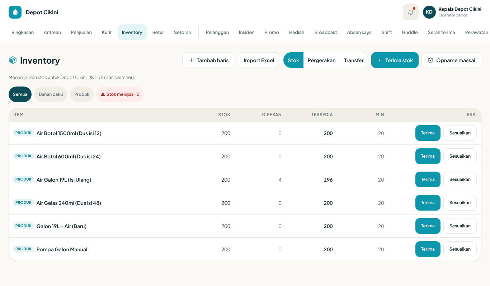
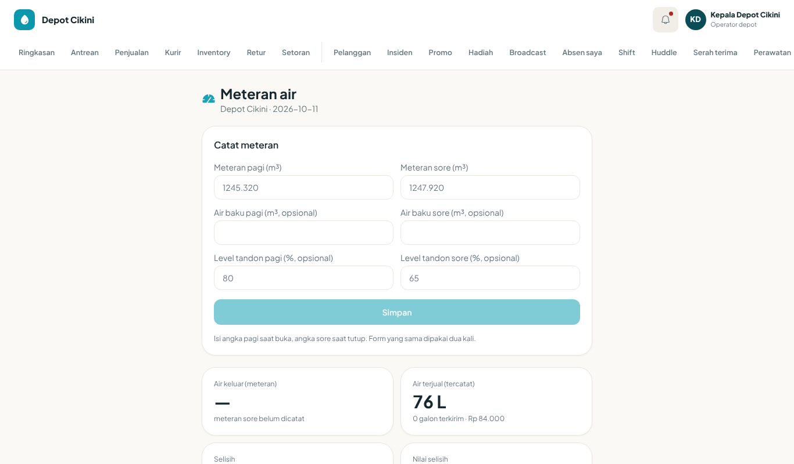
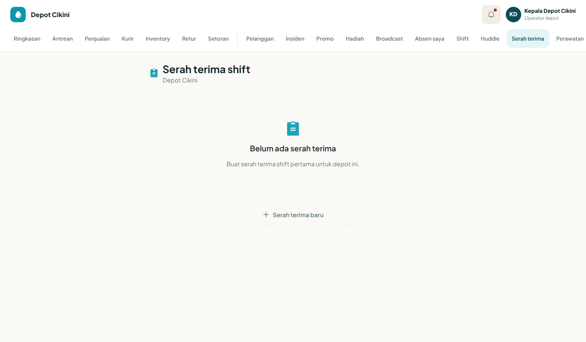

# Bab 3 — Panduan Kepala depot (KEPALA_DEPOT)

| Metadata | Nilai |
|---|---|
| Versi | 0.1 draf |
| Tanggal | 2026-10-10 |
| Klasifikasi | Internal — Terbatas |
| Peran di UI | Kepala depot (keterangan di header konsol: "Operator depot") |
| Peran di kode | `KEPALA_DEPOT` |
| Status pengujian | Belum ada pengujian terstruktur (pengamatan terbatas di lingkungan uji lokal dicatat di dokumen 15). Isi bab disusun dari pembacaan kode dan berkas temuan. |

**Legenda bukti.** **[V]** terverifikasi di kode · **[D]** disimpulkan, perlu konfirmasi · **[K]** perlu konfirmasi bisnis (nilai berasal dari data/pengaturan) · **[B]** diketahui bermasalah/tidak konsisten.

**Catatan hak akses (berlaku untuk seluruh bab).** Hak akses yang ditulis di bab ini adalah nilai BAWAAN dari `packages/access/src/index.ts`. Super admin dapat mengubah daftar hak akses saat aplikasi berjalan, dan perubahan berlaku sekitar 30 detik kemudian. Jika Anda melihat menu atau tombol yang berbeda dari bab ini, tanyakan kepada Admin sebelum menyimpulkan ada kesalahan. **[V]**

---

## 1. Gambaran peran

Kepala depot adalah penanggung jawab harian satu depot Hydromart. Anda memegang pesanan yang masuk, kurir, stok, kas konter, dan penutupan buku harian di depot Anda. Anda tidak mengatur harga katalog, rekening/QRIS depot, atau akun staf. Hal-hal itu dipegang Manajer depot atau Kantor pusat.

Yang membedakan peran ini dari peran lain di dasbor:

- Anda memakai **konsol "Operator depot"** dengan **tab di bagian atas layar**, bukan menu samping. Peran lain (Manajer, SPV, Asisten SPV) memakai menu samping dan navigasi bawah. **[V]** (`apps/web/src/app/dashboard/layout.tsx`)
- Akun Anda **terkunci pada satu depot**. Anda tidak bisa membuka data depot lain. **[V]**
- Banyak keputusan bernilai besar tidak berhenti di Anda. Selisih opname dan selisih galon di atas batas bawaan Rp100.000 masuk ke antrean persetujuan Manajer. Pengembalian dana (refund) tidak dapat Anda ajukan. **[V]**

> **Catatan penting tentang nama peran.** Dalam bahasa sehari-hari "Staff Depot" sering dikira bawahan Kepala depot yang bekerja di konsol. Di kode, "Staff Depot" (`STAFF_DEPOT`) adalah **kurir**, dan masuk ke aplikasi `/driver`. Panduan kurir ada di Bab 4. **[V]**

---

## 2. Tujuan & tanggung jawab

| Area | Yang Anda lakukan | Bagian bab |
|---|---|---|
| Pesanan | Memproses pesanan baru, mengonfirmasi pembayaran tunai/transfer, menugaskan kurir | 6.2 |
| Pengiriman | Memantau kurir di jalan, menarik atau membatalkan pengiriman yang macet | 6.3 |
| Konter | Membuka shift kasir, mencatat penjualan konter, membatalkan salah input, menutup shift | 6.4 |
| Uang COD | Memverifikasi setoran tunai kurir | 6.5 |
| Stok | Terima barang, sesuaikan, opname, titik pesan ulang, transfer antar depot | 6.6 |
| Galon | Mencatat galon keluar dan retur | 6.7 |
| Air | Mencatat meteran air pagi dan sore | 6.8 |
| Pembukuan | Menutup buku harian setelah semua shift kasir tutup | 6.9 |
| Pemasaran lokal | Melihat promo, mengelola aturan promo depot, broadcast, serah hadiah | 6.10–6.12 |
| Tim | Jadwal shift kurir, huddle mingguan, serah terima shift, perawatan alat | 6.13–6.14 |
| Masalah | Insiden, sengketa order | 6.15–6.16 |
| Pelanggan | Direktori, CRM, impor data | 6.17 |
| Diri sendiri | Absen wajah, cuti, kasbon, slip gaji | 6.19 |

---

## 3. Prasyarat akses

1. **Akun staf aktif** dengan peran "Kepala depot".
2. **Depot penempatan sudah diisi** pada akun Anda. Tanpa depot, server menolak dengan pesan "Akun ini belum diberi tanggung jawab depot manapun." **[V]** (`packages/platform/src/nest/depot-scope.ts:166`)
3. **Nomor telepon** terdaftar untuk menerima kode masuk sekali pakai (OTP). **[V]**
4. Untuk fitur HRIS mandiri (`/hr/me`): akun Anda harus **tertaut ke data karyawan** yang dibuat HR dan berstatus aktif. Jika tidak, muncul "Akun ini belum tertaut ke data karyawan" atau "Karyawan tidak aktif". **[V]**
5. Browser modern di laptop/tablet/ponsel. Absen wajah butuh izin kamera dan lokasi (GPS).
6. Untuk mencetak struk konter: izinkan popup di browser. **[V]**

**Yang menyiapkan akses Anda:** akun dan peran dibuat oleh Kantor pusat/Admin; penempatan depot dan data karyawan oleh HR. Anda tidak dapat membuat akun sendiri. **[V]** (matriks peran: `staffAdmin` = Kantor pusat, Super admin)

---

## 4. Masuk & pengaturan awal

### Prosedur: Masuk ke konsol Operator depot

**Tujuan:** Masuk dan mendarat di "Ringkasan hari ini". **Peran:** Kepala depot. **Prasyarat:** akun aktif, nomor telepon dapat menerima SMS. **Titik awal:** halaman `/login`.

| Langkah | Tindakan pengguna | Respons sistem yang diharapkan |
|---|---|---|
| 1 | Buka halaman masuk. Masukkan nomor telepon akun staf Anda. | Sistem mengirim kode sekali pakai. Teks halaman: "Masuk dengan nomor teleponmu — kami kirim kode sekali pakai." |
| 2 | Pada halaman verifikasi, ketik 6 digit kode. | Kolom kode otomatis terkirim saat digit ke-6 diketik. Ada hitung mundur "Kode berlaku {m:ss} lagi." |
| 3 | Jika kode tidak datang, tunggu hitung mundur lalu tekan "Kirim ulang kode". | Pesan "Kode baru dikirim ke {nomor tersamar}." |
| 4 | Setelah berhasil, Anda diarahkan otomatis. | Anda mendarat di `/dashboard` dengan tampilan "Ringkasan hari ini" dan tab di atas layar. **[V]** |

**Hasil akhir:** Header menampilkan nama depot Anda, ikon lonceng notifikasi, inisial dan nama Anda, serta keterangan "Operator depot". **[V]**

**Masalah umum:**

| Pesan | Arti | Solusi |
|---|---|---|
| "Kode verifikasi salah." | Kode yang diketik tidak cocok | Ketik ulang dengan teliti |
| "Kode verifikasi sudah kedaluwarsa. Minta kode baru." | Kode lewat 5 menit | Tekan "Kirim ulang kode" |
| "Terlalu banyak percobaan. Minta kode baru." | Batas percobaan habis | Minta kode baru |
| "Kode baru bisa diminta sebentar lagi. Cek SMS yang sudah masuk dulu." | Jeda antar permintaan kode | Tunggu hitung mundur |
| "Akun ini tidak aktif. Hubungi dukungan Hydromart." | Akun dinonaktifkan | Hubungi Admin/Kantor pusat |

**Izin & batasan:** Anda tidak mengatur kata sandi; masuk memakai OTP SMS. **[V]**

**Daftar periksa:**
- [ ] Nama depot di header benar.
- [ ] Ringkasan hari ini tampil (bukan layar "Pilih depot").
- [ ] Lonceng notifikasi dapat dibuka.

> **[SCREENSHOT REQUIRED: SS-kepala-depot-01 — Halaman /login dengan kolom nomor telepon terisi contoh sintetis (tanpa nomor asli)]**
> *Gambar 3.1 — Halaman masuk staf.*



*Gambar 3.2 — Konsol Operator depot setelah masuk. Terlihat header (nama depot "Depot Cikini", lonceng dengan titik merah, inisial "KD", nama "Kepala Depot Cikini", keterangan "Operator depot") dan bilah tab dari "Ringkasan" sampai "Perawatan" (sisa tab di sebelah kanan perlu digeser). Tangkapan dari lingkungan uji lokal dengan data sintetis (11 Okt 2026): pada saat itu hanya ada 1 pesanan dan ketiga kartu berada pada keadaan kosong.*

### Layar "Pilih depot"

Jika akun Anda belum tertaut ke depot yang terbaca, Ringkasan menampilkan judul "Pilih depot" dan teks "Pilih depot yang kamu kelola untuk melihat ringkasan hari ini." Karena akun Kepala depot terkunci pada satu depot, kondisi ini berarti penempatan depot Anda bermasalah. Hubungi HR atau Admin. **[V]**

### Pengaturan awal yang disarankan

1. Buka tab **Pengaturan** (`/dashboard/operator-settings`) dan atur toggle "Notifikasi ops": "Stok menipis", "Pesanan baru masuk", "Kurir gagal antar" (bawaan aktif). **[V]**
2. Pilih bahasa ("Bahasa": ID/EN) bila perlu.
3. Daftarkan wajah Anda di **Absen saya** (`/hr/me`) supaya bisa absen (lihat 6.19).
4. Pastikan peramban mengizinkan notifikasi, kamera, lokasi, dan popup.

> **[B]** Pada layar Pengaturan, baris "Data akun" dan "Ubah PIN" tampil tetapi **tidak melakukan apa-apa** saat ditekan. Chip "Ambang low-stock default: 20 unit" juga hanya tampilan tetap dan tidak bisa diubah. Jangan mengandalkannya. **[V]** (`operator-settings/page.tsx`)

---

## 5. Menu & modul tersedia

### 5.1 Bilah tab atas (yang benar-benar tampil untuk Kepala depot)

Bilah tab bisa digeser ke samping. Sebuah garis tipis memisahkan tab utama dari tab kelola. Tidak ada navigasi bawah, tidak ada menu samping, dan tidak ada pemilih depot untuk peran ini. **[V]**

| # | Label tab | Rute | Hak akses (bawaan) | Bukti |
|---|---|---|---|---|
| 1 | Ringkasan | `/dashboard` | landing operator | **[V]** |
| 2 | Antrean | `/dashboard/orders` | `orderQueue`, `orderFulfilment` | **[V]** |
| 3 | Penjualan | `/dashboard/walk-in` | `walkInSale`, `cashierShift` | **[V]** |
| 4 | Kurir | `/dashboard/tracking` | `tracking` | **[V]** |
| 5 | Inventory | `/dashboard/inventory` | `inventoryRead`; tulis `inventoryWrite` | **[V]** |
| 6 | Retur | `/dashboard/returns` | `returnsRead`; tulis `returnsWrite` | **[V]** |
| 7 | Setoran | `/dashboard/settlements` | `courierSettle` | **[V]** |
| 8 | Pelanggan | `/dashboard/customers` | `depotCrm`; impor `depotCrmWrite` | **[V]** |
| 9 | Insiden | `/dashboard/incidents` | `incidents` | **[V]** |
| 10 | Promo | `/dashboard/promotions` | `promotionRead` (hanya baca) | **[V]** |
| 11 | Hadiah | `/dashboard/redemptions` | `rewardHandover` | **[V]** |
| 12 | Broadcast | `/dashboard/broadcast` | `depotBroadcast`, `depotCampaign` | **[V]** |
| 13 | Absen saya | `/hr/me` | `canPunchAttendance` | **[V]** |
| 14 | Shift | `/dashboard/shift` | baca: semua staf; ubah: `driverRoster` | **[V]** |
| 15 | Huddle | `/dashboard/huddle` | `depotHuddle` | **[V]** |
| 16 | Serah terima | `/dashboard/handover` | `depotHandover` | **[V]** |
| 17 | Perawatan | `/dashboard/maintenance` | `depotMaintenance` | **[V]** |
| 18 | Kelola depot | `/dashboard/depots` | `depotDirectory` (hanya baca) | **[V]** |
| — | ~~Pembayaran~~ | `/dashboard/payments` | halaman butuh `depotAdmin` (Manajer/Super admin) | Tab **disembunyikan** untuk Kepala depot sejak PR #664 (2026-10-14); dulu tampil lalu ditolak. **[V]** |
| 19 | Meteran | `/dashboard/meter` | `meterRead` | Tab baru sejak PR #664 (2026-10-14). **[V]** |
| 20 | Prakiraan | `/dashboard/forecast` | `forecast` | Tab baru sejak PR #664. **[V]** |
| 21 | Aturan promo | `/dashboard/promo-rules` | `promoRuleRead` | Tab baru sejak PR #664. **[V]** |
| 22 | Sengketa | `/dashboard/disputes` | `depotDisputes` | Tab baru sejak PR #664. **[V]** |
| 23 | CRM | `/dashboard/crm` | `depotCrm` | Tab baru sejak PR #664. **[V]** |
| 24 | Peran | `/dashboard/roles` | semua staf (bukan pelanggan) | Tab baru sejak PR #664. **[V]** |
| 25 | Akun | `/dashboard/account` | semua staf (bukan pelanggan) | Tab baru sejak PR #664. **[V]** |
| 26 | Notifikasi | `/dashboard/notifications` | `opsNotif` | **[V]** |
| 27 | Laporan | `/dashboard/reports` | `orderReportsDepot`, `dailyClose` | **[V]** |
| 28 | Audit | `/dashboard/audit` | `auditRead` | **[V]** |
| 29 | Pengaturan | `/dashboard/operator-settings` | khusus operator depot | **[V]** |

Sejak PR #664 (2026-10-14) tab pada kelompok kedua (setelah garis pemisah) disaring menurut kapabilitas: tab hanya tampil bila peran memegang kapabilitas yang dibutuhkan halamannya (`show` pada `operator-shell.tsx`). Tab **Pembayaran** butuh `depotAdmin`, jadi tidak tampil untuk Kepala depot; tab **Meteran, Prakiraan, Aturan promo, Sengketa, CRM** tampil karena Kepala depot memegang `meterRead`, `forecast`, `promoRuleRead`, `depotDisputes`, `depotCrm`; **Peran** dan **Akun** tampil untuk semua staf. Bila Super admin mengubah hak akses saat berjalan, tab ikut menyesuaikan setelah hak baru terbaca. **[V]** Nomor urut di tabel ini hanya untuk rujukan. Gambar 3.x yang diambil sebelum PR #664 masih menunjukkan bilah tab lama.

### 5.2 Halaman yang tidak punya tab (hanya lewat URL)

Sejak PR #664 (2026-10-14) halaman Meteran air, Aturan promo, Sengketa order, CRM & follow-up, Perkiraan, Peran & akses, dan Akun saya **punya tab** (lihat 5.1) dan tidak lagi hanya lewat URL; catatan lama **[B]** tentang itu sudah diperbaiki. Judul halaman tetap seperti sebelumnya: "Meteran air", "Aturan promo", "Sengketa order", "CRM & follow-up", "Perkiraan", "Peran & akses", "Akun saya". Rujukan prosedur: Meteran 6.8, Aturan promo 6.10, Sengketa 6.16, CRM 6.17, Perkiraan 6.18. **[V]** (`operator-shell.tsx`)

Halaman berikut masih tanpa tab:

| Halaman | Rute | Hak akses | Catatan |
|---|---|---|---|
| Pencarian | `/dashboard/search` | `depotDirectory` | Isi belum dibaca penulis **[D]** |
| Pengaturan depot | `/dashboard/depot-settings` | `depotAdmin` | **Ditolak** untuk Kepala depot |
| Antrean approval | `/dashboard/approvals` | `approvals` | **Ditolak**: hanya Manajer/Super admin |
| Susut | `/dashboard/wastage` | konsol manajer | **Ditolak** |

### 5.3 Peta alur kerja dan siapa yang memutuskan

```
Pesanan masuk --> [Anda] Lanjut ke Dikonfirmasi --> Lanjut ke Disiapkan --> Tugaskan kurir
                                                                            |
        Kurir antar (aplikasi /driver) <------------------------------------+
                  |
                  +--> COD: kurir setor di akhir shift --> [Anda] Verifikasi setoran
Opname selisih > Rp100.000 -------------> [Manajer] Antrean approval
Refund ---------------------------------> [Manajer/Finance] ajukan --> [Finance] putuskan
Tutup buku harian ---------------------> [Anda]  (buka kembali: Kantor pusat/Super admin)
```

---

## 6. Prosedur langkah demi langkah

### 6.1 Membaca "Ringkasan hari ini"

### Prosedur: Memeriksa ringkasan awal hari

**Tujuan:** Mengetahui beban kerja depot dalam satu layar. **Peran:** Kepala depot. **Prasyarat:** sudah masuk, depot terbaca. **Titik awal:** tab **Ringkasan** (`/dashboard`).

| Langkah | Tindakan pengguna | Respons sistem yang diharapkan |
|---|---|---|
| 1 | Buka tab **Ringkasan**. | Judul "Ringkasan hari ini" dengan tanggal hari ini. |
| 2 | Baca empat penghitung. | "Pesanan masuk", "Perlu ditugaskan", "Kurir aktif" (x dari y), "COD belum disetor". |
| 3 | Pada kartu "Perlu ditugaskan", tekan **Tugaskan** (atau tautan "Lihat antrean"). | Anda dibawa ke `/dashboard/orders`. |
| 4 | Pada kartu "Stok menipis · {jumlah}", baca tiga item teratas (tersedia / minimum). | Jika aman: "Semua item di atas ambang." |
| 5 | Pada kartu "Setoran menunggu", tekan **Verifikasi setoran**. | Anda dibawa ke `/dashboard/settlements`. |

**Arti penghitung. [V]**
- "Pesanan masuk": jumlah dari **100 pesanan terbaru** depot, termasuk yang sudah ditutup. Angka ini bukan "hari ini" secara ketat. **[B]**
- "Perlu ditugaskan": pesanan berstatus Disiapkan (PREPARING).
- "Kurir aktif": kurir yang sedang memegang pengiriman (Ditugaskan/Diambil/Diantar) dibanding semua kurir aktif depot.
- "COD belum disetor": jumlah "Wajib setor" dari setoran berstatus menunggu verifikasi.

**Hasil akhir:** Anda tahu urutan prioritas: tugaskan kurir, verifikasi setoran, isi stok.

**Masalah umum:**

| Pesan | Arti | Solusi |
|---|---|---|
| "Pilih depot" | Depot tidak terbaca | Hubungi HR/Admin (4) |
| "Tidak ada pesanan menunggu penugasan." | Tidak ada pesanan Disiapkan | Tidak perlu tindakan |

**Izin & batasan:** Hanya baca.

**Daftar periksa:**
- [ ] Angka "COD belum disetor" dicatat untuk akhir hari.
- [ ] Stok menipis sudah dipesan/dibahas dengan Manajer.

> **[SCREENSHOT REQUIRED: SS-kepala-depot-03 — Ringkasan hari ini dengan empat penghitung terisi dan ketiga kartu (Perlu ditugaskan, Stok menipis, Setoran menunggu)]**
> *Gambar 3.3 — Ringkasan hari ini.*

---

### 6.2 Antrean pesanan

#### Prosedur: Memproses pesanan baru (Dikonfirmasi lalu Disiapkan)

**Tujuan:** Memajukan pesanan dari masuk sampai siap ditugaskan ke kurir. **Peran:** Kepala depot. **Prasyarat:** ada pesanan di depot Anda. **Titik awal:** tab **Antrean** (`/dashboard/orders`).

| Langkah | Tindakan pengguna | Respons sistem yang diharapkan |
|---|---|---|
| 1 | Buka **Antrean**. Baca lencana "{n} pesanan belum selesai". | Empat chip dengan hitungan: "Perlu ditugaskan", "Diproses", "Dikirim", "Ditutup". Pada tangkapan layar uji, teks di bawah judul berbunyi "Semua depot. Pilih satu depot dari switcher untuk memfilter." walau akun Kepala depot tidak punya pemilih depot **[B]**. |
| 2 | Pilih chip **Diproses** (pesanan berstatus Dipesan/Dikonfirmasi). | Daftar baris: nomor pesanan, lencana status (bahasa Indonesia sejak PR #664, 2026-10-14), penerima, alamat, jumlah item, total Rp, dan tombol **Proses**. Bila tidak ada pesanan Disiapkan tetapi ada Dipesan/Dikonfirmasi, layar otomatis membuka chip ini. |
| 3 | Pada baris pesanan, tekan **Proses**. | **[B]** Tombol ini **hanya memilih pesanan**; status tidak berubah. Baris diberi bingkai, dan panel di kanan menampilkan pesan bahwa pesanan harus berstatus Disiapkan sebelum kurir bisa ditugaskan, lengkap dengan tombol **Buka detail pesanan**. |
| 4 | Tekan **Buka detail pesanan**. | Lembar detail terbuka dengan judul nomor pesanan: tanggal, lencana status, penerima, telepon (tersamar pada data uji), alamat, "Catatan", daftar "Item", Subtotal/Ongkir/Total (Diskon tampil bila ada **[D]**), kotak "Pembayaran · {metode}", "Riwayat status", tombol **Cetak struk** dan tombol lanjut status. |
| 5 | Periksa pembayaran (lihat prosedur berikutnya). Tekan **Lanjut ke Dikonfirmasi** (jika status Dipesan). | Lembar menutup dan daftar dimuat ulang. Status menjadi Dikonfirmasi. |
| 6 | Ulangi langkah 3 dan 4 untuk pesanan yang sama, lalu tekan **Lanjut ke Disiapkan**. | Status menjadi Disiapkan. Pesanan pindah ke chip **Perlu ditugaskan**. Satu pembukaan lembar hanya memajukan satu langkah status. **[B]** |
| 7 | (Opsional) tekan **Cetak struk**. | Struk dibuka untuk dicetak. |

**Hal yang diperiksa sebelum menekan lanjut:** nama dan alamat penerima, item dan jumlah, metode pembayaran, serta apakah stok tersedia di depot.

**Cara mengenali sukses:** lencana status berubah, dan pesanan muncul di chip berikutnya.

**Tombol yang tersedia di UI:** hanya **Lanjut ke Dikonfirmasi** (dari Dipesan) dan **Lanjut ke Disiapkan** (dari Dikonfirmasi); teks tombol dibentuk dari label status ('Lanjut ke {status}'). Pindah status setelahnya dilakukan oleh penugasan kurir dan aplikasi kurir. Tombol **Lanjut** dari Tiba ke Selesai (DELIVERED ke COMPLETED) muncul hanya bila server memberi tanda bahwa staf boleh menyelesaikan (`staffCanComplete`, pengaturan per depot). **[V]** `order-status.ts:84-87`

**Pesanan online yang dibayar:** pembayaran online yang lunas otomatis memindahkan Dipesan menjadi Dikonfirmasi. Pesanan tunai/COD tetap menunggu tombol Anda. **[D]** (`order.service.ts:2667`)

**Notifikasi ke pelanggan.** Perubahan ke Dikonfirmasi, Kurir ditugaskan, Dalam perjalanan, Tiba, Selesai, dan Dibatalkan memicu notifikasi ke pelanggan. Disiapkan tidak memicu. Pelanggan menerimanya di kotak masuk dalam aplikasi dan notifikasi dorong (push); WhatsApp tidak lagi dipakai sebagai saluran kirim. **[V]** (temuan I)

> **Label status kini berbahasa Indonesia (sejak PR #664, 2026-10-14).** Lencana status pesanan, "Riwayat status", dan teks tombol lanjut memakai kamus `order.status`: CREATED = **Dipesan**; CONFIRMED = **Dikonfirmasi**; PREPARING = **Disiapkan**; DRIVER_ASSIGNED = **Kurir ditugaskan**; PICKED_UP = **Diambil kurir**; ON_DELIVERY = **Dalam perjalanan**; DELIVERED = **Tiba**; COMPLETED = **Selesai**; CANCELLED = **Dibatalkan**; VOIDED = **Dibatalkan di kasir**. Label yang sama dipakai di antrean, lembar detail, `/track`, struk, daftar pesanan HQ, dan beberapa halaman lain. **[V]** (`apps/web/src/lib/order-status.ts`; kamus `dictionaries/id/order.ts`, blok `status`). Yang **masih mentah (kode Inggris)**: status pembayaran (PENDING, PAID, FAILED), metode pembayaran (CASH), dan status pengiriman (ASSIGNED, PICKED_UP, ON_DELIVERY). **[B]** Layar pada Gambar 3.4, 3.5, dan sejenisnya diambil sebelum perbaikan ini dan masih berlabel Inggris.

**Hasil akhir:** pesanan berstatus Disiapkan (PREPARING) dan siap ditugaskan.

**Masalah umum:**

| Pesan | Arti | Solusi |
|---|---|---|
| "Gagal memperbarui pesanan." | Server menolak atau jaringan putus | Muat ulang, coba lagi |
| "Cannot move an order from X to Y." | Perpindahan status tidak diizinkan dari status sekarang | Muat ulang. Status mungkin sudah berubah oleh orang lain |
| "This order was already updated by someone else. Reload and try again." | Orang lain memperbarui pesanan lebih dulu | Muat ulang halaman lalu ulangi |
| "Akun ini hanya boleh mengakses depot yang menjadi tanggung jawabnya." | Pesanan milik depot lain | Pesanan itu bukan wewenang Anda |

**Izin & batasan:**
- Anda hanya melihat pesanan depot Anda.
- **Tidak ada tombol "Batalkan pesanan"** di antrean. Pesanan yang belum pernah dikirim tidak bisa dibatalkan staf lewat UI, walau server mengizinkannya. Satu-satunya jalur pembatalan oleh staf di UI adalah "Batalkan pengiriman" pada pesanan yang sudah ditugaskan (6.3). Untuk membatalkan pesanan yang belum dikirim, minta Manajer atau Kantor pusat. **[B]** **[V]**
- Tautan langsung: `/dashboard/orders?order=<id>` membuka lembar detail pesanan itu.

**Daftar periksa:**
- [ ] Setiap pesanan Dipesan/Dikonfirmasi sudah diproses.
- [ ] Pembayaran tunai/transfer yang diterima sudah dikonfirmasi (prosedur berikut).



*Gambar 3.4 — Antrean pesanan dengan empat chip ("Perlu ditugaskan · 0", "Diproses · 1", "Dikirim · 0", "Ditutup · 0"). Diambil sebelum PR #664; lencana status kini berbahasa Indonesia ("Dipesan") dan teks "Semua depot. Pilih satu depot dari switcher untuk memfilter." tidak relevan bagi Kepala depot yang hanya punya satu depot. Terlihat satu pesanan dengan lencana berbahasa Inggris "Order placed", total Rp 84.000, tombol **Proses**, dan panel kanan "Tugaskan kurir — Pilih pesanan dari antrean untuk menugaskan kurir." Pada lingkungan uji lokal (data sintetis) hanya ada satu pesanan, bukan beberapa baris.*



*Gambar 3.5 — Diambil sebelum PR #664; kini lencana status, "Riwayat status", dan tombol lanjut berbahasa Indonesia ("Dipesan", "Lanjut ke Dikonfirmasi"); kode pembayaran tetap mentah. Lembar detail pesanan berstatus "Order placed" (data sintetis; telepon tersamar). Terlihat Item, Subtotal/Ongkir/Total, kotak "Pembayaran · CASH" dengan lencana mentah "PENDING", kolom "Uang tunai diterima (opsional)", tombol **Konfirmasi lunas** dan **Tandai gagal**, "Riwayat status" berbahasa Inggris, serta tombol **Cetak struk** dan **Lanjut ke Confirmed**. Metode pembayaran juga tampil sebagai kode mentah "CASH" **[B]**.*

#### Prosedur: Mengonfirmasi pembayaran tunai atau transfer

**Tujuan:** Mencatat pembayaran yang sudah diterima di depot. **Peran:** Kepala depot (`paymentSettle`). **Prasyarat:** pesanan punya pembayaran berstatus PENDING. **Titik awal:** lembar detail pesanan (6.2), kotak "Pembayaran · {metode}".

| Langkah | Tindakan pengguna | Respons sistem yang diharapkan |
|---|---|---|
| 1 | Buka lembar detail pesanan. Baca kotak "Pembayaran · {metode}". | Lencana status pembayaran tampil sebagai kode mentah (PENDING/PAID/FAILED). Untuk non-tunai terlihat "Bukti bayar" (gambar) atau "Belum diunggah pelanggan." |
| 2 | Jika tunai dan PENDING: isi **Uang tunai diterima (opsional)** (contoh 50000). | Petunjuk: "Diisi = kembalian ikut tercatat pada pembayaran." |
| 3 | Cocokkan uang/bukti dengan total. Tekan **Konfirmasi lunas**. | Pembayaran menjadi PAID. |
| 4 | Jika pembayaran tidak sah: tekan **Tandai gagal**. | Dialog "Tandai pembayaran gagal?" — "Pembayaran untuk {pesanan} ditandai GAGAL. Pesanannya tetap ada dan pelanggan masih bisa membayar lagi." Tekan **Tandai gagal** untuk lanjut. |

**Masalah umum:** "Gagal konfirmasi pembayaran." — ulangi; bila terus gagal, catat nomor pesanan dan hubungi Manajer.

**Izin & batasan:** Pelanggan kini melihat status refund dan janji "1–3 hari kerja" di rincian pesanan mereka (sejak PR #664); depot tetap yang mengembalikan uang untuk QRIS/transfer, jadi jawab pertanyaan pelanggan sesuai kenyataan. **[V][K]** Tombol **Ajukan refund** **tidak tampil** untuk Kepala depot. Hak `refundIssue` hanya dimiliki Finance, Manajer, dan Super admin. **[V]** Pembayaran QRIS/transfer tanpa bukti sebaiknya tidak dikonfirmasi sampai bukti terlihat. **[D]**

**Daftar periksa:**
- [ ] Nominal tunai yang diterima sama dengan atau lebih dari total.
- [ ] Bukti transfer/QRIS terlihat jelas sebelum "Konfirmasi lunas".

#### Prosedur: Menugaskan kurir

**Tujuan:** Mengirim pesanan berstatus Disiapkan ke kurir yang sedang bertugas. **Peran:** Kepala depot (`tracking`). **Prasyarat:** pesanan berstatus Disiapkan (PREPARING); kurir sudah check-in shift. **Titik awal:** **Antrean** > chip **Perlu ditugaskan**, atau kartu "Perlu ditugaskan" di Ringkasan.

Ada dua cara yang setara. Keduanya memanggil permintaan penugasan yang sama.

**Cara 1 — Panel kanan di Antrean**

| Langkah | Tindakan pengguna | Respons sistem yang diharapkan |
|---|---|---|
| 1 | Pilih chip **Perlu ditugaskan**. Pada baris pesanan, tekan **Tugaskan**. | Panel "Tugaskan kurir" dengan daftar "Kurir tersedia". |
| 2 | Pilih satu kurir. Kartu menunjukkan "Tersedia · 0 tugas aktif" atau "Sibuk · {n} tugas aktif". | Kurir sibuk terkunci. Aturan: "1 kurir hanya boleh 1 order aktif. Kurir sibuk terkunci." |
| 3 | Tekan **Tugaskan ke {nama}**. | Pesanan menjadi Kurir ditugaskan (DRIVER_ASSIGNED); kurir menerima tugas di aplikasi. |

**Cara 2 — Di dalam lembar detail pesanan (status Disiapkan)**

| Langkah | Tindakan pengguna | Respons sistem yang diharapkan |
|---|---|---|
| 1 | Buka pesanan berstatus Disiapkan. Pada bagian "Tugaskan kurir", buka daftar **Kurir** ("Pilih kurir…"). | Kurir tanpa shift terbuka berstatus nonaktif dan diberi akhiran "— belum buka shift". |
| 2 | Pilih kurir lalu tekan **Tugaskan & kirim**. | Penugasan tercatat. |

**Aturan server (urutan pemeriksaan):** **[V]** (`delivery.service.ts:263-334`)
1. Pesanan sudah punya penugasan — ditolak, kecuali penugasan sebelumnya berstatus dijadwalkan ulang.
2. Kurir harus sedang check-in shift dan berstatus Online.
3. Kurir tidak boleh melebihi batas pengantaran aktif. Bawaan 1; pengaturan per depot 1–20. **[K]**
4. Metode pembayaran harus terbaca. Jika tidak, penugasan ditolak agar kurir tidak berangkat tanpa nominal tagihan.
5. Depot dalam permintaan harus depot Anda.

Nominal COD dihitung server dari pembayaran tunai pesanan. Anda tidak mengisinya. **[V]**

**Masalah umum:**

| Pesan | Arti | Solusi |
|---|---|---|
| "Pilih kurir yang tersedia." / "Pilih kurir." | Belum memilih | Pilih satu kurir |
| "Belum ada kurir aktif. Undang kurir di menu Staf & peran." | Tidak ada kurir terdaftar aktif | Hubungi HR/Kantor pusat. Anda tidak punya menu itu |
| "Pesanan harus disiapkan (status Preparing) sebelum kurir bisa ditugaskan." (teks pesan masih memakai kata Inggris "Preparing"; artinya Disiapkan) | Pesanan belum berstatus Disiapkan | Tekan "Buka detail pesanan", lanjutkan status |
| "This courier is not checked in and available." | Kurir belum check-in/bukan Online. **[B]** Pada uji lokal pesan Inggris ini muncul padahal daftar "Kurir tersedia" di panel kanan masih menandai kurir itu "Tersedia", jadi label "Tersedia" tidak menjamin kurir sudah check-in | Minta kurir mulai shift (Bab 4), lalu coba lagi |
| "This driver already has the maximum number of active deliveries." | Kurir sudah memegang batas pengantaran | Pilih kurir lain atau tunggu selesai |
| "This order already has a delivery assignment." | Pesanan sudah ditugaskan | Muat ulang; cek tab Kurir |
| "Metode pembayaran order ini tidak terbaca, jadi penugasan ditolak — kalau ini order tunai, kurir akan berangkat tanpa nominal tagihan. Coba lagi." | Gagal membaca data pembayaran | Coba lagi beberapa saat |
| "Gagal menugaskan kurir." | Kesalahan umum | Coba lagi |

**Izin & batasan:** Roster kurir dibaca dari daftar `driverRoster`. Anda tidak dapat menugaskan kurir depot lain.

**Daftar periksa:**
- [ ] Kurir yang dipilih berstatus Tersedia.
- [ ] Pesanan hilang dari "Perlu ditugaskan" dan muncul di "Dikirim".



*Gambar 3.6 — Panel "Tugaskan kurir" untuk pesanan berstatus "Preparing" (kini tampil "Disiapkan"; gambar diambil sebelum PR #664) (chip "Perlu ditugaskan · 1"). Terlihat daftar "Kurir tersedia" berisi tiga kurir sintetis, semuanya "Tersedia · 0 tugas aktif"; satu kurir dipilih dan tombol berbunyi **Tugaskan ke Staf Depot Satu**, serta catatan "1 kurir hanya boleh 1 order aktif. Kurir sibuk terkunci." Kondisi berbeda dari rencana: tidak ada kurir berstatus "Sibuk" pada lingkungan uji, jadi tampilan kurir terkunci belum tertangkap.*

---

### 6.3 Memantau pengiriman (Kurir / Live tracking)

#### Prosedur: Memantau dan menangani pengiriman yang macet

**Tujuan:** Mengawasi kurir di jalan; menarik atau membatalkan pengiriman. **Peran:** Kepala depot (`tracking`). **Prasyarat:** ada pengiriman aktif. **Titik awal:** tab **Kurir** (`/dashboard/tracking`).

| Langkah | Tindakan pengguna | Respons sistem yang diharapkan |
|---|---|---|
| 1 | Buka tab **Kurir**. | Judul "Live tracking". Catatan: "Driver yang sedang mengantar. Posisi diperbarui otomatis tiap 15 detik." Daftar hingga 50 pengiriman aktif. Kosong: "Tidak ada pengiriman aktif". |
| 2 | Baca kartu: "Order {n}", tujuan, lencana (ASSIGNED/PICKED_UP/ON_DELIVERY), langkah Ditugaskan > Diambil > Diantar > Tiba, nama kurir, "ETA {m} mnt", koordinat atau "Menunggu posisi driver", dan "{n} dtk/mnt/jam lalu". | Posisi diperbarui setiap 15 detik. |
| 3 | Tekan **Detail** untuk melihat Pesanan, Status, Alamat tujuan, Telepon penerima, COD / "Bukan COD", Ditugaskan. | Panel detail pengiriman. |
| 4 | Jika kurir tidak bisa lanjut: tekan **Tarik ke antrean**. Isi alasan pada dialog "Alasan menarik pengiriman ini dari kurir?". | Pengiriman menjadi dijadwalkan ulang, pesanan kembali ke Disiapkan, kurir bebas. Pesanan muncul lagi di "Perlu ditugaskan". |
| 5 | Jika pesanan harus dibatalkan: tekan **Batalkan pengiriman**. Isi alasan pada dialog "Alasan membatalkan pengiriman ini?". | Pengiriman gagal dan **pesanannya dibatalkan**. Pembayaran dibalik dan stok dilepas oleh layanan pesanan. |

**Aturan:** alasan **wajib** diisi; jika kosong, tidak ada yang terjadi. Dua tombol hanya muncul untuk pengiriman Ditugaskan/Diambil/Diantar. **[V]** (`tracking/page.tsx:105`; `delivery.service.ts:1066-1101`)

**Masalah umum:**

| Pesan | Arti | Solusi |
|---|---|---|
| "Gagal memproses. Coba lagi." | Kesalahan umum | Coba lagi |
| "Cannot move a delivery from X to Y." | Status pengiriman sudah berubah | Muat ulang |
| "Khusus staf" / "Live tracking tersedia untuk staf depot." | Anda tidak punya hak `tracking` | Hubungi Admin |

**Izin & batasan:** "Batalkan pengiriman" membatalkan pesanan pelanggan. Gunakan hanya bila pelanggan/pihak berwenang sudah setuju. Pembatalan dengan pembayaran sudah lunas menyebabkan refund. Refund bernilai besar menunggu persetujuan Kantor pusat/Finance sebelum uang bergerak. **[V]**

**Daftar periksa:**
- [ ] Setiap pengiriman tanpa posisi lebih dari beberapa menit sudah dihubungi.
- [ ] Alasan tarik/batal ditulis jelas untuk jejak audit.



*Gambar 3.7 — Tab **Kurir** ("Live tracking") dengan catatan "Driver yang sedang mengantar. Posisi diperbarui otomatis tiap 15 detik." Pada lingkungan uji lokal (data sintetis) daftar kosong: "Tidak ada pengiriman aktif — Pengiriman yang sedang berjalan akan muncul di sini." Kartu pengiriman aktif beserta tombol **Tarik ke antrean** dan **Batalkan pengiriman** belum tertangkap.*

---

### 6.4 Penjualan di depot dan shift kasir

Semua penjualan konter wajib berada di dalam **shift kasir** yang terbuka atas nama Anda. Shift melekat pada orang (akun yang masuk), bukan pada depot saja. **[V]**

#### Prosedur: Membuka shift kasir

**Tujuan:** Membuka laci kas sebelum menjual. **Peran:** Kepala depot (`cashierShift`). **Prasyarat:** belum ada shift terbuka atas nama Anda di depot ini. **Titik awal:** tab **Penjualan** (`/dashboard/walk-in`), bilah shift di atas halaman.

| Langkah | Tindakan pengguna | Respons sistem yang diharapkan |
|---|---|---|
| 1 | Buka tab **Penjualan**. | Kartu "Belum ada shift terbuka": "Buka shift dulu — penjualan konter ditolak selama laci belum ada penanggung jawabnya." |
| 2 | Hitung uang kembalian di laci. Isi **Uang kembalian awal di laci** (hanya angka; kosong dianggap 0). | Tombol aktif. **[B]** Angka 200000 pada kolom hanyalah teks contoh (placeholder), bukan nilai bawaan. Pada uji lokal, kolom yang dibiarkan kosong membuka shift dengan "Modal awal Rp 0". Ketik modal yang benar-benar ada di laci. |
| 3 | Tekan **Buka shift**. | Toast "Shift dibuka." Bilah berubah: "Shift terbuka — {nama kasir}", "Modal awal Rp X · sejak hh:mm", tombol **Tutup shift**. |

**Masalah umum:**

| Pesan | Arti | Solusi |
|---|---|---|
| "You already have an open shift at this depot. Close it before opening another." | Anda sudah punya shift terbuka | Tutup shift lama dulu |
| "Gagal membuka shift." | Kesalahan umum | Coba lagi |
| "Akses terbatas" / "Hanya operator dan kepala depot yang bisa mencatat penjualan di konter." | Tidak punya hak `walkInSale` | Hubungi Admin |
| "Belum ada depot" / "Pilih depot dulu dari pemilih depot." | Depot tidak terbaca | Hubungi HR/Admin |

> **[B]** Nama kasir pada bilah shift ditampilkan sebagai **nomor telepon** akun, bukan nama. **[V]** (`cashier-shift.controller.ts:26-29`)

**Daftar periksa:**
- [ ] Uang kembalian awal sudah dihitung sebelum diketik.

> **[SCREENSHOT REQUIRED: SS-kepala-depot-08 — Halaman Penjualan dengan kartu "Belum ada shift terbuka" dan kolom "Uang kembalian awal di laci"]**
> *Gambar 3.8 — Membuka shift kasir.*



*Gambar 3.17 — Halaman "Penjualan di depot" setelah shift dibuka (bukan keadaan "Belum ada shift terbuka" pada Gambar 3.8). Bilah "Shift terbuka — 08×x-xxxx-xxxx" menampilkan **nomor telepon tersamar**, bukan nama kasir, dengan "Modal awal Rp 0 · sejak 03.57" dan tombol **Tutup shift** **[B]**. Di bawahnya, kartu "Penjualan konter terakhir" memuat pesanan HM-20261011-1000000 (Rp 84.000) dengan tautan **Batalkan penjualan**, padahal itu pesanan online/antar yang masih berstatus Order placed, bukan penjualan konter **[B]**. Daftar produk (Air Botol 600ml, Pompa Galon Manual, dan seterusnya, masing-masing dengan pengatur jumlah 0) terlihat sebagian. Data sintetis, lingkungan uji lokal.*

#### Prosedur: Mencatat penjualan konter

**Tujuan:** Mencatat penjualan langsung (pembeli datang ke depot) dan mencetak struk. **Peran:** Kepala depot (`walkInSale`). **Prasyarat:** shift kasir terbuka; stok produk ada. **Titik awal:** tab **Penjualan**, judul "Penjualan di depot" ("Pembeli datang langsung, bayar tunai.").

| Langkah | Tindakan pengguna | Respons sistem yang diharapkan |
|---|---|---|
| 1 | Pilih produk dan jumlah dengan tombol tambah/kurang. | Hanya produk jenis PRODUK yang punya stok yang tampil; jumlah dibatasi stok tersedia. Kosong: "Tidak ada produk siap jual di depot ini. Isi stok dulu lewat Inventory." |
| 2 | (Opsional) isi **Nama pembeli (opsional)** dan **Nomor HP (opsional)**. Tekan **Cek pelanggan**. | "Pelanggan dikenali" — harga agen atau tier ikut terhitung. Nomor HP yang diisi membuat pembeli mendapat poin dan masuk daftar pelanggan depot. Cek nomor dapat membuat akun pelanggan baru. |
| 3 | (Opsional) aktifkan **Antar ke alamat pembeli**. Isi Alamat lengkap, Kota, Nama penerima, Nomor yang bisa dihubungi kurir, Patokan (opsional). | "Ongkir dihitung per galon dan sudah masuk ke total." Bila belum lengkap: "Alamat dan nomor belum lengkap — total di bawah masih harga ambil sendiri." |
| 4 | (Opsional) isi **Galon kosong dibawa**. | Server menolak jika melebihi galon isi yang dijual. |
| 5 | (Opsional) isi **Kode voucher (opsional)** (contoh HEMAT10). | Perlu nomor HP; potongan dihitung server. |
| 6 | Periksa ringkasan: Subtotal, Diskon, Harga agen, Ongkir, Total. | Harga dihitung server. |
| 7 | Pilih **Metode pembayaran**: Tunai, QRIS, atau TRANSFER. | QRIS/TRANSFER hanya aktif jika Manajer sudah mengisi QRIS/rekening depot. |
| 8 | Jika tunai: isi **Uang tunai diterima** (atau tekan **Uang pas**). | Tampil "Kembalian" atau "Masih kurang". Tunai kurang dari total diblokir: "Uang tunai kurang dari total." |
| 9 | Tekan **Simpan & cetak struk** (tunai) atau **Pembayaran diterima & cetak struk** (QRIS/Transfer). | Toast "Penjualan {pesanan} tersimpan." Struk terbuka. Pesanan langsung berstatus Selesai (COMPLETED; lencana "Walk-in"). |

**Status tombol utama:** "Memeriksa shift…" lalu "Buka shift dulu" (nonaktif tanpa shift), lalu tombol simpan. Tombol juga nonaktif jika keranjang kosong atau total server belum terbaca. **[V]**

**Cara aman supaya tidak dobel:** setiap percobaan memakai satu kunci idempotensi. Mencoba ulang tombol yang sama mengembalikan penjualan yang sama, bukan penjualan baru. **[V]**

**Jika pembayaran gagal tercatat setelah penjualan tersimpan:** muncul kartu "Pembayaran belum tercatat" — "Penjualan {pesanan} sudah tersimpan, tapi pembayarannya belum tercatat. Uangnya ada di laci Anda — catat sekarang, selagi pembeli masih di sini." Tekan **Coba lagi catat pembayaran**. Sukses: "Pembayaran {pesanan} tercatat." **[V]**

**Masalah umum:**

| Pesan | Arti | Solusi |
|---|---|---|
| "Buka shift kasir dulu sebelum mencatat penjualan di konter." | Server mendapati tidak ada shift terbuka | Buka shift |
| "Stok tidak cukup untuk sebagian barang. Jumlahnya sudah diperbarui — sesuaikan lalu coba lagi." | Stok berubah | Cek jumlah lalu ulangi |
| "Keranjang berubah sejak percobaan sebelumnya. Ulangi penjualan ini." | Keranjang beda dari percobaan yang sama | Mulai ulang penjualan |
| "Nomor pembeli belum bisa dicek sekarang. Coba lagi, atau kosongkan nomornya untuk jual tanpa nama." | Cek pelanggan gagal | Kosongkan nomor |
| "Tidak bisa mengecek nomor ini." | Cek pelanggan gagal | Coba lagi |
| "Isi nomor HP pembeli dulu — voucher menempel pada akun." | Voucher tanpa nomor | Isi nomor HP |
| "This voucher only waives delivery, and a counter sale has none. Keep it for a delivery order." | Voucher ongkir tidak berlaku untuk jual ambil sendiri | Simpan voucher untuk pesanan antar |
| "Reseller pricing already applies — vouchers cannot be used on this order." | Pembeli agen sudah dapat harga agen | Lepas voucher |
| "Galon kosong (X) melebihi galon isi yang dijual (Y)." | Terlalu banyak galon kosong | Kurangi |
| "Depot ini sedang tidak melayani antar dari konter." | Antar dari konter tidak aktif | Matikan opsi antar |
| "Harga belum bisa dihitung server. Coba lagi sebentar." | Gagal hitung harga | Tekan "Muat ulang" |
| "Harga khusus depot tidak terbaca — total memakai harga dasar katalog." | Harga khusus tidak terbaca | Muat ulang halaman sebelum menjual |
| "Depot ini belum mengatur tujuan pembayaran untuk metode itu." | QRIS/rekening belum diisi | Gunakan tunai; minta Manajer mengisi |
| "Struk tidak bisa dibuka — izinkan popup, lalu tekan "Cetak ulang struk"." | Popup diblokir | Izinkan popup lalu cetak ulang |
| "Gagal menyimpan penjualan." | Kesalahan umum | Coba lagi |

**Izin & batasan:** Penjualan hanya untuk depot Anda. Metode QRIS dan transfer bergantung pada pengaturan pembayaran yang hanya bisa diubah Manajer (lihat 8, tab **Pembayaran** ditolak untuk Anda). **[V]**

**Daftar periksa:**
- [ ] Shift terbuka sebelum penjualan pertama.
- [ ] Total di layar sama dengan yang disebut ke pembeli.
- [ ] Struk dicetak/diterima pembeli.

> **[SCREENSHOT REQUIRED: SS-kepala-depot-09 — Form penjualan konter: daftar produk, ringkasan harga, pilihan metode bayar, uang tunai diterima dan kembalian]**
> *Gambar 3.9 — Penjualan konter.*

#### Prosedur: Membatalkan penjualan konter yang salah

**Tujuan:** Membalik penjualan konter yang salah input pada hari dan shift yang sama. **Peran:** Kepala depot. **Prasyarat:** shift Anda terbuka; penjualan dibuat pada atau setelah shift Anda dibuka. **Titik awal:** kartu "Penjualan konter terakhir" (judul pada layar uji; keterangan "Depot ini saja").

> **[B]** Daftar "Penjualan konter terakhir" pada uji lokal ikut memuat **pesanan online/antar** (nomor HM-…) lengkap dengan tautan **Batalkan penjualan** (lihat Gambar 3.17). Tautan itu tidak berarti pesanan tersebut penjualan konter. Jangan dipakai untuk pesanan antar; pembatalan pesanan antar tidak lewat tombol ini (lihat pesan "Hanya penjualan konter yang bisa dibatalkan di kasir…" di bawah). Akibat menekannya tidak diuji. **[D]**

| Langkah | Tindakan pengguna | Respons sistem yang diharapkan |
|---|---|---|
| 1 | Pada kartu "Penjualan konter terakhir" atau baris daftar, tekan **Batalkan penjualan** (label baris: "Batalkan penjualan {pesanan}"). | Dialog "Batalkan {pesanan}?" — "Uang dikembalikan ke pembeli, barang masuk stok lagi, dan poin ditarik kembali." |
| 2 | Isi **Alasan** (wajib; contoh "Pembeli salah pilih ukuran galon"). Maksimum 255 karakter. | Petunjuk: "Wajib — laci akan berkurang sebesar penjualan ini." |
| 3 | Tekan **Ya, batalkan** (atau **Tidak jadi** untuk mundur). | Toast "Penjualan {pesanan} dibatalkan." Status menjadi "Dibatalkan di kasir" (VOIDED; sebelum PR #664 tampil "Voided at the counter") dengan lencana "Dibatalkan". Stok kembali, poin ditarik, voucher dilepas. Tidak perlu persetujuan. |

**Masalah umum:**

| Pesan | Arti | Solusi |
|---|---|---|
| "Hanya penjualan konter yang bisa dibatalkan di kasir. Pesanan antar lewat proses refund." | Itu pesanan antar, bukan konter | Refund dilakukan Manajer/Finance |
| "Penjualan ini sudah dibatalkan." | Sudah dibatalkan | Tidak perlu tindakan |
| "Penjualan ini bukan hari ini, jadi tidak bisa dibatalkan di kasir. Ajukan refund." | Penjualan lebih lama dari shift Anda | Minta Manajer mengajukan refund |
| "Pembayaran belum bisa dikembalikan, jadi penjualan tidak dibatalkan. Coba lagi sebentar." | Pembalikan pembayaran gagal | Coba lagi |
| "Gagal membatalkan penjualan." | Kesalahan umum | Coba lagi |

**Izin & batasan:** Pembatalan mengurangi uang yang diharapkan di laci. Jangan membatalkan untuk menyembunyikan selisih. Alasan tersimpan di jejak audit. **[V]**

#### Prosedur: Menutup shift dan menghitung laci

**Tujuan:** Menutup shift dan mencatat selisih kas. **Peran:** Kepala depot. **Prasyarat:** shift Anda terbuka. **Titik awal:** tab **Penjualan**, tombol **Tutup shift**.

| Langkah | Tindakan pengguna | Respons sistem yang diharapkan |
|---|---|---|
| 1 | **Hitung dulu** uang tunai di laci. | — |
| 2 | Tekan **Tutup shift**. Isi **Uang tunai dihitung di laci** (contoh 1450000). | Petunjuk: "Hitung dulu, baru masukkan. Selisih dihitung server." Angka yang diharapkan sengaja **tidak** ditampilkan sebelum Anda mengetik. |
| 3 | (Opsional) isi **Catatan (opsional)** (contoh "Kembalian kurang Rp 2.000"). Maksimum 500 karakter. | — |
| 4 | Tekan **Tutup & hitung selisih** (aktif setelah angka diketik) atau **Batal**. | Kartu "Shift ditutup" menampilkan "Seharusnya", "Dihitung", "Selisih" (merah bila negatif). |

**Cara server menghitung.** Seharusnya = uang kembalian awal + pembayaran tunai pada shift ini. Selisih = dihitung dikurangi seharusnya (negatif berarti laci kurang). Penjualan bersih (tanpa modal awal) dicatat ke buku kas depot sebagai pemasukan kategori KONTER dengan keterangan "Tunai konter — shift {kasir}". **[V]** (`cashier-shift.service.ts`)

**Tidak ada persetujuan atas selisih kas.** Selisih hanya tercatat pada baris shift. **[V]**

**Masalah umum:**

| Pesan | Arti | Solusi |
|---|---|---|
| "Cash taken this shift cannot be read right now, so the shift cannot be closed. Try again shortly." | Total tunai shift tidak terbaca | Shift tetap terbuka; coba lagi sebentar |
| "This shift is already closed." | Sudah ditutup | Muat ulang |
| "This shift belongs to another cashier." | Shift milik kasir lain | Anda hanya bisa menutup shift sendiri; shift kasir lain ditutup Manajer/Finance |
| "Gagal menutup shift." | Kesalahan umum | Coba lagi |

**Izin & batasan:** Kepala depot hanya menutup shift sendiri. Menutup shift orang lain (`canCloseAnyShift`) hanya Manajer, SPV, Finance, Direktur, Super admin. Selama masih ada shift kasir terbuka, **tutup buku harian ditolak** (6.9). **[V]**

**Daftar periksa:**
- [ ] Laci dihitung sebelum mengetik angka.
- [ ] Selisih tidak nol dicatat penyebabnya pada catatan.
- [ ] Shift ditutup sebelum tutup buku.

> **[SCREENSHOT REQUIRED: SS-kepala-depot-10 — Dialog tutup shift dengan kolom "Uang tunai dihitung di laci" terisi dan hasil kartu "Shift ditutup" dengan Seharusnya/Dihitung/Selisih]**
> *Gambar 3.10 — Tutup shift dan selisih kas.*

---

### 6.5 Verifikasi setoran COD

#### Prosedur: Memverifikasi setoran tunai kurir

**Tujuan:** Mencocokkan uang tunai fisik dari kurir dengan tagihan COD. **Peran:** Kepala depot (`courierSettle`; juga Manajer, Finance, Super admin). **Prasyarat:** kurir sudah check-out shift dan menekan "Setor ke kasir" di aplikasinya (Bab 4). **Titik awal:** tab **Setoran** (`/dashboard/settlements`) atau tombol **Verifikasi setoran** di Ringkasan.

| Langkah | Tindakan pengguna | Respons sistem yang diharapkan |
|---|---|---|
| 1 | Buka **Setoran**. Pastikan filter **Status** = "Menunggu verifikasi" (bawaan). | Judul "Verifikasi setoran COD". Teks "Shift {tanggal} · {n} setoran menunggu" dan "Depot {nama}". Tiap baris: nama kurir, "{n} pesanan COD · setor {hh:mm}", "Wajib setor" Rp. |
| 2 | Terima uang fisik dari kurir dan hitung. | — |
| 3 | Tekan **Hitung & verifikasi** pada baris kurir. | Panel menampilkan "Disetor Rp X" beserta "pas", "kurang Rp Y", atau "lebih Rp Z" (hijau bila tidak kurang, merah bila kurang). |
| 4 | Bandingkan angka "Disetor" dengan uang yang Anda hitung. | Angka "Disetor" diisi kurir sendiri; Anda yang memastikan uang fisik sama. |
| 5 | Bila kurang: **untuk Kepala depot, kotak "Bebankan selisih {nominal} ke saldo kurir" tidak tampil** (sejak PR #664, 2026-10-14). Layar menampilkan "Membebankan selisih ke kurir hanya bisa oleh manajer. Anda bisa memverifikasi tanpa membebankan." Kotak itu hanya tampil untuk Manajer dan Super admin (kapabilitas `approvals`). | Verifikasi Anda tidak memotong upah kurir. Pembebanan dilakukan Manajer yang memverifikasi. **[V]** |
| 6 | Isi **Catatan** bila perlu. | Catatan **wajib** untuk sengketa, untuk setoran lebih di atas Rp 5.000, dan (sejak PR #664) untuk memverifikasi setoran yang berstatus Sengketa ("Isi catatan penyelesaian sengketa."). |
| 7 | Tekan **Verifikasi**. Atau tekan **Sengketakan** bila uang tidak cocok dan perlu diselesaikan di luar sistem. | Baris pindah ke "Terverifikasi" (chip hijau) atau "Sengketa". |

**Atau menyengketakan:** **Sengketakan** mewajibkan alasan ("Isi alasan sengketa."). **Setoran berstatus Sengketa kini bisa diverifikasi dari sistem** (sejak PR #664, 2026-10-14): pilih filter **Status** = "Sengketa", tekan **Hitung & verifikasi** pada baris itu (ada lencana "Sengketa"), isi **Catatan** (wajib), lalu **Verifikasi**. Tombol **Sengketakan** tidak tampil untuk setoran yang sudah berstatus Sengketa. **[V]**

**Hasil setelah verifikasi:** baris menampilkan "Disetor Rp", "Kurang Rp" (bila ada), tombol **Rincian** (Wajib setor, Disetor, Selisih, "Dibebankan ke kurir" Ya/Tidak, Catatan). Riwayat juga tampil di aplikasi kurir.

**Aturan server. [V]** (`settlement.service.ts:220-288`)
- Selisih = disetor dikurangi wajib setor (negatif = kurang).
- Setoran lebih lebih dari Rp 5.000 tanpa catatan ditolak: "Explain the surplus in the note before verifying this deposit." (artinya: jelaskan kelebihan pada catatan sebelum memverifikasi). Pesan Inggris yang sama juga muncul bila setoran berstatus Sengketa diverifikasi tanpa catatan, walau teksnya menyebut kelebihan. **[B]**
- **Beban selisih ke kurir hanya untuk Manajer/Super admin** (sejak PR #664): bila permintaan membebankan masuk dari peran lain, server menolak dengan 403 "Membebankan selisih ke kurir harus disetujui manajer. Verifikasi tanpa membebankan, atau minta manajer yang memverifikasi." Pemeriksaan hanya berlaku bila ada kekurangan nyata yang dibebankan; kelebihan tidak terpengaruh. **[V]** (`settlement.service.ts`)
- Pembebanan hanya berlaku untuk kekurangan nyata. Pembebanan dikirim ke buku upah kurir **sebelum** setoran ditandai terverifikasi.
- Kelebihan setoran **tidak** dikreditkan ke kurir.

**Masalah umum:**

| Pesan | Arti | Solusi |
|---|---|---|
| "Pembebanan selisih ke kurir belum tercatat di buku upahnya, jadi setoran ini belum diverifikasi. Coba lagi." | Pencatatan potongan ke upah gagal | Aman ditekan ulang |
| "This settlement has already been resolved." | Sudah diselesaikan | Muat ulang |
| "Isi alasan sengketa." | Alasan kosong | Isi alasan |
| "Isi catatan penyelesaian sengketa." | Setoran Sengketa diverifikasi tanpa catatan | Isi catatan |
| "Membebankan selisih ke kurir harus disetujui manajer. Verifikasi tanpa membebankan, atau minta manajer yang memverifikasi." | Kasir selain Manajer/Super admin mencoba membebankan | Verifikasi tanpa beban, atau minta Manajer |
| "Khusus kasir depot" / "Verifikasi setoran COD tersedia untuk operator/manajer depot dan finance." | Tidak punya hak `courierSettle` | Hubungi Admin |

**Izin & batasan:**
- Keputusan pemilik 2026-10-14 (dibangun): membebankan selisih ke kurir butuh manajer. Diterapkan sebagai pemeriksaan kapabilitas `approvals` (Manajer/Super admin), **bukan** antrean persetujuan asinkron; jenis persetujuan "COD_VARIANCE" tetap tidak dibuat. Alasannya, kurir yang menyetor dan manajer yang memverifikasi adalah orang kedua. Kepala depot tetap boleh memverifikasi **tanpa** beban, menyengketakan, dan menyelesaikan sengketa (dengan catatan). Kekurangan yang Anda verifikasi tanpa beban tidak memotong upah kurir. Setoran yang sudah Terverifikasi tidak dapat diputuskan ulang (hanya status Menunggu verifikasi dan Sengketa yang bisa diputuskan, `canResolve`), jadi bila kekurangan seharusnya dibebankan, biarkan setoran itu untuk Manajer memverifikasinya, atau sengketakan dengan alasan jelas. **[V][D]**
- Anda **tidak dapat menyetor atas nama kurir** (`courierDeposit` hanya kurir). **[V]**
- Teks di aplikasi kurir "Selisih kurang dipotong dari upah Anda" hanya benar bila Manajer/Super admin memverifikasi dengan pembebanan. **[V]**
- Setoran Sengketa kini punya tombol verifikasi di UI (lihat di atas); catatan lama bahwa tombolnya tidak ada sudah diperbaiki. **[V]**
- Tidak ada kolom untuk mengetik hasil hitung uang Anda sendiri. Hasil hitung Anda tercermin hanya lewat pilihan Verifikasi/Sengketakan dan catatan. **[B]**

**Daftar periksa:**
- [ ] Uang fisik dihitung di depan kurir.
- [ ] Kekurangan yang tidak Anda bebankan sudah dicatat alasannya dan diteruskan ke Manajer bila perlu dibebankan **[K]**.
- [ ] Penghitung "COD belum disetor" di Ringkasan = 0 sebelum tutup buku.

> **[SCREENSHOT REQUIRED: SS-kepala-depot-11 — Panel "Hitung & verifikasi" untuk setoran kurang: Disetor, kurang Rp, kotak "Bebankan selisih", kolom Catatan, tombol Verifikasi dan Sengketakan]**
> *Gambar 3.11 — Verifikasi setoran COD.*



*Gambar 3.19 — Tab **Setoran** pada lingkungan uji lokal (data sintetis): judul "Verifikasi setoran COD", "Shift 11 Oktober 2026 · 0 setoran menunggu", filter **Status** = "Menunggu verifikasi", dan keadaan kosong "Tidak ada setoran — Belum ada setoran menunggu verifikasi untuk depot ini." Di bawah judul tampil "Menampilkan depot pertama — pilih depot di switcher untuk memverifikasi setoran." (teks pemilih depot yang tidak ada untuk Kepala depot **[B]**). Bilah info di bawah berbunyi "Verifikasi mencocokkan tunai fisik dengan total COD kurir. Selisih tercatat sebagai tanggungan kurir & muncul di riwayat setoran app kurir." Kalimat ini lebih umum daripada aturan sebenarnya, karena kekurangan hanya dibebankan bila Manajer/Super admin mencentang "Bebankan selisih" **[B]**. Gambar diambil sebelum PR #664; filter "Sengketa" kini memuat tombol verifikasi dan kotak beban tidak tampil untuk Kepala depot. Panel "Hitung & verifikasi" belum tertangkap.*

---

### 6.6 Inventori dan opname

#### Prosedur: Menerima barang dan menyesuaikan stok

**Tujuan:** Mencatat stok masuk dan koreksi. **Peran:** Kepala depot (`inventoryWrite`). **Prasyarat:** baris stok sudah ada untuk barang tersebut. **Titik awal:** tab **Inventory** (`/dashboard/inventory`).

| Langkah | Tindakan pengguna | Respons sistem yang diharapkan |
|---|---|---|
| 1 | Buka **Inventory**. Pilih tab **Stok**. | Tabel kolom: Item, Stok, Dipesan, Tersedia, Min, Aksi. Filter: "Semua", "Bahan baku", "Produk", "Stok menipis". |
| 2 | Untuk barang masuk, tekan **Terima** pada baris. | Isian "Terima {unit} (mis. 10)". |
| 3 | Ketik jumlah bulat. Isi **Alasan (opsional)** (maks 300 karakter). Tekan **Terima stok**. | Stok bertambah, tercatat sebagai pergerakan. |
| 4 | Untuk koreksi, tekan **Sesuaikan**, ketik jumlah bertanda (contoh -5), tekan **Simpan penyesuaian**. | Stok berubah. Hasil akhir tidak boleh di bawah 0. |

**Masalah umum:**

| Pesan | Arti | Solusi |
|---|---|---|
| "Isi angka bulat (boleh negatif)." | Jumlah kosong/bukan bulat | Ketik angka bulat |
| "Adjustment would drive stock below zero." | Penyesuaian membuat stok di bawah nol | Kurangi jumlah penyesuaian |
| "Khusus staf" / "Inventori tersedia untuk staf depot dan kantor pusat." | Tidak punya hak | Hubungi Admin |

Peran yang hanya boleh membaca melihat tulisan "Hanya lihat". Lencana jenis item tampil sebagai kode mentah (PRODUK, GALON, dan sebagainya). **[V]**

#### Prosedur: Opname stok (hitung fisik)

**Tujuan:** Menyamakan stok sistem dengan hitungan fisik. **Peran:** Kepala depot. **Titik awal:** **Inventory** > baris barang > **Opname**, atau tombol **Opname massal**.

| Langkah | Tindakan pengguna | Respons sistem yang diharapkan |
|---|---|---|
| 1 | Hitung fisik barang di rak. | — |
| 2 | Pada baris, buka bagian terperinci lalu **Opname**. Isi **Jumlah {unit} hasil opname** (placeholder "saat ini {n}"). | Hanya angka 0 atau lebih: "Isi jumlah 0 atau lebih." |
| 3 | Tekan **Simpan opname**. | Stok sistem **langsung** menjadi jumlah hitungan. Selisih dicatat sebagai pergerakan OPNAME. |
| 4 | Untuk banyak barang: tekan **Opname massal**. Sheet "Lembar opname": isi "Hitung fisik" (kolom: Item, Sistem, Hitung fisik, Selisih). Tekan **Simpan opname** atau **Batal**. | Hanya baris yang berubah dikirim. Satu permintaan per baris. Bila ada yang gagal: "{n} baris gagal disimpan — angkanya masih tersimpan di layar, coba lagi." Tanpa perubahan: "Belum ada perubahan untuk disimpan." |

**Persetujuan Manajer. [V]** (`inventory.service.ts:415-500`; `setting-defs.ts:58-67`)
- Nilai selisih = selisih jumlah × harga jual baris.
- Jika **lebih dari** batas auto-pass (bawaan **Rp100.000**) maka dibuat persetujuan "Selisih opname {item}" berstatus PENDING di antrean Manajer. Sejak PR #664 (2026-10-14) halaman Persetujuan milik Manajer memuat item berstatus PENDING **dan HELD** (ditahan), sehingga item yang ditahan tidak lagi hilang dari daftar. **[V]** (`dashboard/approvals/page.tsx`)
- Jika **sama dengan atau di bawah** batas, **tidak ada** persetujuan sama sekali (lolos otomatis).
- Barang tanpa harga jual (bahan baku) bernilai Rp0 sehingga tidak pernah memicu persetujuan.
- Perubahan stok **tidak ditahan** atau dibatalkan oleh persetujuan. Persetujuan hanyalah peninjauan sesudahnya.
- Jika setelah opname jumlah dipesan melebihi jumlah hitung, dibuat persetujuan "Stok kurang dari pesanan: {item}".
- Batas auto-pass hanya dapat diubah Kantor pusat/Super admin. **[K]** nilai per depot dapat berbeda.
- Anda tidak punya akses ke halaman persetujuan, jadi Anda tidak bisa melihat status pengajuan itu. Tanyakan kepada Manajer. **[B]**

**Daftar periksa:**
- [ ] Hitung fisik dilakukan dua kali untuk selisih besar.
- [ ] Penjelasan selisih ditulis di "Alasan".

> **[SCREENSHOT REQUIRED: SS-kepala-depot-12 — Lembar opname massal dengan kolom Item/Sistem/Hitung fisik/Selisih dan sebagian baris berubah]**
> *Gambar 3.12 — Opname massal.*



*Gambar 3.18 — Tab **Inventory** (judul halaman juga "Inventory"), subtab **Stok**. Terlihat tombol **Tambah baris**, **Import Excel**, pilihan Stok/Pergerakan/Transfer, **Terima stok** dan **Opname massal**; filter "Semua", "Bahan baku", "Produk", "Stok menipis · 0"; kolom ITEM, STOK, DIPESAN, TERSEDIA, MIN, AKSI; tombol per baris **Terima** dan **Sesuaikan**; lencana jenis mentah "PRODUK". Pada "Air Galon 19L (Isi Ulang)" tampil Stok 200, Dipesan 4, Tersedia 196. Data sintetis, lingkungan uji lokal. Lembar opname massal belum tertangkap.*

#### Prosedur lain di Inventory

| Tugas | Cara | Aturan dan pesan |
|---|---|---|
| Titik pesan ulang | Baris > **Titik pesan** > "Titik pesan ulang ({unit})" > **Simpan titik pesan** | "Stok di bawah nilai ini ditandai perlu pesan ulang. 0 = mati." Error: "Isi angka 0 atau lebih." |
| Harga jual depot | Baris PRODUK > **Harga** > "Override harga jual (IDR)" > **Simpan harga**; hapus dengan **Hapus override** | Kosongkan + Hapus untuk kembali ke harga katalog. Sumber harga tampil: "harga khusus depot" / "harga aturan aktif" / "harga katalog". Berlaku langsung tanpa persetujuan. **[V]** |
| Tambah baris stok | **Tambah baris** > "Tambah baris stok": Jenis, Produk ("Pilih produk…"), Nama barang, Satuan, Stok awal, "Stok minimum (0 = tanpa alert)", "Harga khusus depot (opsional)" | Error: "Pilih produk dari katalog dulu." / "Isi nama barangnya." / "Jumlah dan stok minimum harus angka bulat 0 atau lebih." / "Gagal membuat baris stok." Server: "A stock line for this item already exists in the depot." (baris stok sudah ada), "That product is not in the catalog (or is no longer active)." (produk tidak ada di katalog atau tak aktif). Spanduk "{n} produk katalog belum punya baris stok di depot ini" memberi tombol **Buat baris stok**. |
| Hapus baris | Baris > **Hapus baris** | Konfirmasi "Hapus baris stok ini? Hanya bisa untuk baris kosong yang belum pernah terjual." Server: "Count the line down to zero before deleting it; stock on hand is not paperwork." (nolkan stok dulu) / "This line has recorded sales — hide the product instead, its ledger is history." (sudah ada penjualan; sembunyikan produk) |
| Barang ditahan | Baris > **Ditahan oleh order** | Daftar pesanan yang menahan stok atau "Tidak ada order yang menahan stok ini." |
| Riwayat | Baris > **Riwayat stok** atau tab **Pergerakan** | Daftar pergerakan |
| Impor Excel | **Import Excel** (`/dashboard/inventory/import`) | Baris PRODUK wajib punya sku/productId; bahan baku dikosongkan. Hak `inventoryWrite`. |

#### Prosedur: Transfer stok antar depot

**Tujuan:** Mengirim atau menerima stok antar depot. **Peran:** Kepala depot (`inventoryWrite`). **Titik awal:** **Inventory** > tab **Transfer**.

| Langkah | Tindakan pengguna | Respons sistem yang diharapkan |
|---|---|---|
| 1 | Pada "Kirim ke depot lain", isi **Depot tujuan** ("Pilih depot…"), **Produk**, **Jumlah**. Kirim. | Stok pengirim langsung berkurang. Pengiriman dibatasi stok tersedia (stok dikurangi pesanan). |
| 2 | Untuk membatalkan kiriman keluar, tekan **Tarik kembali** pada daftar "Transfer keluar". | Barang kembali ke depot pengirim. |
| 3 | Untuk kiriman masuk, pada "Transfer masuk (menunggu dihitung)", hitung barang lalu tekan **Terima**. | Stok depot Anda bertambah. |

| Pesan | Arti | Solusi |
|---|---|---|
| "Insufficient stock at the fulfilling depot: ..." | Stok tersedia pengirim tidak cukup | Kurangi jumlah |
| "Depot asal dan tujuan sama." | Tujuan = asal | Pilih depot lain |
| "Transfer ini sudah diterima atau dibatalkan." | Sudah final | Muat ulang |

---

### 6.7 Retur galon

#### Prosedur: Mencatat retur galon kosong dan galon keluar

**Tujuan:** Mencatat galon kosong yang kembali ke depot dan galon isi yang keluar (deposit). **Peran:** Kepala depot (`returnsWrite`). **Prasyarat:** hak `returnsRead`/`returnsWrite`. **Titik awal:** tab **Retur** (`/dashboard/returns`).

| Langkah | Tindakan pengguna | Respons sistem yang diharapkan |
|---|---|---|
| 1 | Buka **Retur**. | Judul "Retur galon" dan "Retur untuk {depot}". Kartu: "Galon di pelanggan", "Galon keluar", "Galon kembali" (+ "{n} rusak"), "Deposit tertahan". Daftar baris: "{n} galon", lencana "Rusak", deposit Rp. |
| 2 | Tekan **Catat retur**. Isi **Jumlah galon** (wajib, lebih dari 0). | Error bila kosong: "Masukkan jumlah galon (lebih dari 0)." |
| 3 | Isi **Deposit dikembalikan (IDR)**. Kosong berarti tanpa deposit. | Error: "Deposit harus 0 atau lebih." |
| 4 | Pilih **Kondisi**: "Baik (dipakai ulang)" atau "Rusak". Isi **Catatan (opsional)**. | — |
| 5 | Tekan **Simpan retur**. | Retur tercatat. Galon kondisi Baik menambah stok baris GALON (jika baris ada). Kondisi Rusak tidak menambah stok. |
| 6 | Untuk galon keluar: tekan **Catat galon keluar**. Isi **Jumlah galon**, **Deposit ditahan (IDR)**, catatan. Tekan **Simpan**. | Galon keluar tercatat. Error: "Gagal menyimpan galon keluar." |

> **Deposit galon dan pelanggan (sejak PR #664, 2026-10-14).** Syarat & Ketentuan Pasal 6 kini menyatakan bahwa depot mencatat deposit atas nama pelanggan saat galon diantar dan mengembalikannya saat galon kembali dalam keadaan utuh. Checkout pelanggan menampilkan baris "Deposit galon ({n} galon)" sebagai **estimasi** (nilai per galon depot × jumlah galon) yang **belum masuk total pesanan** dan belum ditagih lewat pembayaran. Depot yang mencatat/mengembalikan deposit di layar ini tetap pencatat satu-satunya; penagihan deposit sungguhan belum dibangun. **[V][K]**

> Formulir retur **tidak punya kolom pelanggan**. Retur dibandingkan dengan total depot, bukan per pelanggan. **[V]**

**Aturan server. [V]** (`gallon-return.service.ts:60-330`)
- Refund deposit lebih besar dari deposit yang masih ditahan depot ditolak: "Deposit refund exceeds the deposit this depot still holds (refunding X, Y held)." (refund melebihi deposit yang ditahan).
- Retur melebihi galon yang beredar **tidak ditolak**. Retur tercatat dan dibuat persetujuan "GALLON_VARIANCE" untuk Manajer. Nilainya = tarif deposit bawaan Rp20.000 × galon kelebihan. Lolos otomatis jika Rp100.000 atau kurang (kira-kira sampai 5 galon kelebihan pada nilai bawaan). **[K]** Sejak PR #664 halaman rincian persetujuan Manajer untuk jenis "Selisih retur galon" menampilkan baris "Selisih" berupa jumlah galon kelebihan (mis. "8 galon"), dan untuk "Refund deposit" nilai "Deposit dikembalikan" kini dibaca dari kunci `deposit` atau `depositRefunded` (jalur retur rusak), sehingga tidak lagi Rp0 di rincian. **[V]** Apakah angka pada baris daftar juga sudah benar belum dibaca penulis. **[D]**
- Retur kondisi Rusak membuat persetujuan "DEPOSIT_REFUND". Retur tanpa pelanggan yang dikenali juga membuat persetujuan serupa; deposit tidak dibayar sampai diputuskan. **[V]**
- Catatan retur disimpan lebih dulu; persetujuan dibuat sesudahnya dengan upaya terbaik.

**Masalah umum:** "Gagal menyimpan retur." / "Gagal menyimpan galon keluar." — ulangi; jika berulang, laporkan ke Manajer.

**Impor saldo galon:** tombol **Import Saldo Galon Pelanggan** (`/dashboard/returns/import`). Hak `returnsWrite`. Akun pelanggan PENDING dibuat untuk nomor baru. Impor ini **tidak mengubah stok fisik GALON**. **[V]**

**Izin & batasan:** Keputusan atas persetujuan galon ada di Manajer. Anda hanya melihat akibatnya.

**Daftar periksa:**
- [ ] Jumlah galon dihitung fisik sebelum dicatat.
- [ ] Galon rusak dipisahkan dari yang baik.

> **[SCREENSHOT REQUIRED: SS-kepala-depot-13 — Halaman Retur galon dengan empat kartu ringkasan dan formulir "Catat retur"]**
> *Gambar 3.13 — Retur galon.*

---

### 6.8 Meteran air

#### Prosedur: Mencatat meteran air pagi dan sore

**Tujuan:** Mencatat angka meteran produksi air untuk mendeteksi kebocoran atau galon keluar tak tercatat. **Peran:** Kepala depot (`meterWrite`). **Prasyarat:** hak `meterRead`/`meterWrite`. **Titik awal:** tab **Meteran** (`/dashboard/meter`; tab ada sejak PR #664, 2026-10-14, sebelumnya hanya lewat URL).

| Langkah | Tindakan pengguna | Respons sistem yang diharapkan |
|---|---|---|
| 1 | Buka tab **Meteran**. | Judul "Meteran air", bagian "Catat meteran". Petunjuk: "Isi angka pagi saat buka, angka sore saat tutup. Form yang sama dipakai dua kali." |
| 2 | Pagi: isi **Meteran pagi (m³)**. Opsional **Air baku pagi (m³, opsional)** dan **Level tandon pagi (%, opsional)**. Tekan **Simpan**. | Tanggal diisi hari ini. Tombol berubah "Menyimpan…". |
| 3 | Sore: isi **Meteran sore (m³)** (opsional air baku dan level tandon sore). Tekan **Simpan**. | Kartu hasil: "Air keluar (meteran)", "Air terjual (tercatat)" ("{n} galon terkirim · Rp"), "Selisih" ("± {galon} galon setara (acuan {liter} L)"), "Nilai selisih", "Rendemen RO", "Level tandon", "Perkiraan sisa air", "Perkiraan habis dalam", "Riwayat selisih". |

**Aturan. [V]** (`meter.service.ts`)
- Angka numerik ≥ 0, maksimal 3 desimal.
- Meteran sore tanpa meteran pagi: 422 "Meteran awal hari ini belum dicatat, jadi meteran akhir belum bisa disimpan."
- Meteran sore lebih kecil dari pagi: 422 "Angka meteran produksi akhir tidak boleh lebih kecil dari angka awal." (atau untuk air baku).
- Bentrok edit (dua orang) menghasilkan konflik 409.
- Bila selisih melewati ambang (bawaan 200 liter **[K]**): peringatan "Selisih melewati ambang {liter} liter. Cek galon yang keluar tanpa tercatat, kebocoran, atau salah ketik angka meteran." Satu peringatan "Selisih meteran air" juga dikirim sekali per hari ke nomor/saluran peringatan depot.
- Tidak ada alur persetujuan.

**Masalah umum:** "Gagal menyimpan meteran." atau pesan server di atas. "Akses terbatas" / "Rekonsiliasi meteran air hanya untuk staf depot ke atas." bila tidak punya hak.

**Daftar periksa:**
- [ ] Angka pagi dicatat saat buka.
- [ ] Angka sore dicatat sebelum tutup buku.
- [ ] Peringatan selisih ditindaklanjuti (kebocoran/salah ketik).



*Gambar 3.14 — Halaman **Meteran air** ("Depot Cikini · 2026-10-11", diambil sebelum PR #664, ketika tab "Meteran" belum ada di bilah tab dan halaman dibuka lewat alamat; kini tabnya ada). Terlihat bagian "Catat meteran" dengan enam kolom (Meteran pagi/sore, Air baku pagi/sore, Level tandon pagi/sore), tombol **Simpan** yang tampak pudar (nonaktif), dan petunjuk "Isi angka pagi saat buka, angka sore saat tutup. Form yang sama dipakai dua kali." Angka pada kolom (mis. 1245.320, 1247.920, 80, 65) tampil abu-abu seperti teks contoh, bukan isian. Kartu hasil hanya sebagian terlihat: "Air keluar (meteran) —" ("meteran sore belum dicatat") dan "Air terjual (tercatat) 76 L" ("0 galon terkirim · Rp 84.000"); kartu "Selisih", "Nilai selisih", dan "Rendemen RO" berada di bawah batas tangkapan. Arti angka 76 L ketika "0 galon terkirim" belum dikonfirmasi **[D]**.*

---

### 6.9 Laporan dan tutup buku harian

#### Prosedur: Membaca laporan harian dan mingguan

**Tujuan:** Meninjau hasil depot. **Peran:** Kepala depot. **Titik awal:** tab **Laporan** (`/dashboard/reports`).

| Langkah | Tindakan pengguna | Respons sistem yang diharapkan |
|---|---|---|
| 1 | Buka **Laporan**. Pilih tab **harian** atau **mingguan**. | Tanpa depot terbaca: "Pilih depot" — "Pilih depot di switcher untuk melihat laporan operasional." |
| 2 | Tab harian: pilih **Tanggal laporan**. | Judul "Laporan harian · {tanggal}". Kartu: "Pesanan selesai", "Pendapatan", "COD disetor" (+ "Kas konter"), "Gagal antar". Tabel "Per kurir" (Kurir/Selesai/Gagal/COD), "Galon" (Retur masuk, Keluar, Rusak), "Stok menipis", dan tabel pesanan (No. pesanan, Waktu, Status, Penerima, Kurir, Galon, Subtotal, Ongkir, Diskon, Total). |
| 3 | (Opsional) tekan **Ekspor Excel**, **CSV**, atau **PDF**. | File "laporan-harian". Gagal: "Gagal mengekspor laporan." |
| 4 | Tab mingguan: baca "Laporan mingguan": Pesanan, Rata-rata per hari, SLA tepat waktu, Pendapatan per hari, Produk terlaris, "Kurir terbaik pekan ini". | — |

#### Prosedur: Menutup buku harian

**Tujuan:** Mengunci angka kas dan COD satu hari. **Peran:** Kepala depot (`dailyClose`; juga Manajer, Kantor pusat, Direktur, Super admin). **Prasyarat:** semua shift kasir depot sudah ditutup. **Titik awal:** **Laporan** > tab **harian**.

| Langkah | Tindakan pengguna | Respons sistem yang diharapkan |
|---|---|---|
| 1 | Pastikan semua shift kasir tertutup (6.4) dan setoran COD terverifikasi (6.5). | — |
| 2 | Pilih **Tanggal laporan**. Tinjau angka. | — |
| 3 | Tekan **Tutup buku**. | Server menyimpan snapshot kas masuk, kas keluar, kas konter, COD disetor, COD diharapkan untuk hari itu (zona waktu depot). Lencana "Buku ditutup". |

**Penolakan yang mungkin. [V]** (`daily-close.service.ts`)

| Pesan | Arti | Solusi |
|---|---|---|
| "Masih ada {n} shift kasir terbuka. Tutup shift dulu, baru buku harian." | Ada shift kasir terbuka di depot | Tutup shift (milik Anda sendiri, atau minta Manajer menutup shift orang lain) |
| "Hari ini sudah ditutup." | Hari itu sudah ditutup | Tidak perlu tindakan |
| "Bulan {YYYY-MM} sudah ditutup. Buka bulan itu dulu untuk mengubah hari {tanggal}." | Bulan sudah dikunci | Hanya Kantor pusat yang bisa membuka |
| "Tanggal tidak valid (pakai YYYY-MM-DD)." | Tanggal tidak valid | Pilih ulang |
| "Gagal menutup buku." | Kesalahan umum | Coba lagi |
| "Status tutup buku tidak bisa dibaca." | Status tidak terbaca | Muat ulang |

Total COD yang tidak terbaca membuat penutupan gagal dengan aman (tidak jadi ditutup). **[V]**

**Setelah ditutup:** lencana "Buku ditutup". Uang yang masuk setelah tutup tampil sebagai "{n} entri masuk setelah tutup ({nominal})". Tombol **Buka kembali** hanya terlihat untuk Kantor pusat dan Super admin. **Kepala depot tidak pernah melihatnya.** **[V]**

**Hal yang tidak dipaksa sistem. [V]** Tutup buku hanya diblokir oleh shift kasir yang masih terbuka. Sistem **tidak memaksa** setoran COD harus terverifikasi sebelum tutup, dan tidak memeriksa selisih. Pastikan sendiri "COD belum disetor" = 0. **[B]**

**Hasil akhir:** hari terkunci. Tidak ada persetujuan atasan.

**Daftar periksa:**
- [ ] Semua shift kasir tertutup.
- [ ] Semua setoran COD terverifikasi atau disengketakan dengan catatan.
- [ ] Opname dan meteran sore selesai.
- [ ] Tutup buku ditekan untuk tanggal yang benar.

> **[SCREENSHOT REQUIRED: SS-kepala-depot-15 — Laporan harian dengan tombol "Tutup buku" dan, pada kondisi kedua, lencana "Buku ditutup"]**
> *Gambar 3.15 — Tutup buku harian.*

---

### 6.10 Promo dan aturan promo

#### Tab Promo (hanya baca)

**Titik awal:** tab **Promo** (`/dashboard/promotions`). Anda bisa melihat daftar promo dan tombol **Analitik**. **Sejak PR #664 (2026-10-14)** tombol **Promo baru**, **Edit**, dan **Hapus** hanya tampil bila peran memegang `promotionWrite` (Marketing, Manajer, Super admin), jadi tidak tampil untuk Kepala depot. Catatan lama **[B]** bahwa tombol tampil lalu ditolak server (403 "You do not have permission to perform this action.") sudah diperbaiki; server tetap menolak penulisan oleh Kepala depot bila dipanggil langsung. **[V]** (`promotions/page.tsx`, `canManagePromotions`; `access/index.ts` `promotionWrite`)

Untuk membuat atau mengubah promo spanduk, minta Manajer atau Marketing. Voucher tidak punya halaman untuk Anda.

#### Prosedur: Membuat aturan promo otomatis untuk depot sendiri

**Tujuan:** Membuat promo otomatis saat checkout (jadwal, produk, kelipatan) untuk depot Anda. **Peran:** Kepala depot (`promoRuleWrite`). **Prasyarat:** hak `promoRuleRead`/`promoRuleWrite`. **Titik awal:** tab **Aturan promo** (`/dashboard/promo-rules`; tab ada sejak PR #664, 2026-10-14, sebelumnya hanya lewat URL).

| Langkah | Tindakan pengguna | Respons sistem yang diharapkan |
|---|---|---|
| 1 | Buka tab **Aturan promo**. | Judul "Aturan promo" — "Promo otomatis saat checkout — jadwal, produk, kelipatan". |
| 2 | Tekan **＋ Aturan baru**. Isi **Nama**. | — |
| 3 | Pilih **Jenis**: "Harga khusus (SPECIAL_PRICE)", "Beli X dapat Y (BUY_X_GET_Y)", "Potongan ongkir (SHIPPING_DISCOUNT)", "Diskon persen per produk (PERCENTAGE_OFF)", "Gratis produk lain (BUNDLE_GIFT)", "Diskon minimum belanja (ORDER_DISCOUNT)". | Kolom menyesuaikan jenis. |
| 4 | Isi **Depot (ID)** = depot Anda. Atur Produk/Semua produk, Kategori, Mulai, Berakhir, Hari, Jam mulai, Jam berakhir, Qty minimum/maksimum, Channel (Aplikasi, Kasir), Aktif, "Hanya pelanggan baru". | Kosongkan Depot (berlaku jaringan) **tidak** bisa untuk Anda. |
| 5 | Simpan. | Aturan tampil dengan lencana "Aktif"/"Nonaktif" dan tombol **Edit**, **Hapus**, **Duplikat**. |

**Pesan validasi:** "Nama wajib diisi." · "Isi diskon persen dengan bilangan 1-99." · "Isi minimum belanja dan potongannya (nominal, atau persen 1-99)." · "Isi jumlah beli, jumlah gratis, dan pilih produk hadiah." · "Hadiah harus produk yang berbeda — untuk produk yang sama pakai Beli X Gratis Y." · "Gagal menyimpan aturan promo." · "Aturan promo ini sudah pernah dipakai — nonaktifkan saja, jangan hapus." (aturan terpakai tidak boleh dihapus). **[V]**

**Izin & batasan:** Aturan **jaringan** (tanpa depot) terlihat tetapi **Edit/Hapus disembunyikan**. Anda hanya bisa mengubah aturan depot Anda. Tidak ada persetujuan atas aturan depot. Dampaknya langsung ke harga pelanggan, jadi koordinasikan dengan Manajer. **[V]**

**Daftar periksa:**
- [ ] Rentang tanggal dan jam benar.
- [ ] Aturan dicoba pada contoh keranjang.

> **[SCREENSHOT REQUIRED: SS-kepala-depot-16 — Halaman Aturan promo dengan daftar aturan dan formulir "＋ Aturan baru"]**
> *Gambar 3.16 — Aturan promo depot.*

---

### 6.11 Broadcast

#### Prosedur: Mengirim pengumuman ke kurir atau pelanggan depot

**Tujuan:** Menyampaikan info ke kurir aktif atau ke segmen pelanggan depot. **Peran:** Kepala depot (`depotBroadcast`; pelanggan memakai `depotCampaign`). **Titik awal:** tab **Broadcast** (`/dashboard/broadcast`).

| Langkah | Tindakan pengguna | Respons sistem yang diharapkan |
|---|---|---|
| 1 | Buka **Broadcast**, tekan **Pesan baru**. Pilih **Kirim ke**: "Kurir aktif", "Semua pelanggan", "Berisiko churn" (tidak order ≥60 hari), atau "Pelanggan baru" (≤30 hari). | Untuk pelanggan tampil "Kirim ke {n} pelanggan". Catatan: "Broadcast pelanggan hanya ke pelanggan depot Anda. Kampanye lintas depot & email/SMS dikelola tim marketing." |
| 2 | Untuk kurir: pilih **Level** (Info, Mendesak, Terjadwal). | — |
| 3 | Isi **Judul** (maks 120; contoh "Stok galon 19L menipis") dan **Pesan** (maks 2000). | — |
| 4 | Tekan **Kirim broadcast**. | Untuk kurir: pemberitahuan di aplikasi kurir, daftar "Terkirim". Untuk pelanggan: kampanye dibuat lalu dikirim bertahap oleh penjadwal (sapuan tiap 2 menit). |

**Masalah umum:** "Isi judul dan pesan dulu." · "Gagal mengirim broadcast." · "A campaign needs at least one recipient." (kampanye butuh minimal satu penerima). Kosong: "Belum ada broadcast terkirim."

**Izin & batasan:** Tidak ada persetujuan atas blast pelanggan di kode. Anda bertanggung jawab atas isi dan jumlah penerima. Kampanye lintas depot dan email/SMS bukan wewenang Anda. Saluran pesan pelanggan adalah kotak masuk aplikasi dan notifikasi dorong; WhatsApp tidak lagi menjadi saluran kirim. **[V]** (temuan I) Beberapa teks di UI atau komentar kode masih menyebut WhatsApp. **[B]**

**Daftar periksa:**
- [ ] Segmen penerima benar sebelum menekan kirim.
- [ ] Pesan ke kurir pakai level "Mendesak" hanya untuk hal darurat.

---

### 6.12 Penukaran hadiah

#### Prosedur: Menyerahkan hadiah yang ditukar poin

**Tujuan:** Menyerahkan hadiah kepada pelanggan lalu menandainya. **Peran:** Kepala depot (`rewardHandover`). **Titik awal:** tab **Hadiah** (`/dashboard/redemptions`).

| Langkah | Tindakan pengguna | Respons sistem yang diharapkan |
|---|---|---|
| 1 | Buka **Hadiah**. | Judul "Penukaran hadiah" — "Hadiah yang sudah ditukar poin dan menunggu diambil pelanggan." Baris: "Kode", "{n} poin", "Menunggu sejak {waktu}", "Depot mana pun" bila tanpa depot pengambilan. |
| 2 | Minta pelanggan menunjukkan kode di layar. **Cocokkan kode.** | Petunjuk: "Cocokkan kode di layar pelanggan sebelum menyerahkan hadiah. Setelah ditandai, pelanggan tidak bisa membatalkan lagi." |
| 3 | Serahkan hadiah, tekan **Sudah diambil**. | Toast "Hadiah ditandai sudah diambil." |

**Pesan:** "Gagal menandai hadiah." · "Penukaran ini sudah dibatalkan." · "Hadiah ini baru saja diserahkan oleh depot lain." · "Penukaran hadiah tidak ditemukan." Kosong: "Tidak ada hadiah yang menunggu diambil." Klik berulang tidak berbahaya (idempoten). **[V]**

---

### 6.13 Jadwal shift kurir

#### Prosedur: Mengatur jadwal shift mingguan kurir

**Tujuan:** Menjadwalkan kurir Pagi/Sore/Libur per hari. **Peran:** Kepala depot (`driverRoster`; semua staf boleh membaca). **Titik awal:** tab **Shift** (`/dashboard/shift`).

| Langkah | Tindakan pengguna | Respons sistem yang diharapkan |
|---|---|---|
| 1 | Buka **Shift**. Pilih pekan dengan "Pekan sebelumnya"/"Pekan {rentang}"/"Pekan berikutnya". | "Jadwal shift kurir" + nama depot. Legenda Pagi/Sore/Libur. |
| 2 | Tekan **Atur shift**. | Tombol menjadi "Selesai atur". |
| 3 | Tekan sel kurir × hari untuk berganti: Libur → Pagi → Sore → Libur. | Sel kosong dianggap Libur. |
| 4 | (Opsional) tekan **Salin minggu lalu**. | Bila kosong: "Minggu lalu kosong, tidak ada yang disalin." Gagal: "Gagal menyalin jadwal minggu lalu." |
| 5 | Tekan **Selesai atur**. | Perubahan tersimpan. Gagal: "Gagal menyimpan shift." |
| 6 | (Opsional) **Ekspor Excel** atau **CSV**. | Gagal Excel: "Gagal membuat file Excel. Coba ekspor CSV." |

Kosong: "Belum ada kurir" — "Belum ada kurir aktif untuk dijadwalkan di depot ini." Ini jadwal **kurir**. Absen Anda sendiri ada di **Absen saya**. **[V]**

> Jadwal ini tidak otomatis mengunci kurir. Penugasan memeriksa kurir yang sudah check-in shift, bukan jadwal. **[D]**

---

### 6.14 Huddle, serah terima shift, dan perawatan alat

> Judul penolakan pada halaman ini dan beberapa halaman manajer lain (pemasok, langganan, target, rating, buku kas, banding depot, Performa tim, Laporan L/R, Pengaturan depot, dan sejenisnya) kini berbunyi **"Akses terbatas"**, bukan "Khusus Manajer depot" (sejak PR #664, 2026-10-14). Kepala depot **berwenang** atas Huddle, Serah terima, dan Perawatan (`depotHuddle`, `depotHandover`, `depotMaintenance`); judul itu hanya muncul bila hak Anda dicabut Admin. **[V]** Beberapa gerbang lain tetap bertuliskan "Khusus staf", "Khusus Operator depot", dan sebagainya.

#### Huddle mingguan (tab Huddle)

| Langkah | Tindakan | Respons |
|---|---|---|
| 1 | Buka **Huddle**. Bila belum ada: "Belum ada huddle minggu ini" — tekan **Mulai huddle**. | Minggu dihitung mulai Senin. |
| 2 | **Kehadiran**: tekan **Catat kehadiran**/**Ubah kehadiran**, ketik (contoh "8 dari 9 hadir"), **Simpan**. | — |
| 3 | **Agenda & catatan**: **Tambah agenda**, isi **Judul agenda** dan **Catatan**, **Tambah**. | Kosong: "Belum ada agenda." |
| 4 | **Action item · {selesai}/{total} selesai**: **Tambah action item**, isi **Action item** dan **Penanggung jawab**, **Tambah**. | — |

Error: "Gagal menyimpan huddle." Bentrok edit dijaga (versi terakhir yang dilihat).

#### Prosedur: Serah terima shift

**Tujuan:** Memindahkan tanggung jawab shift dengan daftar periksa. **Titik awal:** tab **Serah terima**.

| Langkah | Tindakan pengguna | Respons sistem yang diharapkan |
|---|---|---|
| 1 | Tekan "Serah terima baru". Atur **Shift dari** (bawaan Pagi) dan **Shift ke** (bawaan Sore). | — |
| 2 | Isi **Staf serah** dan **Staf terima** (**wajib**). | Kosong: "Isi nama staf serah dan terima." |
| 3 | Tandai **Checklist**: ketuk item untuk berganti kosong → sebagian → selesai. Bawaan: "Hitung kas laci", "Cek stok galon & segel", "Order tertunda dialihkan", "Insiden terbuka diberi tahu", "Setoran COD diverifikasi". | — |
| 4 | Isi **Catatan (opsional)**, tekan **Buat serah terima**. | Gagal: "Gagal membuat serah terima." |
| 5 | Buka detail ("{selesai} dari {total} selesai"), tekan **Tandatangani serah terima**. | Berubah menjadi "Sudah ditandatangani" + waktu. Gagal: "Gagal menandatangani serah terima." |

> **[B]** Layar menyuruh melengkapi sisa item sebelum menandatangani, tetapi tombol **tidak dikunci** dan server tidak memeriksa checklist. Tanda tangan bisa diberikan walau checklist belum selesai. Disiplin ada pada Anda. **[V]** (`handover.service.ts:66-69`)



*Gambar 3.20 — Tab **Serah terima** pada lingkungan uji lokal (data sintetis): judul "Serah terima shift", "Depot Cikini", keadaan kosong "Belum ada serah terima — Buat serah terima shift pertama untuk depot ini." dan tombol **+ Serah terima baru**. Formulir dan checklist belum tertangkap.*

#### Perawatan alat (tab Perawatan)

| Langkah | Tindakan | Respons |
|---|---|---|
| 1 | Buka **Perawatan**. | Judul "Perawatan alat", "{depot} · {n} jatuh tempo". Lencana: "Jatuh tempo", "{n} hari lagi", "Baru", "Sehat". Kosong: "Belum ada jadwal". |
| 2 | Tekan **Jadwalkan**. Isi **Nama alat** (contoh "Filter RO membran"), **Kategori** (contoh "Filtrasi"), **Interval (hari)**, **Servis berikutnya** (tanggal). | Semua **wajib**: "Nama, kategori, interval, dan tanggal berikutnya wajib diisi." |
| 3 | Tekan **Simpan jadwal**. | Gagal: "Gagal menjadwalkan." |
| 4 | Setelah alat diservis, tekan **Tandai servis** pada barisnya. | Tanggal berikutnya dihitung dari interval. Gagal: "Gagal menandai servis." |

Teks interval: "Servis tiap {n} hari" atau "Servis tiap {n} bln". **[V]**

**Daftar periksa:**
- [ ] Huddle mingguan dicatat.
- [ ] Serah terima shift ditandatangani kedua pihak.
- [ ] Alat jatuh tempo dijadwalkan servis.

---

### 6.15 Insiden

#### Prosedur: Melaporkan dan menyelesaikan insiden depot

**Tujuan:** Mencatat kejadian operasional dan menutupnya. **Peran:** Kepala depot (`incidents`). **Titik awal:** tab **Insiden** (`/dashboard/incidents`).

| Langkah | Tindakan pengguna | Respons sistem yang diharapkan |
|---|---|---|
| 1 | Buka **Insiden**. Filter: "Semua", "Baru" (OPEN), "Ditangani" (IN_PROGRESS), "Selesai" (RESOLVED). | Judul "Insiden" dan "{n} terbuka". Kosong: "Tidak ada insiden". |
| 2 | Tekan **Laporkan insiden**. Pilih **Jenis**: Kurir terjatuh, Kendaraan mogok, Konflik pelanggan, Listrik padam, Galon bocor / rusak, Lainnya. | — |
| 3 | Pilih **Tingkat**: BERAT, SEDANG, RINGAN. | — |
| 4 | (Opsional) **Kurir (opsional)**, **Nomor pesanan (opsional)** (contoh HM-260902-001), **Nomor HP pelanggan**. | Dengan nomor HP, keluhan "Konflik pelanggan" juga masuk antrean pusat; kartu bertanda "Diteruskan ke pusat" atau "Tidak diteruskan". |
| 5 | Isi **Judul** ("Ringkas dalam satu kalimat"; 3–120 karakter) dan **Keterangan** (maks 1000). | — |
| 6 | Tekan **Kirim laporan**. | Gagal: "Judul terlalu pendek — tulis apa yang terjadi." / "Laporan gagal dikirim." |
| 7 | Untuk menutup: pada kartu tekan **Tindak lanjut** atau **Tandai selesai**, isi **Catatan penyelesaian** (min 3 karakter; contoh "Sudah ditangani manajer, pelanggan dihubungi"). | Gagal: "Tulis catatan penyelesaian minimal 3 karakter." / "Gagal menyelesaikan insiden." Hasil: "Diselesaikan {waktu}". |

Daftar kedua **Laporan insiden kurir** (hanya baca): "Dilaporkan kurir dari jalan. Yang HIGH sudah masuk feed ops; sisanya dibaca di sini." Kosong: "Belum ada laporan insiden dari kurir depot ini." Ada tautan "Lihat foto". **[V]**

**Izin & batasan:** Kode mengizinkan Kepala depot menyelesaikan insiden, walau komentar hak akses menyebut Manajer yang menyelesaikan. **[V]** (`access/index.ts:293-295`) Hanya laporan kurir tingkat Darurat (HIGH) yang diteruskan ke tim operasional. **[V]**

---

### 6.16 Sengketa order

#### Prosedur: Mencatat dan menyelesaikan sengketa pelanggan

**Tujuan:** Menangani klaim pelanggan atas pesanan. **Peran:** Kepala depot (`depotDisputes`). **Titik awal:** tab **Sengketa** (`/dashboard/disputes`; tab ada sejak PR #664, 2026-10-14).

| Langkah | Tindakan pengguna | Respons sistem yang diharapkan |
|---|---|---|
| 1 | Buka tab **Sengketa**. | "Sengketa order" — "{n} terbuka · klaim pelanggan". Chip: Semua, Terbuka, Selesai, Ditolak. |
| 2 | Tekan "Catat sengketa". Isi **Nomor order** (contoh ORD-2418), **Nama pelanggan**, **Kategori** (Salah item, Tidak diterima, Lebih bayar, Kualitas, Lainnya), **Nilai (Rp, opsional)**, **Kurir (opsional)**, **Keterangan**. | Wajib: nomor order, nama pelanggan, keterangan. Pesan: "Nomor order, nama pelanggan, dan keterangan wajib diisi." |
| 3 | Tekan **Simpan sengketa**. | Sengketa berstatus OPEN. |
| 4 | Untuk menutup, isi **Catatan (opsional)** lalu pilih **Refund ({nominal})**, **Kirim ulang**, atau **Tolak**. | **Tolak** → Ditolak. **Kirim ulang** hanya menandai selesai; **tidak membuat pesanan pengganti**. |

> **[B] Refund tidak dapat dijalankan oleh Kepala depot.** Tombol **Refund** meminta refund dengan hak akses Anda, sedangkan hak `refundIssue` hanya milik Finance, Manajer, Super admin. Permintaan ditolak, sengketa tetap OPEN, dan muncul "Refund tidak bisa diminta: {alasan}". Teruskan sengketa bernilai uang ke Manajer. Refund bernilai besar tetap butuh persetujuan Kantor pusat/Finance. **[V]** (`dispute.service.ts:100-124`; teks penolakan **[D]**)

Alasan tidak-bisa-refund yang mungkin: "integrasi refund belum dikonfigurasi", "sesi tidak terbaca, refund tidak diminta", "pesanan {ref} tidak ditemukan", "nomor {ref} cocok dengan {n} pesanan". Pesan lain: "This dispute has already been resolved or rejected." (sengketa sudah selesai/ditolak) · "Gagal menyelesaikan sengketa." Teks penolakan akses "Khusus Manajer depot" menyesatkan; Kepala depot berwenang. **[B]**

---

### 6.17 Pelanggan, CRM, dan impor

#### Direktori pelanggan (tab Pelanggan)

| Langkah | Tindakan | Respons |
|---|---|---|
| 1 | Buka **Pelanggan**. Cari lewat **Cari nama atau telepon**. | Kolom: Pelanggan, Pesanan, Galon dipinjam, Terakhir, Detail. Lencana "Langganan"; "Tanpa nama"; "Data galon depot belum tersambung". |
| 2 | Tekan baris untuk detail. | Statistik: Total pesanan, Nilai belanja, Galon dipinjam; "Risiko churn" (dengan saran retensi); "Deposit galon"; "Pesanan terakhir"; "Alamat" ("Utama", "Dalam jangkauan"/"Luar jangkauan"). |
| 3 | Tombol **Hubungi** membuka panggilan telepon. | — |

> **[B]** Tombol **Buatkan pesanan** pada detail pelanggan **tidak membuat pesanan**; hanya membuka antrean pesanan. Foto pendaftaran agen tidak tampil untuk Kepala depot. **[V]** (`customers/detail/page.tsx:276-280`)

#### Prosedur: Impor pelanggan atau alamat dari Excel

**Tujuan:** Memasukkan banyak pelanggan sekaligus. **Peran:** Kepala depot (`depotCrmWrite`). **Titik awal:** **Pelanggan** > **Import Excel** atau **Import Alamat Pelanggan**.

| Langkah | Tindakan pengguna | Respons sistem yang diharapkan |
|---|---|---|
| 1 | Pastikan satu depot terpilih. | Jika tidak: "Pilih satu depot dulu di pemilih depot". Untuk Kepala depot, depot Anda otomatis satu. |
| 2 | Tekan **Unduh template Excel**. Isi kolom: **fullName*** (≤120), **phone*** (≤32, nomor HP Indonesia), addressLine (≤255), city, province, landmark. | Mengisi alamat berarti kota wajib. |
| 3 | Tekan **Pilih file** (.xlsx atau .csv saja, maks 500 baris). | Ringkasan "{n} baris siap" / "{n} baris bermasalah". |
| 4 | Unduh baris bermasalah (**Unduh baris bermasalah** / **Unduh baris gagal**), perbaiki, unggah ulang. | — |

Pesan: "Maksimal {max} baris per file (file ini {count})." · "bukan nomor HP Indonesia yang sah" · "Format lama (.xls / .ods) tidak bisa dibaca..." · "File kosong atau tidak punya baris data." · "Kolom wajib hilang: {kolom}." · "Impor gagal, coba lagi." Pelanggan yang diimpor tetap mendaftar lewat OTP dan otomatis tertaut. **[V]**

#### CRM & follow-up (tab CRM)

Tab **CRM** (`/dashboard/crm`; tab ada sejak PR #664), hanya baca. Kartu: "Baru" (order pertama ≤30 hari), "Aktif" (order ≤30 hari terakhir), "Tidak aktif" (tidak order >30 hari), "Total pelanggan", "Repeat rate". "Antrean follow-up" berisi pelanggan tanpa order >60 hari dengan tombol **WhatsApp** (membuka tautan wa.me dengan templat sapaan). Ini membuka aplikasi WhatsApp Anda sendiri, bukan kirim sistem. **[V]**

---

### 6.18 Halaman pendukung lain

| Halaman | Rute | Apa yang Anda lihat/lakukan | Catatan |
|---|---|---|---|
| Notifikasi | `/dashboard/notifications` (tab Notifikasi + lonceng) | "Riwayat notifikasi"; kelompok "Hari ini"/"Kemarin"; tombol **Tandai semua dibaca**; filter Semua, Belum dibaca, Pesanan, Stok, Kurir, Penjualan, HR; lencana "Gagal kirim". Kosong: "Tidak ada peringatan". | Teks "dari seluruh jaringan depot" **[B]**; umpan sebenarnya hanya depot Anda. Status baca tersimpan per akun. Hanya "Stok menipis" dan "Insiden kurir" berjudul Indonesia; event lain tampil sebagai kode mentah. |
| Audit | `/dashboard/audit` | "Jejak audit" depot Anda, chip Semua, Harga, Pengembalian dana, Staf. Hanya baca. | Kosong: "Belum ada aktivitas" |
| Perkiraan | tab **Prakiraan** (`/dashboard/forecast`; tab sejak PR #664) | "Perkiraan permintaan", pilihan "Rentang prediksi" dan "Jendela riwayat", tabel produk dan "Prediksi pendapatan". Hanya baca. | Kosong: "Belum ada perkiraan" |
| Kelola depot | tab **Kelola depot** | Daftar/Peta, detail depot (Profil, Alamat, Koordinat, Radius layanan, Ongkir, Min. order, Hari libur, Ringkasan stok). | **Hanya baca.** Tombol "Depot baru", "Ubah", "Jam & libur", "Nonaktifkan/Aktifkan" disembunyikan untuk Anda. |
| Pembayaran | `/dashboard/payments` (**tanpa tab untuk Kepala depot** sejak PR #664, 2026-10-14) | Bila dibuka lewat alamat: ditolak dengan "Akses manajer depot" — "Pengaturan pembayaran hanya untuk manajer depot dan super admin." | Tab disembunyikan karena butuh `depotAdmin`. QRIS/rekening diatur Manajer. **[V]** |
| Pengaturan depot | `/dashboard/depot-settings` | Ditolak: "Akses terbatas" — "Pengaturan depot butuh hak depotAdmin." (judul sebelum PR #664: "Khusus Manajer depot") | **[V]** |
| Peran & akses | `/dashboard/roles` | Matriks hak akses hanya baca ("Read-only"). | Hanya Super admin dapat mengubahnya. Daftar tampil adalah nilai bawaan. |
| Akun saya | `/dashboard/account` | "Pengaturan": "Alert yang dikirim", "Bahasa", "PIN persetujuan", "Perangkat masuk". | — |

---

### 6.19 HRIS mandiri untuk Kepala depot (/hr/me)

**Titik awal:** tab **Absen saya** (`/hr/me`). Layar bersih tanpa tab; tautan "← Kembali ke konsol" kembali ke dasbor. Prasyarat: akun tertaut ke karyawan aktif. **[V]**

Menu: "Halo, {nama}" — "Layanan mandiri karyawan". Kartu: "Absen Sekarang", "Absensi Saya", "Slip Gaji Saya", "Cuti Saya", kasbon, "Pengumuman", "Daftar / Perbarui Wajah". Prosedur lengkapnya sama dengan yang dipakai kurir dan dijelaskan terperinci di Bab 4, bagian 6.15–6.20. Ringkasan khusus Kepala depot:

| Tugas | Langkah singkat | Catatan |
|---|---|---|
| Daftar wajah (sekali) | **Daftar / Perbarui Wajah** > **Ambil Foto** (1–3 foto) > centang persetujuan > **Simpan** | Wajib sebelum absen pertama. |
| Absen | **Absen Sekarang** > pilih Check-in/Check-out > **Ambil Foto** | Perlu kamera dan GPS. Geofence depot hanya berlaku bila depot mengaturnya. |
| Cuti | **Cuti Saya** > isi Jenis, Mulai, Selesai, Alasan > **Ajukan Cuti** | Tahap 1: **Manajer** (atau HR); tahap 2: HR. Anda tidak menyetujui cuti. |
| Kasbon | **Kasbon Saya** > Nominal, Alasan > **Ajukan Kasbon** | Diputuskan Asisten SPV depot bila ada; bila tidak ada, Manajer/HR. Anda tidak memutuskan kasbon. Cicilan ditentukan penyetuju. Sejak PR #664 (2026-10-14): **maksimal 1x gaji pokok** (bulanan; untuk karyawan harian 26 hari upah harian) dan pengajuan yang tidak diputuskan dalam **3 hari kerja** (Senin-Jumat; libur nasional tidak dihitung) otomatis menjadi Dibatalkan dengan catatan kedaluwarsa. **[V]** |
| Slip gaji | **Slip Gaji Saya** > pilih periode > **Unduh PDF** | Slip berstatus Draft juga terlihat sebelum HR menyetujui; angka bisa berubah. **[B]** |

**Waktu absen vs shift kasir:** absen wajah (HRIS) dan shift kasir (konter) adalah dua hal terpisah. Absen wajah tidak membuka shift kasir. **[V]**

---

## 7. Kolom wajib & aturan validasi (ringkasan)

| Formulir | Kolom wajib | Batas/format | Bukti |
|---|---|---|---|
| Buka shift kasir | — (kosong = 0) | Angka bulat 0..batas | **[V]** |
| Tutup shift kasir | Uang tunai dihitung | Bulat 0..batas; catatan ≤500 | **[V]** |
| Penjualan konter | Produk/jumlah; metode bayar; tunai ≥ total | Voucher butuh nomor HP; galon kosong ≤ galon isi | **[V]** |
| Batalkan penjualan | Alasan | ≤255 karakter | **[V]** |
| Konfirmasi pembayaran | — | Uang tunai diterima opsional | **[V]** |
| Tarik/Batalkan pengiriman | Alasan | Teks bebas | **[V]** |
| Verifikasi setoran | Catatan bila sengketa atau setoran lebih >Rp5.000 | — | **[V]** |
| Terima/Sesuaikan stok | Jumlah bulat | Alasan ≤300; hasil tidak <0 | **[V]** |
| Opname | Jumlah hitung ≥0 | Alasan ≤300 | **[V]** |
| Tambah baris stok | Jenis, produk/nama, satuan | Stok awal & minimum bulat ≥0 | **[V]** |
| Retur galon | Jumlah >0 | Deposit ≥0; refund ≤ deposit ditahan | **[V]** |
| Meteran | Pagi dulu, sore ≥ pagi | ≥0, 3 desimal | **[V]** |
| Tutup buku | Tanggal | YYYY-MM-DD; catatan ≤500 | **[V]** |
| Broadcast | Judul, pesan | Judul ≤120, pesan ≤2000 | **[V]** |
| Insiden | Judul 3–120, keterangan ≤1000 | Catatan selesai 3–1000 | **[V]** |
| Sengketa | Nomor order, nama, keterangan | — | **[V]** |
| Serah terima | Staf serah, staf terima | Shift 1–60; staf 1–120 karakter | **[V]** |
| Perawatan | Nama, kategori, interval, tanggal | — | **[V]** |
| Impor pelanggan | fullName, phone | ≤500 baris; .xlsx/.csv | **[V]** |

---

## 8. Kesalahan umum & solusi

| Gejala | Penyebab | Solusi |
|---|---|---|
| Tab **Pembayaran** tidak ada | Disembunyikan sejak PR #664 (2026-10-14); halaman butuh `depotAdmin` (Manajer/Super admin) | Minta Manajer mengisi QRIS/rekening **[V]** |
| Tombol **Promo baru/Edit/Hapus** tidak ada di tab Promo | Sejak PR #664 tombol hanya tampil bagi pemegang `promotionWrite` (Marketing, Manajer, Super admin) | Minta Manajer/Marketing **[V]** |
| Halaman meteran, aturan promo, sengketa, CRM tidak ada di tab | Diperbaiki sejak PR #664 (2026-10-14): tab Meteran, Prakiraan, Aturan promo, Sengketa, CRM, Peran, Akun kini tampil sesuai kapabilitas. Bila tab tidak tampil, hak Anda mungkin dicabut Super admin | Hubungi Admin |
| Badge status pesanan berbahasa Inggris | Hanya pada tangkapan layar lama atau cache lama; sejak PR #664 label pesanan berbahasa Indonesia. Status pembayaran/pengiriman memang masih kode mentah | Lihat padanan di 6.2 **[B]** |
| Tidak bisa membatalkan pesanan Disiapkan | Tidak ada tombol di UI | Minta Manajer atau gunakan "Batalkan pengiriman" bila sudah ditugaskan **[B]** |
| Tidak bisa melihat status persetujuan opname/galon | Halaman persetujuan hanya Manajer | Tanya Manajer **[B]** |
| Setoran Sengketa | Sejak PR #664 bisa diselesaikan: filter Status = Sengketa, **Hitung & verifikasi**, catatan wajib | Lihat 6.5 **[V]** |
| "Pesanan masuk" tidak sama dengan jumlah hari ini | Memakai 100 pesanan terbaru | Pakai **Laporan** > harian untuk angka resmi **[B]** |
| Pesan error server berbahasa Inggris | Server belum menerjemahkan | Lihat terjemahan di tabel masalah tiap prosedur |
| "Akun ini hanya boleh mengakses depot yang menjadi tanggung jawabnya." | Anda menyentuh data depot lain | Wajar; depot Anda terkunci **[V]** |
| "You do not have permission to perform this action." | Hak akses tidak ada (artinya: tidak punya izin) | Minta peran yang berwenang atau Admin |

---

## 9. Batasan peran (apa yang TIDAK bisa; butuh persetujuan siapa)

### 9.1 Batas wewenang Kepala depot, Manajer, dan Kantor pusat

| Situasi | Kepala depot dapat | Butuh |
|---|---|---|
| Opname dengan nilai selisih **> Rp100.000** (bawaan, `approvalAutoPassIdr`) | Menyimpan hitungan (stok langsung berubah) | **Manajer** memutuskan di Antrean approval (Setujui/Tolak/Tahan) |
| Opname ≤ Rp100.000 | Selesai sendiri | Tidak ada persetujuan sama sekali |
| Stok kurang dari pesanan setelah opname | Menyimpan hitungan | Persetujuan Manajer "Stok kurang dari pesanan: {item}" |
| Retur galon melebihi saldo beredar; retur rusak; retur tanpa pelanggan | Mencatat retur | Persetujuan Manajer (GALLON_VARIANCE / DEPOSIT_REFUND) |
| Mengubah batas auto-pass Rp100.000 | **Tidak bisa** | **Kantor pusat** atau Super admin (`approvalThresholdWrite`) |
| Kekurangan setoran COD | Verifikasi tanpa beban, atau sengketakan. **Tidak bisa membebankan ke kurir** (sejak PR #664) | Manajer/Super admin yang membebankan (pemeriksaan kapabilitas, bukan antrean; jenis COD_VARIANCE tidak dipakai) |
| Selisih laci kas saat tutup shift | Hanya tercatat | Tidak ada persetujuan |
| Refund pesanan ("Ajukan refund", tombol Refund pada sengketa) | **Tidak bisa** | Manajer/Finance mengajukan; Finance memutuskan; nilai besar (>Rp100.000 bawaan `REFUND_HQ_THRESHOLD`) menunggu persetujuan Kantor pusat/Finance |
| Membuka kembali hari yang sudah ditutup | **Tidak bisa** | **Kantor pusat** atau Super admin |
| Membuat/mengubah/menghapus promo spanduk | Hanya melihat | Marketing atau Manajer |
| Voucher | Tidak punya halaman | Marketing atau Manajer |
| Aturan promo | **Bisa**, hanya depot sendiri | Aturan jaringan oleh pusat |
| Data depot, jam buka, hari libur, QRIS/rekening, ongkir, radius, harga katalog | **Tidak bisa** | **Manajer** (`depotAdmin`) |
| Harga jual per baris stok ("Harga") | **Bisa**, langsung berlaku | Impor harga massal masuk persetujuan Kantor pusat |
| Akun staf dan peran | **Tidak bisa** | Kantor pusat (`staffAdmin`), Super admin |
| Pesanan pembelian dan pemasok | **Tidak bisa** | Manajer |
| Susut, loyalty, referral, rating, langganan, target, harga borongan, buku kas, rekonsiliasi pembayaran, komisi, ulasan bulanan | **Tidak punya menu/tab** | Manajer dan peran keuangan. Catatan sejak PR #664 (2026-10-14): halaman Komisi kurir dan Tinjauan bulanan kini digerbangi `courierSettle` dan `dailyClose` (yang dipegang Kepala depot), dan Performa tim `deliveryReports` (tidak dipegang Kepala depot); jadi dua halaman pertama tidak lagi menolak Kepala depot bila dibuka lewat alamat, walau tidak ada tab untuknya. Gerbang halaman **[V]**; penegakan di server mengikuti OPEN_GAPS_DECISIONS_2026-10 (butir b6) **[D]** |
| Menutup shift kasir orang lain | **Tidak bisa** | Manajer/SPV/Finance/Direktur/Super admin |
| Menyetor COD atas nama kurir | **Tidak bisa** | Kurir sendiri |
| Menyetujui klaim pengeluaran kurir | **Tidak bisa** (`expenseApprove`) | Manajer (sampai Rp500.000 bawaan), Finance di atasnya |
| Menyetujui cuti | **Tidak bisa** | Tahap 1 Manajer/HR, tahap 2 HR |
| Menyetujui kasbon | **Tidak bisa** | Asisten SPV (jika ada), Manajer, HR. Sejak PR #664: pengajuan kasbon maksimal 1x gaji pokok dan kedaluwarsa bila tidak diputuskan dalam 3 hari kerja (lihat 6.19) |
| Membatalkan pesanan yang belum dikirim | Tidak ada tombol (pembatalan oleh staf sebelum kurir ditugaskan masih menunggu keputusan pemilik **[K]**) | Manajer/Kantor pusat |
| Data depot lain | **Terkunci** | — |

> Seluruh nilai ambang di atas adalah bawaan kode. Pengaturan depot atau Kantor pusat dapat berbeda. **[K]**

### 9.2 Terkunci pada satu depot

Peran Kepala depot dan kurir terkunci pada satu depot yang tercantum di token akses. Nama depot lain dalam permintaan ditolak dengan "Akun ini hanya boleh mengakses depot yang menjadi tanggung jawabnya." Akun tanpa depot ditolak dengan "Akun ini belum diberi tanggung jawab depot manapun." Karena itu tidak ada pemilih depot di header Anda. Penempatan diubah HR. **[V]**

### 9.3 Masalah UI yang diketahui

1. ~~Tab Pembayaran tampil lalu ditolak~~ Diperbaiki sejak PR #664 (2026-10-14): tab disembunyikan bagi yang tak memegang `depotAdmin`. **[V]**
2. ~~Halaman hanya lewat URL~~ Diperbaiki sejak PR #664: Meteran air, Aturan promo, Sengketa order, CRM & follow-up, Perkiraan, Peran & akses, Akun saya kini punya tab. Pencarian masih tanpa tab. **[V]**
3. Status pesanan kini berbahasa Indonesia (sejak PR #664). **[B]** yang tersisa: status pembayaran/pengiriman tampil sebagai kode mentah.
4. ~~Tombol Promo tampil tetapi ditolak server~~ Diperbaiki sejak PR #664: tombol tulis hanya untuk pemegang `promotionWrite`. **[V]**
5. ~~Judul penolakan menyesatkan ("Khusus Manajer depot")~~ Diperbaiki sejak PR #664: judul kini "Akses terbatas". **[V]**
6. **[B]** Tombol tidak ada di UI walau server mendukung: batalkan pesanan. (Setoran Sengketa sudah diperbaiki sejak PR #664.) Pembatalan pesanan oleh staf sebelum kurir ditugaskan menunggu keputusan pemilik. **[K]**
7. **[B]** "Data akun", "Ubah PIN", dan "Ambang low-stock default" pada Pengaturan tidak berfungsi.

---

## 10. Pertimbangan keamanan

- **Keluar setelah selesai.** Tombol **Keluar** ada di tab **Pengaturan**. Jangan meninggalkan konsol terbuka di komputer bersama.
- **Satu orang, satu akun.** Shift kasir melekat pada akun. Jangan bergantian memakai satu akun; selisih kas akan ditagih kepada pemilik shift.
- **Kode OTP rahasia.** Jangan bagikan kode ke siapa pun, termasuk yang mengaku dari pusat.
- **Alasan jujur.** Alasan pembatalan, penarikan, dan sengketa tersimpan di jejak audit.
- **Data pelanggan.** Nomor HP pelanggan dilindungi UU PDP. Jangan menyalin ke luar sistem. Bukti antar disimpan selama 12 bulan, lalu dihapus otomatis. **[V]**
- **Data wajah.** Anda bisa menarik persetujuan dan menghapus data wajah sendiri dari menu Daftar Wajah.
- **Struk dan popup.** Izinkan popup hanya untuk situs Hydromart.
- **Pembagian tugas (maker-checker).** Pengaju tidak boleh memutuskan pengajuannya sendiri ("Pengaju tidak boleh memutuskan pengajuannya sendiri — teruskan ke atasan."). Jangan mencoba meminta Manajer menyetujui item Anda secara tidak tercatat.
- Hak akses di bab ini adalah nilai bawaan; Super admin dapat mengubahnya dan perubahan berlaku sekitar 30 detik.

---

## 11. Kegiatan akhir hari/berkala

### Pembukaan (urutan yang disarankan **[D]**)

1. Masuk, baca **Ringkasan** dan lonceng notifikasi.
2. **Meteran air**: catat "Meteran pagi (m³)" (`/dashboard/meter`).
3. **Absen saya** > **Absen Sekarang** (check-in wajah).
4. **Penjualan** > **Buka shift** dengan modal awal.
5. Cek **Shift** (jadwal) dan **Kurir** (siapa yang sudah check-in; penugasan menolak kurir yang belum check-in).
6. **Serah terima** dari shift sebelumnya; **Inventory** > "Stok menipis".

### Sepanjang hari

- **Antrean**: proses pesanan Dipesan/Dikonfirmasi, konfirmasi pembayaran, tugaskan kurir.
- **Kurir**: pantau; tarik/batalkan pengiriman macet.
- **Penjualan**: penjualan konter; batalkan salah input.
- **Retur** dan **Inventory** sesuai kejadian; **Setoran** saat kurir check-out; **Insiden**, **Hadiah**, **Pelanggan**, **Broadcast** bila perlu.

### Akhir hari (urutan wajib karena ketergantungan)

1. Pastikan setiap setoran COD terverifikasi; "COD belum disetor" = 0 (tidak dipaksa sistem).
2. **Inventory** > **Opname** / **Opname massal**.
3. **Meteran air**: "Meteran sore (m³)".
4. **Penjualan** > **Tutup shift** > hitung laci.
5. **Serah terima**: buat dan tandatangani untuk shift berikutnya.
6. **Laporan** > harian > **Tutup buku**.
7. **Absen saya** > Check-out.

### Berkala

- **Mingguan:** Huddle, jadwal shift kurir, perawatan alat, laporan mingguan.
- **Bulanan:** tinjau kinerja bersama Manajer; Kepala depot tidak punya menu laporan bulanan.

### Tugas terjadwal sistem yang berdampak pada depot Anda (WIB)

| Jam | Kegiatan otomatis | Dampak |
|---|---|---|
| Tiap jam :05 | Pesanan berstatus Dipesan lebih dari 60 menit dibatalkan otomatis; Dikonfirmasi/Disiapkan lebih dari 24 jam dibatalkan ("stalled at the depot"). Stok dilepas, pembayaran dibalik | Proses pesanan tepat waktu agar tidak batal sendiri **[K]** |
| Tiap jam :25 | Pembayaran non-tunai PENDING lebih dari 24 jam digagalkan | Konfirmasi pembayaran cepat |
| Tiap 10 menit | Peringatan sekali per pengiriman yang terlambat dari batas SLA depot | Hanya melapor, tidak mengalihkan |
| 09:00 | Pengingat galon belum kembali ke pelanggan | — |
| 13:00 dan 21:00 | Laporan penjualan depot ("Penjualan depot hari ini") | Masuk ke notifikasi depot |
| Tiap 2 menit | Kampanye pelanggan yang sedang terkirim diproses bertahap | — |

**[V]** (`scripts/scheduler/crontab`; temuan I bagian 3)

---

## 12. Skenario praktis

**Skenario A — Kurir kekurangan setoran.** Kurir menyetor Rp475.000 dari wajib Rp500.000. Buka **Setoran** > **Hitung & verifikasi**. Panel menunjukkan "kurang Rp 25.000". Hitung uang fisik. Bila benar kurang, biarkan **Bebankan selisih** tercentang dan isi catatan, lalu **Verifikasi**. Bila kurir menyangkal dan perlu diselidiki, pilih **Sengketakan** dengan alasan. Tidak ada Manajer yang perlu menyetujui; Anda yang bertanggung jawab.

**Skenario B — Selisih opname galon.** Hitung fisik 48, sistem 50, harga jual Rp20.000: nilai selisih Rp40.000, di bawah batas Rp100.000. Simpan opname; tidak ada persetujuan. Bila selisih 8 galon (Rp160.000), simpan opname lalu beri tahu Manajer karena persetujuan "Selisih opname" masuk antrean mereka.

**Skenario C — Pelanggan meminta refund.** Anda tidak melihat **Ajukan refund**. Catat kasus di **Sengketa order** bila perlu dan teruskan ke Manajer atau Finance. Jangan menekan Refund pada sengketa karena akan ditolak.

**Skenario D — Lupa tutup shift.** Tutup buku ditolak "Masih ada {n} shift kasir terbuka." Tutup shift Anda. Jika shift milik kasir lain, minta Manajer menutupnya (pesan "This shift belongs to another cashier." bila Anda mencoba).

**Skenario E — Pembeli konter salah pilih ukuran.** Pada hari dan shift yang sama, tekan **Batalkan penjualan** dengan alasan, lalu input ulang. Bila sudah lewat hari, minta Manajer mengajukan refund.

**Skenario F — Kurir tidak bisa dihubungi, pesanan tertahan.** Di tab **Kurir**, tekan **Tarik ke antrean** dengan alasan. Pesanan kembali ke "Perlu ditugaskan" lalu tugaskan kurir lain.

---

## 13. Daftar periksa penyelesaian

- [ ] Saya masuk dan melihat nama depot yang benar.
- [ ] Bisa memproses pesanan, mengonfirmasi pembayaran, dan menugaskan kurir.
- [ ] Bisa membuka dan menutup shift kasir dengan hitungan laci yang benar.
- [ ] Bisa memverifikasi setoran COD dan memahami keputusan beban selisih.
- [ ] Bisa opname dan memahami ambang Rp100.000.
- [ ] Tahu letak tab Meteran, Aturan promo, Sengketa, dan CRM.
- [ ] Tahu apa yang butuh Manajer atau Kantor pusat (bagian 9).
- [ ] Bisa tutup buku harian setelah semua shift kasir tutup.
- [ ] Sudah mendaftarkan wajah dan bisa absen.

---

## 14. Inventaris screenshot bab ini

| ID | Layar | Kondisi | Status |
|---|---|---|---|
| SS-kepala-depot-01 | Halaman masuk `/login` | Nomor sintetis terisi | Belum diambil |
| SS-kepala-depot-02 | Ringkasan hari ini + header + bilah tab | Setelah masuk | Diambil (2026-10-11, lingkungan uji lokal, data sintetis) — `kepala-depot-01-ringkasan.png`; kartu dalam keadaan kosong |
| SS-kepala-depot-03 | Ringkasan: empat penghitung dan tiga kartu | Ada data contoh | Belum diambil (kartu terisi; tangkapan yang ada hanya keadaan kosong, dipakai pada SS-02) |
| SS-kepala-depot-04 | Antrean pesanan, empat chip | Beberapa pesanan | Diambil (2026-10-11, lingkungan uji lokal, data sintetis) — `kepala-depot-02-pesanan.png`; hanya satu pesanan |
| SS-kepala-depot-05 | Lembar detail pesanan Dipesan | Tombol Lanjut ke Dikonfirmasi | Diambil (2026-10-11, lingkungan uji lokal, data sintetis) — `kepala-depot-03-detail-pesanan.png` |
| SS-kepala-depot-06 | Panel "Tugaskan kurir" | Satu kurir Tersedia, satu Sibuk | Diambil (2026-10-11, lingkungan uji lokal, data sintetis) — `kepala-depot-09-tugaskan-kurir.png`; tanpa kurir Sibuk |
| SS-kepala-depot-07 | Live tracking | Satu pengiriman aktif | Diambil (2026-10-11, lingkungan uji lokal, data sintetis) — `kepala-depot-10-kurir.png`; keadaan kosong, kartu aktif belum diambil |
| SS-kepala-depot-08 | Penjualan: "Belum ada shift terbuka" | Belum ada shift | Belum diambil |
| SS-kepala-depot-09 | Form penjualan konter | Keranjang terisi, tunai | Belum diambil |
| SS-kepala-depot-10 | Tutup shift dan hasil selisih | Selisih negatif | Belum diambil |
| SS-kepala-depot-11 | Panel verifikasi setoran | Setoran kurang | Belum diambil |
| SS-kepala-depot-12 | Lembar opname massal | Sebagian baris berubah | Belum diambil |
| SS-kepala-depot-13 | Retur galon | Kartu + formulir | Belum diambil |
| SS-kepala-depot-14 | Meteran air | Form + kartu hasil | Diambil (2026-10-11, lingkungan uji lokal, data sintetis) — `kepala-depot-06-meter.png`; kartu Selisih/Rendemen RO di luar tangkapan |
| SS-kepala-depot-15 | Laporan harian dengan Tutup buku | Sebelum dan sesudah tutup | Belum diambil |
| SS-kepala-depot-16 | Aturan promo | Daftar + form | Belum diambil |
| SS-kepala-depot-17 | Penjualan: shift terbuka, bilah shift, "Penjualan konter terakhir" | Shift terbuka; memuat pesanan online dengan "Batalkan penjualan" | Diambil (2026-10-11, lingkungan uji lokal, data sintetis) — `kepala-depot-04-walk-in.png` (Gambar 3.17) |
| SS-kepala-depot-18 | Inventory, subtab Stok | Daftar stok enam produk | Diambil (2026-10-11, lingkungan uji lokal, data sintetis) — `kepala-depot-05-stok.png` (Gambar 3.18) |
| SS-kepala-depot-19 | Setoran COD | Keadaan kosong | Diambil (2026-10-11, lingkungan uji lokal, data sintetis) — `kepala-depot-07-setoran.png` (Gambar 3.19) |
| SS-kepala-depot-20 | Serah terima shift | Keadaan kosong | Diambil (2026-10-11, lingkungan uji lokal, data sintetis) — `kepala-depot-08-serah-terima.png` (Gambar 3.20) |

---

## 15. Catatan celah & hal yang perlu dikonfirmasi

Rujuk ke berkas `17-open-questions` untuk daftar terpadu.

**Celah teknis ([B]) yang perlu diputuskan tim produk:**
1. Pemetaan peran "Staff Depot" = kurir, bukan petugas konsol.
2. ~~Tab Pembayaran ditolak, tab Promo menampilkan tombol tulis, halaman hanya via URL.~~ Diperbaiki sejak PR #664 (2026-10-14). **[V]**
3. Tidak ada tombol batal pesanan di UI (menunggu keputusan pemilik, butir 6). Penyelesaian setoran Sengketa sudah ada sejak PR #664. **[K]**
4. Setoran COD kini diputuskan satu orang untuk verifikasi, tetapi beban ke kurir hanya Manajer/Super admin (sejak PR #664). Tutup buku tidak mensyaratkan setoran terverifikasi. Opname dan void konter masih diputuskan satu orang (ambang persetujuan menunggu pemilik). **[K]**
5. Kepala depot tidak bisa melihat status persetujuan yang dipicunya.
6. Rincian Persetujuan untuk Selisih retur galon dan Refund deposit (retur rusak) sudah diperbaiki sejak PR #664; item HELD tampil di daftar. Angka pada baris daftar belum dibuktikan (cek visual oleh Manajer). **[D]**

**Perlu konfirmasi bisnis ([K]):**
1. Batas auto-pass approval Rp100.000 per depot di produksi, tarif deposit galon Rp20.000, ambang selisih meteran 200 liter, batas pengantaran aktif per kurir, pengaturan `staffCanComplete`.
2. Kebijakan pembebanan kekurangan setoran COD: siapa yang membebankan sudah diputuskan (Manajer/Super admin, sejak PR #664); kapan dibebankan dan tenggatnya masih terbuka. **[K]**
3. Tenggat setoran COD kurir dan tenggat tutup buku harian.
4. Siapa yang menyetujui pembatalan pesanan yang belum dikirim bila Kepala depot tidak dapat membatalkannya.
5. ~~Apakah Kepala depot sebaiknya memegang tab Meteran air, Sengketa, dan Aturan promo~~ Sudah: tabnya tampil sesuai kapabilitas sejak PR #664. Apakah SPV memang boleh menulis buku kas, target, insiden, dan sengketa tetap menunggu pemilik. **[K]**
6. Isi halaman `/dashboard/search` belum dibaca penulis.
