# Bab 11 — Panduan Proses Bisnis End-to-End

| Metadata | Nilai |
|---|---|
| Versi | 0.1 draf |
| Tanggal | 2026-10-10 |
| Klasifikasi | Internal — Rahasia |
| Status pengujian | Belum ada pengujian yang dijalankan oleh penulis dokumen ini. Isi bab disusun dari pembacaan kode, berkas temuan, dan Bab 2–10. |
| Dokumen pasangan | Bab 15 (Matriks Uji & Validasi) memuat skenario uji untuk tiap alur di bab ini. |

**Legenda bukti.** **[V]** terverifikasi di kode · **[D]** disimpulkan, perlu konfirmasi · **[K]** perlu konfirmasi bisnis (nilai berasal dari data/pengaturan) · **[B]** diketahui bermasalah/tidak konsisten. Fitur yang tidak ada ditulis "Tidak tersedia".

**Catatan hak akses (berlaku untuk seluruh bab).** Hak akses yang ditulis di sini adalah nilai BAWAAN dari `packages/access/src/index.ts`. Super admin dapat mengubahnya saat aplikasi berjalan, dan perubahan berlaku sekitar 30 detik kemudian. Jika peran di lapangan berbeda dari bab ini, tanyakan kepada Admin sebelum menyimpulkan ada kesalahan. **[V]**

**Catatan nama peran.** "Staff Depot" di permintaan bisnis = `STAFF_DEPOT` di kode = **kurir** (aplikasi `/driver`). Peran tambahan di kode: Manajer, Direktur, Finance, Marketing. Nama peran di UI: Pelanggan, Kepala depot, Staf depot (kurir), SPV, Asisten SPV, Pemilik waralaba, HR, Kantor pusat (Head office), Direktur, Finance, Marketing, Manajer, Super admin (Admin).

---

## 1. Cara membaca bab ini

1. Bagian 2 adalah **inventaris alur** (daftar semua alur, nomor, bab panduan peran yang menjelaskan layarnya).
2. Bagian 3 adalah **matriks cakupan proses** ringkas (alur × komponen).
3. Bagian 4 berisi **13 komponen untuk setiap alur**: tujuan, pemicu, aktor, prasyarat, data/dokumen, status awal, langkah, jalur persetujuan/penolakan, transisi status, notifikasi, penanganan pengecualian, status akhir, dan jejak audit/pelaporan. Di tiap alur ada diagram. Langkah yang **tidak ada di sistem** ditandai **"Tidak tersedia"**.
4. Bagian 5 adalah **tabel cakupan proses** (alur × peran: pemrakarsa / pelaksana / pemeriksa / pengambil keputusan).
5. Bagian 6 adalah tabel **"langkah dari skenario ilustrasi yang tidak sesuai kode"**.
6. Bagian 7 adalah catatan celah.

Diagram memakai sintaks Mermaid sederhana. Bila penampil Markdown tidak menggambar Mermaid, baca sebagai daftar panah.

**Zona waktu pekerjaan terjadwal:** WIB (Asia/Jakarta) kecuali diubah lewat `SCHEDULER_TZ`/`PRICING_TZ`. **[V]**

---

## 2. Inventaris alur kerja

| No | Alur | Aktor utama | Panduan peran terkait |
|---|---|---|---|
| F01 | Pesanan pelanggan → diproses depot → antar kurir → bukti antar → bayar/COD → setoran COD → selesai | Pelanggan, Kepala depot, Kurir | Bab 2 (Checkout, Membayar, Melacak), Bab 3 §6.2, §6.3, §6.5, Bab 4 §6.4–6.6, §6.11 |
| F02 | Pembatalan pesanan dan refund (ambang Rp100.000, Finance) | Pelanggan, Kepala depot/Manajer, Finance | Bab 2 (Membatalkan pesanan dan refund), Bab 3 §6.3, Bab 9 §6.7 |
| F03 | Retur galon dan deposit | Kurir, Kepala depot, Manajer | Bab 4 §6.10, Bab 3 §6.7, Bab 5 Lampiran A.3 |
| F04 | Penjualan kasir (walk-in), shift kasir, tutup buku harian (+ buka kembali HQ) | Kepala depot, Manajer, Kantor pusat | Bab 3 §6.4, §6.9, Bab 9 §6.30 |
| F05 | Opname stok dan antrean approval Manajer | Kepala depot, Manajer | Bab 3 §6.6, Bab 5 Lampiran A.3 |
| F06 | Pengadaan (PO → terima barang) | Manajer | Bab 5 Lampiran A.4 |
| F07 | Insiden dan sengketa → eskalasi | Kepala depot, SPV, Manajer, Kantor pusat, Pelanggan | Bab 3 §6.15–6.16, Bab 5 (Insiden, Sengketa), Bab 9 §6.23–6.24, Bab 2 (komplain) |
| F08 | Langganan | Pelanggan, sistem | Bab 2 (Langganan) |
| F09 | Voucher, poin, referral, hadiah | Pelanggan, Kepala depot, Marketing | Bab 2 (Voucher dan poin, Referral, Menukar poin), Bab 3 §6.12 |
| F10 | Pendaftaran waralaba → persetujuan HQ → undang pemilik → onboarding depot → payout/penarikan (+ rilis HQ maker-checker) | Calon mitra, Kantor pusat, Manajer/Admin, Pemilik, Finance, Direktur | Bab 7 §6.1–6.10, Bab 9 §6.3–6.8 |
| F11 | Usulan harga depot → keputusan HQ | Manajer, Kantor pusat/Direktur | Bab 9 §6.10 |
| F12 | Admin undang staf → peran → akses → nonaktifkan/hapus | Admin, Kantor pusat | Bab 10 §6.2–6.7, Bab 9 §6.4 |
| F13 | HR karyawan → akun → peran → offboarding → pencabutan akses (jeda token 15 menit) | HR, Admin | Bab 8 §6.1–6.6 |
| F14 | Absensi wajah | Karyawan, HR | Bab 4 §6.16–6.17, Bab 8 §6.8 |
| F15 | Cuti dua tahap | Karyawan, Manajer/HR | Bab 4 §6.18, Bab 8 §6.10 |
| F16 | Kasbon | Karyawan, Asisten SPV (atau Manajer/HR) | Bab 4 §6.19, Bab 6 (Memutuskan kasbon), Bab 8 §6.11 |
| F17 | Payroll DRAFT → APPROVED → PAID | HR, Finance | Bab 8 §6.12 |
| F18 | Penugasan/pinjam karyawan lintas depot (fitur mati secara bawaan) | Manajer/SPV, HR | Bab 5 (Mengajukan pinjam karyawan), Bab 8 §6.19 |
| F19 | UU PDP: ekspor/hapus data (SLA 72 jam) | Pelanggan, Kantor pusat | Bab 2 (UU PDP), Bab 9 §6.29 |
| F20 | Klaim pengeluaran kurir | Kurir, Manajer/Finance | Bab 4 §6.13 |
| F21 | Penarikan saldo kurir | Kurir, Finance | Bab 4 §6.12, Bab 9 §6.6 |
| F22 | Pekerjaan otomatis terjadwal | Sistem | Bagian 4 alur F22 |
| F23 | Fraud dan risiko | Sistem, Kantor pusat | Bab 9 §6.25 |

---

## 3. Matriks cakupan proses (ringkas)

Tanda: **Y** = ada dan terverifikasi di kode · **S** = sebagian/dengan catatan · **T** = tidak tersedia.

| Alur | Persetujuan bertingkat | Pemisahan tugas dipaksa server | Notifikasi otomatis | Jejak audit | Pembatalan/pembalikan |
|---|---|---|---|---|---|
| F01 | T (konfirmasi staf) | T | Y (pelanggan) | S | Y (batalkan/jadwal ulang) |
| F02 | Y (di atas ambang) | S (hanya peran, bukan orang) | S (pelanggan tidak diberi tahu saat refund selesai) | Y | — |
| F03 | Y (selisih/rusak) | Y (pengaju ≠ pemutus) | T | S | T |
| F04 | T | T | T | S | Y (void hari-sama) / Y (buka kembali HQ) |
| F05 | S (peninjauan sesudahnya) | Y | T | S | T |
| F06 | T | T | T | S | T |
| F07 | T | T | S | S | T |
| F08 | T | T | S (jeda otomatis) | S | Y (jeda/batal) |
| F09 | T | T | S | S | S (batal sebelum diambil) |
| F10 | Y | Y (rilis payout) | T (pemohon dihubungi manual) | Y | S |
| F11 | Y | Y (bersyarat) | T | Y | T |
| F12 | S | S | T | Y | S (nonaktif bisa dibalik; hapus tidak) |
| F13 | T | T | T | Y | S |
| F14 | S (absen tertahan) | T | T | Y | S |
| F15 | Y (2 tahap) | Y | Y | S | Y (batal saat menunggu) |
| F16 | Y | Y | Y | S | Y (batal saat menunggu) |
| F17 | T (tiga langkah, orang boleh sama) | T | T | S | T |
| F18 | Y | S | T | S | Y |
| F19 | Y | T | T | Y | T |
| F20 | Y (di atas ambang) | S | T | S | T |
| F21 | S | Y (tahap rilis HQ) | T | Y | S (Gagal mengembalikan saldo) |
| F22 | — | — | S | Y (heartbeat) | — |
| F23 | Y | T | T | S | Y (Aman/Clear) |

---

## 4. Rincian alur

Setiap alur memakai bentuk tabel 13 komponen yang sama. Nama status memakai label layar (Indonesia) dengan kode di kurung bila perlu. Label status pesanan dan pembayaran di konsol depot masih tampil dalam bahasa Inggris atau kode mentah **[B]**; padanannya ada di Bab 3 §6.2.

### F01 — Pesanan pelanggan sampai selesai

```mermaid
flowchart LR
  A[Pelanggan checkout: Dipesan] --> B[Pembayaran dibuat PENDING]
  B -->|online lunas / staf konfirmasi| C[Dikonfirmasi]
  C -->|Kepala depot: Lanjut ke Preparing| D[Disiapkan]
  D -->|Kepala depot: Tugaskan kurir| E[Kurir ditugaskan]
  E --> F[Diambil kurir] --> G[Dalam perjalanan]
  G -->|COD: kurir terima uang| H[Bukti antar: foto + nama penerima]
  H --> I[Tiba lalu Selesai otomatis]
  I --> J[Kurir check-out lalu setor COD]
  J --> K[Kepala depot verifikasi setoran]
  G -->|Gagal / tidak di tempat| X[Pesanan Dibatalkan]
  G -->|Jadwal ulang| D
```

| Komponen | Isi |
|---|---|
| 1. Tujuan | Mengantar pesanan pelanggan, menerima pembayaran, dan menyetor uang tunai secara tercatat. |
| 2. Pemicu | Pelanggan menekan **Buat pesanan — Rp…** di `/checkout`. **[V]** |
| 3. Aktor | Pelanggan; Kepala depot (juga Manajer/SPV/Asisten SPV untuk tindakan pesanan); Kurir (Staf depot); sistem; Finance (verifikasi setoran bila diberi hak). |
| 4. Prasyarat | Pelanggan masuk; alamat dalam radius depot (bawaan 5 km **[K]**); stok tersedia; minimum pesanan depot terpenuhi; kurir sudah check-in shift berstatus Online; depot Kepala depot terbaca. |
| 5. Data/dokumen | Keranjang, alamat dengan titik peta atau depot pilihan, metode bayar (tunai/COD, transfer, QRIS; e-wallet dan VA hanya bila penyedia aktif **[K]**), voucher opsional, bukti bayar (jpeg/png/webp ≤ 5 MB), foto bukti antar, nama penerima, tanda tangan opsional, daftar COD. |
| 6. Status awal | Pesanan **Dipesan** (CREATED); pembayaran **PENDING**. |
| 7. Langkah | (1) Pelanggan checkout; kunci unik mencegah pesanan ganda. (2) Stok dicadangkan, depot menerima notifikasi "Pesanan baru masuk". (3) Pembayaran: online lunas otomatis menjadi Dikonfirmasi; tunai/transfer/QRIS dikonfirmasi staf lewat **Konfirmasi lunas** atau tombol **Lanjut ke Confirmed**. (4) Kepala depot **Lanjut ke Preparing**. (5) Kepala depot **Tugaskan** kurir. (6) Kurir **Konfirmasi barang diambil**, **Mulai antar**. (7) COD: kurir **Terima uang** → kembalian dihitung. (8) Kurir **Selesaikan pengantaran** dengan foto, nama penerima, GPS. (9) Pesanan Tiba lalu Selesai. (10) Kurir check-out lalu **Setor ke kasir**. (11) Kepala depot **Hitung & verifikasi**. Langkah "pelanggan menandatangani di layar sebagai syarat" **Tidak tersedia** (tanda tangan opsional). **[V]** |
| 8. Jalur setuju/tolak | Tidak ada persetujuan atasan untuk pesanan. Penolakan: staf **Tandai gagal** pada pembayaran (pelanggan boleh membayar lagi). Setoran: **Verifikasi** atau **Sengketakan** (alasan wajib). Selisih kurang dapat dibebankan ke saldo kurir (kotak centang, bawaan tercentang); setoran lebih > Rp5.000 butuh catatan. **[V]** |
| 9. Transisi status | Pesanan: Dipesan → Dikonfirmasi → Disiapkan → Kurir ditugaskan → Diambil kurir → Dalam perjalanan → Tiba → Selesai; Dibatalkan dari status tertentu; kembali ke Disiapkan saat jadwal ulang. Pengiriman: Ditugaskan → Diambil → Diantar → Selesai / Gagal / Dijadwalkan ulang. Pembayaran: PENDING → PAID / FAILED / CANCELLED; PAID → REFUNDED. Setoran: Menunggu verifikasi → Terverifikasi / Sengketa → Terverifikasi (catatan wajib; tombol tidak ada di UI **[B]**). Shift kurir: Online ↔ Istirahat/Offline → Selesai. **[V]** |
| 10. Notifikasi | Ke pelanggan (kotak masuk + push): Pesanan diterima, dikonfirmasi, Kurir ditugaskan, dalam perjalanan, terkirim, selesai, dibatalkan (bukan bila pelanggan sendiri membatalkan), Pengiriman dijadwalkan ulang, Beri penilaian (±30 menit setelah tiba, sekali). Ke depot: Pesanan baru masuk. Tidak ada notifikasi untuk: pembayaran dikonfirmasi/gagal. Status Disiapkan tidak memicu notifikasi. WhatsApp dan email **Tidak tersedia** sebagai saluran. **[V][B]** |
| 11. Pengecualian | Stok kurang (pesan server Inggris, pelanggan mengurangi jumlah); di luar radius; pembayaran gagal dimulai (tekan lagi, pesanan sama dipakai); bayar non-tunai tertunda > 24 jam → otomatis Gagal; pesanan belum dikonfirmasi > 60 menit atau tertahan di depot > 24 jam → dibatalkan otomatis **[K]**; kurir di luar radius check-in (200 m bawaan); antrean offline kurir (bukti, uang tunai diterima, jadwal ulang, gagal tersimpan di ponsel dan terkirim ulang, maksimal 6 percobaan); no-show butuh ≥ 2 upaya kontak dan 300 detik; setoran tidak masuk antrean offline. **[V]** |
| 12. Status akhir | Pesanan **Selesai** (poin diberikan, stok dikonsumsi, kredit pemilik waralaba lewat outbox), atau **Dibatalkan**. Setoran **Terverifikasi** atau **Sengketa**. |
| 13. Jejak audit/pelaporan | Riwayat status pesanan dan pengiriman; bukti antar (foto disimpan 12 bulan lalu dihapus otomatis); riwayat setoran; laporan harian depot (`/dashboard/reports`); Log audit HQ (`/hq/audit`). Tombol "Uang dulu baru Selesai" dijaga tampilan aplikasi, bukan server **[B]**. |

**Celah dalam alur:** Kepala depot tidak punya tombol **Batalkan pesanan** untuk pesanan yang belum dikirim **[B]**; tidak ada pengingat/tenggat setoran **[K]**; "COD belum disetor" tidak memblokir tutup buku **[B]**.

### F02 — Pembatalan pesanan dan refund

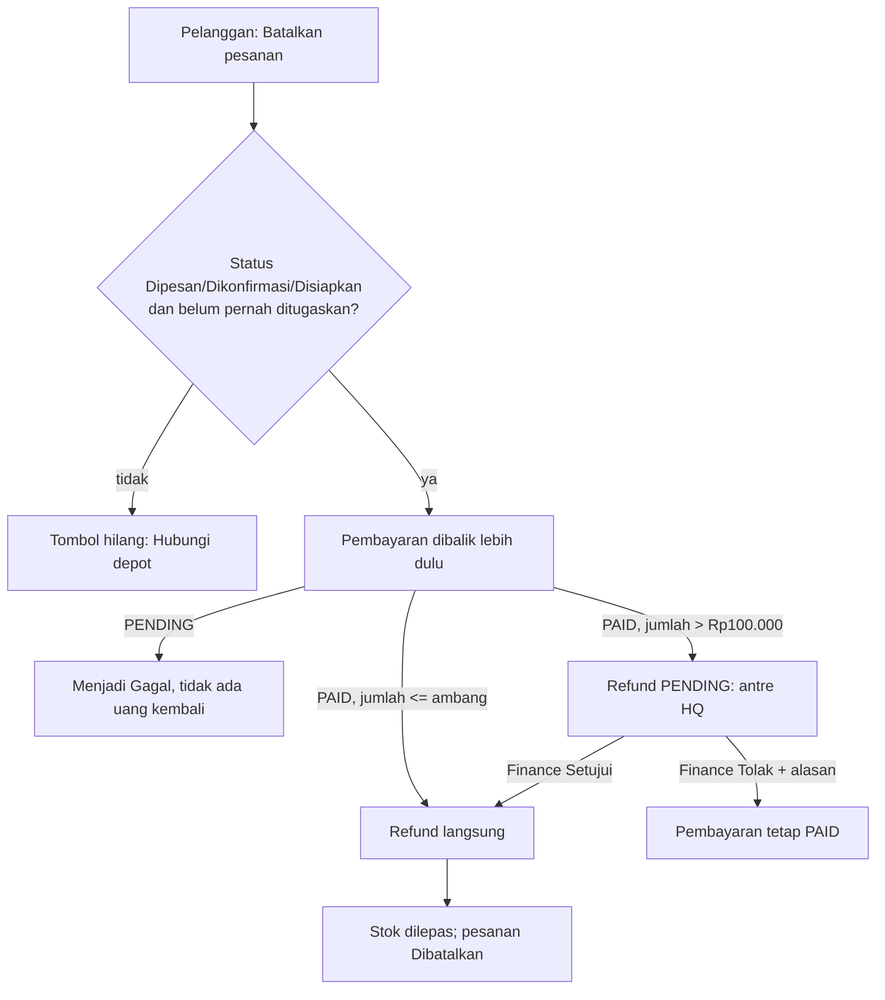

| Komponen | Isi |
|---|---|
| 1. Tujuan | Membatalkan pesanan yang belum dikirim dan mengembalikan uang tanpa kebocoran stok/kas. |
| 2. Pemicu | Pelanggan menekan **Batalkan pesanan**; depot menekan **Batalkan pengiriman**; kurir menandai gagal/no-show; sistem membatalkan otomatis; sengketa diselesaikan dengan "Refund"; Manajer/Finance menekan **Ajukan refund**. |
| 3. Aktor | Pelanggan, Kepala depot/Manajer, Kurir, sistem, Finance (keputusan), Head office/Direktur (membaca antrean). |
| 4. Prasyarat | Pelanggan: status Dipesan, Dikonfirmasi, atau Disiapkan **dan** kurir belum pernah ditugaskan (aturan juga berlaku bila dijadwalkan ulang). Refund: pembayaran PAID. |
| 5. Data/dokumen | Alasan pembatalan (opsional, ≤ 255 huruf) untuk pelanggan; alasan tarik/batal wajib untuk staf; alasan tolak refund wajib. |
| 6. Status awal | Pesanan aktif; pembayaran PENDING atau PAID; persetujuan refund NONE. |
| 7. Langkah | (1) Permintaan batal. (2) Sistem membalik pembayaran **lebih dulu** (gagal-tertutup: bila tidak bisa dibalik, pesanan tidak dibatalkan). (3) Pesanan Dibatalkan, stok dilepas. (4) Jika PAID dan jumlah ≤ ambang, refund diproses langsung. (5) Jika > ambang (bawaan Rp100.000 **[K]**), status persetujuan PENDING dan item muncul di `/hq/refunds`. (6) Finance **Setujui** (satu klik, tanpa konfirmasi) atau **Tolak** dengan alasan. Cara dan waktu uang kembali ke pelanggan (QRIS/transfer dibayar langsung ke depot) tidak terdokumentasi pasti; pengembalian manual oleh depot **[B][K]**. |
| 8. Jalur setuju/tolak | Hanya Finance dan Super admin memutuskan (`refundQueue`). Head office dan Direktur melihat tombol tetapi ditolak server **[B]**. Tombol Tolak tidak muncul untuk pesanan yang sudah dibatalkan ("uang pelanggan harus dikembalikan"). Tidak ada pengecekan "pemohon ≠ penyetuju"; Finance dapat memulai lalu menyetujui sendiri **[B]**. |
| 9. Transisi status | Pesanan: aktif → Dibatalkan. Pembayaran: PENDING → Gagal/Dibatalkan; PAID → REFUNDED (atau tetap PAID bila ditolak). Persetujuan refund: NONE → PENDING → APPROVED / REJECTED. |
| 10. Notifikasi | Pelanggan menerima "Pesanan dibatalkan" bila dibatalkan oleh depot/sistem; **tidak** bila membatalkan sendiri; **tidak ada** notifikasi saat refund selesai atau ditolak. **[V][B]** |
| 11. Pengecualian | Setelah kurir ditugaskan: pesan "Kurir sudah ditugaskan, jadi pesanan tidak bisa lagi dibatalkan dari sini…". "An order in status X can no longer be cancelled." Refund gagal diproses: "Gagal memproses refund." Pembalikan pembayaran gagal: pembatalan ditahan, coba lagi. Pengiriman dengan uang tunai dipegang kurir: jawaban "Sudah saya kembalikan"/"Masih saya pegang" wajib. |
| 12. Status akhir | Dibatalkan + pembayaran Gagal/Dikembalikan; atau pembayaran PAID dengan refund Ditolak. |
| 13. Jejak audit/pelaporan | Alasan tolak "tercatat atas nama Anda"; antrean `/hq/refunds`; kartu KPI "Refund perlu disetujui" di `/hq/payments`; fraud scan harian menandai pelanggan dengan ≥ 3 refund selesai dalam 30 hari (≥ 5 = risiko tinggi). |

### F03 — Retur galon dan deposit

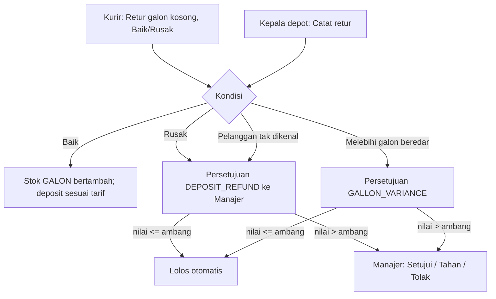

| Komponen | Isi |
|---|---|
| 1. Tujuan | Mencatat galon kosong kembali dan galon keluar, menghitung deposit, dan menahan selisih bernilai besar untuk ditinjau. |
| 2. Pemicu | Kurir menekan **Retur galon kosong** di pengantaran; Kepala depot menekan **Catat retur** atau **Catat galon keluar** (`/dashboard/returns`); pengingat otomatis harian untuk galon belum kembali. |
| 3. Aktor | Kurir (`courierReturn`), Kepala depot/Manajer (`returnsWrite`), Manajer (keputusan `approvals`). |
| 4. Prasyarat | Kurir: pengantaran berstatus Diantar dan terhubung ke depot. Kepala depot: hak `returnsRead/Write`. |
| 5. Data/dokumen | Jumlah galon (1–99 untuk kurir), Kondisi (Baik/Rusak), Deposit dikembalikan (Rp), catatan. Formulir depot tidak punya kolom pelanggan **[V]**. |
| 6. Status awal | Saldo galon beredar dan deposit tertahan sesuai ledger depot. |
| 7. Langkah | (1) Catat retur. (2) Sistem menghitung deposit (tarif bawaan Rp20.000 per galon **[K]**). (3) Kondisi Baik menambah stok galon; Rusak tidak menambah stok dan tidak mengembalikan deposit pada layar kurir. (4) Bila ada kondisi khusus, persetujuan dibuat (lihat diagram). (5) Manajer memutuskan di `/dashboard/approvals`. |
| 8. Jalur setuju/tolak | Manajer: **Setujui**, **Tahan**, **Tolak** (catatan wajib untuk tolak). Nilai ≤ batas auto-pass (bawaan Rp100.000) disetujui otomatis ("Disetujui otomatis (di bawah ambang)"). Pengaju tidak boleh memutuskan pengajuannya sendiri. Refund deposit lebih besar dari deposit yang ditahan depot ditolak langsung. Persetujuan hanya peninjauan sesudahnya; catatan retur sudah tersimpan. **[V]** |
| 9. Transisi status | Persetujuan: PENDING → APPROVED / REJECTED / HELD; HELD → APPROVED / REJECTED; APPROVED dan REJECTED final. Item Tahan hilang dari daftar dan hanya terbuka lewat tautan **[B]**. |
| 10. Notifikasi | Pelanggan: pengingat "Galon belum dikembalikan" (maksimal sekali per 7 hari, bawaan **[K]**). Tidak ada notifikasi untuk Kepala depot tentang keputusan Manajer; Kepala depot tidak bisa membuka antrean approval **[B]**. |
| 11. Pengecualian | Kurir offline: retur masuk antrean; "Sudah tercatat sebelumnya" bila diulang; "Pengantaran ini belum terhubung ke depot, jadi retur tidak bisa dicatat." Tampilan detail desktop untuk "Selisih retur galon" dan "Deposit dikembalikan" dapat menampilkan Rp0 **[B]**. Pembuatan persetujuan upaya-terbaik (tidak memblokir retur). |
| 12. Status akhir | Retur tercatat; persetujuan Disetujui/Ditolak/otomatis; saldo galon beredar berubah. |
| 13. Jejak audit/pelaporan | Laporan harian (kolom Galon: Retur masuk, Keluar, Rusak); `/hq/returns` (galon beredar, deposit tertahan, 100 depot pertama); Deposit galon di Akun pelanggan. |

### F04 — Penjualan kasir (walk-in), shift kasir, tutup buku

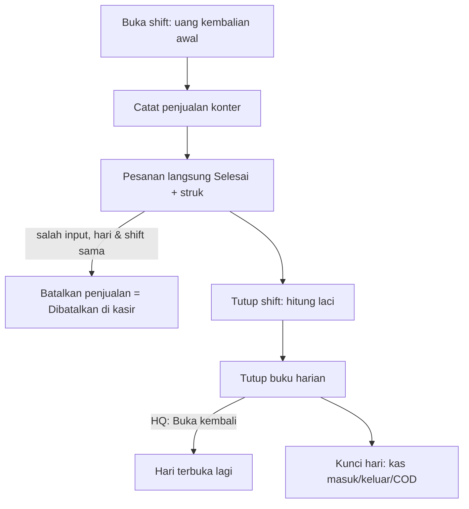

| Komponen | Isi |
|---|---|
| 1. Tujuan | Mencatat penjualan langsung di depot, mengendalikan uang laci, dan mengunci angka satu hari. |
| 2. Pemicu | Pembeli datang ke depot; awal/akhir hari kerja. |
| 3. Aktor | Kepala depot atau Manajer (`cashierShift`, `walkInSale`); Manajer/SPV/Finance/Direktur/Super admin dapat menutup shift orang lain; Kepala depot/Manajer/Head office/Direktur/Super admin menutup buku; Head office/Super admin membuka kembali. |
| 4. Prasyarat | Shift terbuka atas nama kasir (satu shift terbuka per kasir per depot); stok produk; QRIS/transfer hanya bila Manajer mengisi tujuan pembayaran. |
| 5. Data/dokumen | Uang kembalian awal; produk, jumlah; nama/HP pembeli opsional; voucher (butuh HP); galon kosong dibawa; alamat antar opsional; uang tunai diterima; alasan batal (wajib, ≤ 255); uang tunai dihitung di laci; catatan (≤ 500). |
| 6. Status awal | Tidak ada shift terbuka; hari belum ditutup. |
| 7. Langkah | (1) **Buka shift**. (2) Isi keranjang, **Simpan & cetak struk**. (3) Harga dihitung server; satu kunci idempotensi per percobaan. (4) Bila pembayaran gagal tercatat setelah penjualan tersimpan: kartu "Pembayaran belum tercatat" → **Coba lagi catat pembayaran**. (5) **Batalkan penjualan** bila salah input. (6) **Tutup shift**: hitung laci dulu, angka "seharusnya" tidak ditampilkan sebelum mengetik. (7) Setelah semua shift tertutup, **Tutup buku**. (8) Bila perlu koreksi: Head office/Super admin **Buka kembali**, lalu tutup lagi. Tutup bulan: Manajer; buka bulan: **Tidak tersedia** bagi Head office menurut nilai bawaan **[B][D]**. |
| 8. Jalur setuju/tolak | Tidak ada persetujuan atas selisih kas ataupun tutup buku. Pembatalan penjualan tanpa persetujuan. Pembukaan kembali hanya hak Head office/Super admin. **[V]** |
| 9. Transisi status | Shift: OPEN → CLOSED. Pesanan konter: Selesai atau Dibatalkan di kasir (VOIDED). Buku harian: belum ditutup → Ditutup → Dibuka kembali → Ditutup. |
| 10. Notifikasi | Pembeli beridentitas menerima "Pesanan diterima" dan poin; void tidak memicu notifikasi. Penjualan harian dikirim dua kali sehari (13:00 dan 21:00) sebagai notifikasi "Penjualan depot hari ini". |
| 11. Pengecualian | "Buka shift kasir dulu…"; "You already have an open shift…"; stok tidak cukup; keranjang berubah; tunai kurang; void ditolak untuk pesanan antar/lebih lama dari shift ("Ajukan refund"); "Cash taken this shift cannot be read right now…" (shift tetap terbuka, gagal-tertutup); "Masih ada {n} shift kasir terbuka…" saat tutup buku; "Bulan {YYYY-MM} sudah ditutup…". Nama kasir tampil sebagai nomor telepon **[B]**. |
| 12. Status akhir | Hari terkunci dengan snapshot kas masuk, kas keluar, kas konter, COD disetor, COD diharapkan. Uang masuk setelah tutup tampil "{n} entri masuk setelah tutup". |
| 13. Jejak audit/pelaporan | Baris shift mencatat Seharusnya/Dihitung/Selisih; penjualan bersih dicatat ke buku kas (kategori KONTER); alasan void tersimpan; laporan harian/mingguan dapat diekspor (Excel/CSV/PDF); sistem **tidak** memaksa COD terverifikasi sebelum tutup buku **[B]**. |

### F05 — Opname stok dan antrean approval Manajer

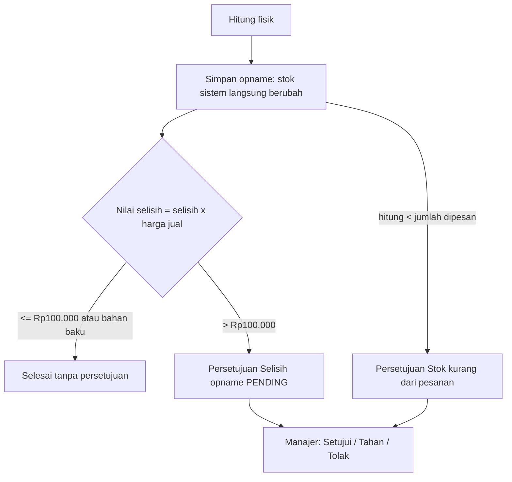

| Komponen | Isi |
|---|---|
| 1. Tujuan | Menyamakan stok sistem dengan stok fisik dan memastikan kerugian besar ditinjau atasan. |
| 2. Pemicu | Jadwal hitung fisik oleh Kepala depot. |
| 3. Aktor | Kepala depot (`inventoryWrite`); Manajer (`approvals`); Head office/Super admin mengubah batas auto-pass (praktis hanya Super admin **[B]**). |
| 4. Prasyarat | Baris stok sudah ada; hak `inventoryWrite`. |
| 5. Data/dokumen | Jumlah hasil opname (≥ 0), alasan (opsional); lembar opname massal (hanya baris berubah dikirim). |
| 6. Status awal | Stok sistem berbeda dari fisik (atau sama). |
| 7. Langkah | (1) Hitung fisik. (2) **Simpan opname** — stok langsung menjadi hitungan; pergerakan OPNAME dicatat. (3) Sistem menilai selisih. (4) Persetujuan dibuat bila perlu. (5) Manajer meninjau; pengaju tidak boleh memutuskan sendiri. |
| 8. Jalur setuju/tolak | Setujui / Tahan / Tolak (alasan wajib). Keputusan **tidak membalik** perubahan stok. Kepala depot tidak punya akses antrean sehingga tidak bisa melihat status **[B]**. |
| 9. Transisi status | PENDING → APPROVED / REJECTED / HELD; opname sendiri tidak punya status. |
| 10. Notifikasi | Tidak ada notifikasi ke pengaju atau Manajer untuk persetujuan; kartu "Antrean approval" di dasbor Manajer menampilkan 5 teratas. Notifikasi "Stok menipis" untuk stok di bawah minimum. |
| 11. Pengecualian | "Isi jumlah 0 atau lebih."; sebagian baris gagal pada opname massal ("{n} baris gagal disimpan…"); "This approval item has already been approved or rejected."; "Pengaju tidak boleh memutuskan pengajuannya sendiri — teruskan ke atasan." Jenis "Kurang setoran" (COD_VARIANCE) ada tetapi tidak pernah dibuat sistem **[V]**. |
| 12. Status akhir | Stok sistem = hitungan; persetujuan final atau tidak diperlukan. |
| 13. Jejak audit/pelaporan | Riwayat stok (pergerakan OPNAME), antrean `/dashboard/approvals` dengan "Diajukan oleh", "Diputuskan oleh", Batas auto-pass tersimpan saat dibuat. |

### F06 — Pengadaan (PO → terima barang)

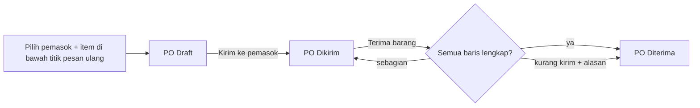

| Komponen | Isi |
|---|---|
| 1. Tujuan | Memesan barang ke pemasok dan memasukkan barang yang datang ke stok depot. |
| 2. Pemicu | Stok di bawah titik pesan ulang ("Buat PO dari stok menipis" / "Buat dari forecast"). |
| 3. Aktor | Manajer dan Super admin (`procurement`). Kepala depot, SPV, Asisten SPV: **Tidak tersedia**. |
| 4. Prasyarat | Pemasok terdaftar untuk depot yang sama (`/dashboard/suppliers`); depot terpilih di pemilih. |
| 5. Data/dokumen | Pemasok, item, jumlah (bulat ≥ 1), biaya per unit (≥ 1), ongkos kirim; nomor PO otomatis `PO-XXXXXXXX`; alasan kurang kirim (≤ 200). |
| 6. Status awal | Draft. |
| 7. Langkah | (1) **Buat PO draft**. (2) **Kirim ke pemasok** (hanya Draft). (3) Saat barang tiba, **Buka untuk terima barang** → isi "Datang kini" per baris (kosong = terima semua sisa). (4) **Terima barang → RECEIPT**: tiap baris diterima menjadi pergerakan stok RECEIPT. (5) Bila kurang dari sisa, isi "Alasan sisanya tidak datang" untuk menutup baris. Pembayaran ke pemasok: **Tidak tersedia** di sistem. |
| 8. Jalur setuju/tolak | Tidak ada persetujuan atasan atas PO. Pembatalan PO: **Tidak tersedia**. |
| 9. Transisi status | Draft → Dikirim → Diterima. Penerimaan sebagian tetap Dikirim. |
| 10. Notifikasi | Tidak ada. |
| 11. Pengecualian | "Only a DRAFT purchase order can be sent." (hanya Draft yang bisa dikirim); "Only a SENT purchase order can be received." (hanya Dikirim yang bisa diterima); "Line N: … would exceed the M still outstanding…" (melebihi sisa); "Nothing to receive…" (semua sudah penuh); "unitCostIdr must be at least 1…"; "Supplier not found."; jika stok baris tidak bisa dibukukan, baris tetap outstanding tanpa peringatan layar **[B]**; pemasok yang dipakai PO tidak bisa dihapus. |
| 12. Status akhir | PO Diterima; stok bertambah. |
| 13. Jejak audit/pelaporan | Pergerakan stok "PO {nomor} · {label}" (+ "kurang kirim: …"); kartu pemasok (jumlah PO, nilai, ketepatan waktu). |

### F07 — Insiden dan sengketa → eskalasi

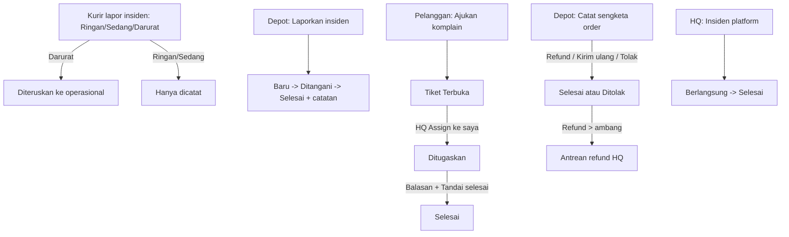

| Komponen | Isi |
|---|---|
| 1. Tujuan | Mencatat kejadian dan klaim pelanggan, menutupnya dengan keputusan tertulis, dan meneruskan yang berat ke tingkat lebih tinggi. |
| 2. Pemicu | Kejadian lapangan (kurir jatuh, kendaraan mogok, listrik padam, galon rusak); klaim pelanggan (salah item, tidak diterima, lebih bayar, kualitas); keluhan pelanggan; gangguan platform. |
| 3. Aktor | Kurir (lapor); Kepala depot, Manajer, SPV, Super admin (`incidents`; sengketa `depotDisputes` termasuk Head office/Direktur); Pelanggan (komplain); Head office/Direktur (tiket, insiden platform). Asisten SPV: tidak punya akses insiden/sengketa. |
| 4. Prasyarat | Depot terpilih; pelanggan masuk untuk komplain. |
| 5. Data/dokumen | Insiden depot: Judul, Jenis, Tingkat, Kurir/Nomor pesanan opsional, Keterangan, "Catatan penyelesaian" (≥ 3 karakter). Sengketa: Nomor order, Nama pelanggan, Kategori, Keterangan (wajib), Nilai, Catatan (wajib bila Tolak). Komplain: Ringkasan masalah (3–200), Ceritakan yang terjadi (wajib). Insiden kurir: jenis, tingkat, kronologi (3–1000), foto opsional. |
| 6. Status awal | Insiden depot Baru (OPEN); sengketa Terbuka; tiket Terbuka; insiden HQ Berlangsung. |
| 7. Langkah | Insiden depot: **Kirim laporan** → (opsional Ditangani) → **Tandai selesai** dengan catatan. Sengketa: **Simpan sengketa** → pilih **Refund ({amount})**, **Kirim ulang**, atau **Tolak**. Tiket: pelanggan **Kirim komplain** → HQ **Assign ke saya** → **Kirim** balasan → **Tandai selesai**. Insiden platform: **Buka insiden**, tambah pembaruan linimasa, **Tandai selesai**. Insiden Darurat dari kurir diteruskan ke tim operasional; Ringan/Sedang hanya dicatat. Eskalasi otomatis atau tenggat respons: **Tidak tersedia** **[V]**. |
| 8. Jalur setuju/tolak | Sengketa: Refund meminta refund lewat jalur pembayaran (di atas ambang menunggu Finance); Tolak butuh catatan. Tiket tidak punya persetujuan. |
| 9. Transisi status | Insiden depot: Baru → Ditangani → Selesai. Sengketa: Terbuka → Selesai / Ditolak (final). Tiket: Terbuka → Ditugaskan → Selesai (server tidak menjaga urutan **[D]**). Insiden platform: Berlangsung → Selesai. |
| 10. Notifikasi | Insiden Darurat kurir → notifikasi "Insiden kurir" ke nomor operasional. Pelanggan **tidak** menerima notifikasi balasan komplain; balasan terlihat sebagai "Balasan Hydromart" di daftar komplain **[B]**. Pengingat atau notifikasi tiket ke HQ: tidak ditemukan. |
| 11. Pengecualian | "Judul terlalu pendek — tulis apa yang terjadi."; "Tulis catatan penyelesaian minimal 3 karakter."; "Nomor order, nama pelanggan, dan keterangan wajib diisi."; hanya sengketa Terbuka yang bisa diselesaikan; teks pembatas layar salah menyebut hanya operator/manajer **[B]**. |
| 12. Status akhir | Selesai / Ditolak / Selesai (tiket) / Selesai (insiden HQ). |
| 13. Jejak audit/pelaporan | Daftar berfilter (Semua/Baru/Ditangani/Selesai); linimasa insiden HQ; "Laporan insiden kurir" dengan tanda "Diteruskan ke pusat". |

### F08 — Langganan (galon rutin)

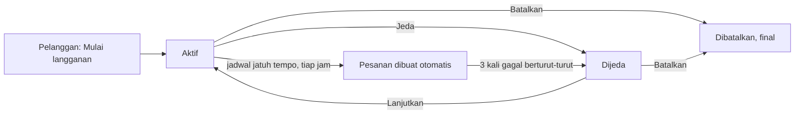

| Komponen | Isi |
|---|---|
| 1. Tujuan | Pengantaran galon berkala tanpa memesan ulang. |
| 2. Pemicu | Pelanggan menekan **Mulai langganan**; pekerjaan terjadwal tiap jam (menit 00) memproses yang jatuh tempo. |
| 3. Aktor | Pelanggan; sistem. Manajer/Super admin mengelola langganan buatan depot (`depotSubscriptions`, sistem terpisah dari langganan pelanggan **[V]**). |
| 4. Prasyarat | Alamat dengan titik peta; produk; tanggal pertama tidak lampau. |
| 5. Data/dokumen | Produk, Jumlah (bawaan 2), Frekuensi (Mingguan/2 minggu/Bulanan), Pengiriman pertama, alamat. |
| 6. Status awal | Aktif. |
| 7. Langkah | (1) Pelanggan membuat langganan. (2) Tiap jadwal sistem membuat pesanan dengan harga depot dan ongkir per galon, diskon langganan (bawaan 5% **[K]**). (3) Pembayaran tidak dimulai otomatis; bayar dari rincian pesanan atau tunai **[D]**. (4) Pelanggan dapat **Jeda**, **Lanjutkan**, **Ganti alamat**, **Batalkan**. Melewati satu jadwal saja: **Tidak tersedia**. |
| 8. Jalur setuju/tolak | Tidak ada persetujuan. |
| 9. Transisi status | Aktif ↔ Dijeda; Aktif/Dijeda → Dibatalkan (final: "A cancelled subscription can no longer be changed."). Jeda otomatis setelah 3 kegagalan berturut-turut. |
| 10. Notifikasi | "Pesanan diterima" tiap pesanan otomatis; notifikasi jeda otomatis (judul tidak ada di kamus **[B]**). Pengingat "Saatnya isi ulang?" bila 14 hari tanpa pesanan (08:00). |
| 11. Pengecualian | "Alamat ini belum punya titik peta…"; tidak ada tagihan saat dijeda; pesanan langganan tidak mendapat promo otomatis (keputusan E-4). |
| 12. Status akhir | Aktif berjalan, Dijeda, atau Dibatalkan. |
| 13. Jejak audit/pelaporan | Daftar langganan pelanggan; `/hq/subscriptions` (BACA; dua populasi terpisah). |

### F09 — Voucher, poin, referral, hadiah

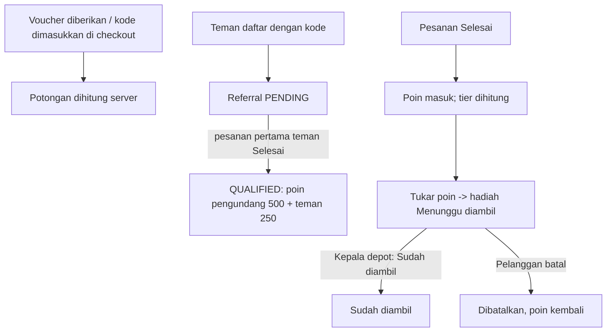

| Komponen | Isi |
|---|---|
| 1. Tujuan | Memberi insentif belanja ulang dan memastikan hadiah diserahkan sekali. |
| 2. Pemicu | Kode voucher di checkout; pesanan Selesai; kode referral saat daftar; penukaran poin; ulang tahun (harian 07:00); kedaluwarsa poin (harian 03:45, mati secara bawaan). |
| 3. Aktor | Pelanggan; Kepala depot/Manajer/Marketing (`rewardHandover`); Manajer/Marketing/Super admin membuat voucher dan program; Head office/Direktur hanya memantau voucher. |
| 4. Prasyarat | Voucher sah (masa berlaku, kuota, minimal belanja, depot/produk, bukan harga agen); pelanggan baru untuk referral; poin cukup dan hadiah tersedia. |
| 5. Data/dokumen | Kode voucher; kode referral 8 karakter; kode penukaran tampil di layar pelanggan. |
| 6. Status awal | Voucher Bisa dipakai; poin saldo; penukaran ACTIVE ("Menunggu diambil"). |
| 7. Langkah | Voucher: **Terapkan** di checkout (satu per pesanan). Poin: subtotal ÷ Rp1.000 dibulatkan ke bawah (bawaan **[K]**), masuk setelah pesanan Selesai. Tier: REGULAR 0, SILVER 1.000, GOLD 5.000, PLATINUM 15.000 poin (diskon 0/2/5/8% bawaan kode **[K]**). Referral: pengundang 500 poin, teman 250 poin setelah pesanan pertama teman Selesai **[K]**. Hadiah: **Tukar** → pilih depot → tunjukkan kode → Kepala depot cocokkan kode → **Sudah diambil**. Permintaan voucher ke HQ: **Tidak tersedia** (dihapus keputusan 2026-09-04). |
| 8. Jalur setuju/tolak | Tidak ada persetujuan. Kepala depot tidak bisa membuat voucher (tanpa halaman) **[V]**. |
| 9. Transisi status | Penukaran: ACTIVE → USED (staf) atau CANCELLED (pelanggan, poin dan stok kembali). Referral: PENDING → QUALIFIED. |
| 10. Notifikasi | "Voucher baru", "Poin bertambah", "Naik tier membership", "Saatnya isi ulang?". Tidak ada notifikasi saat penukaran dibatalkan atau diambil. |
| 11. Pengecualian | Pesan voucher Inggris (expired, not valid yet, usage limit, dsb.); "Reseller pricing already applies…"; "Hadiah ini sudah diambil, jadi penukarannya tidak bisa dibatalkan."; "Hadiah ini baru saja diserahkan oleh depot lain." (klik ganda aman, atomik); "This reward is out of stock." / "You do not have enough points…". Kode referral gagal menampilkan pesan umum "Kode tidak dapat digunakan." |
| 12. Status akhir | Potongan berlaku; poin bertambah/berkurang; hadiah Sudah diambil atau Dibatalkan. |
| 13. Jejak audit/pelaporan | Riwayat poin; "Penukaran saya"; `/hq/vouchers` (belanja voucher jaringan, 50 pertama); statistik referral (Diundang, Berhasil, Poin). Efek samping pesanan (poin, referral, stok, kredit waralaba) dikirim lewat antrean outbox yang dicoba ulang tiap 10 menit. |

### F10 — Waralaba: pendaftaran → HQ → pemilik → onboarding → payout

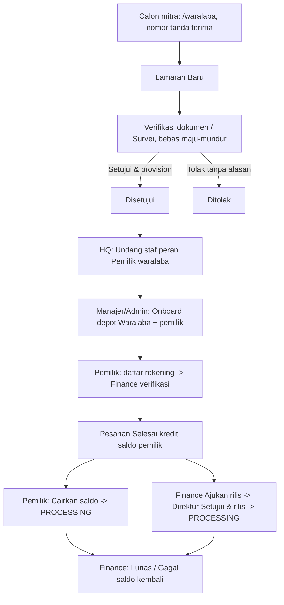

| Komponen | Isi |
|---|---|
| 1. Tujuan | Menerima mitra baru dengan pemeriksaan HQ dan mencairkan hasil usaha secara terkendali. |
| 2. Pemicu | Calon mitra mengirim formulir publik; HQ meninjau; pemilik meminta pencairan atau Finance mengajukan rilis. |
| 3. Aktor | Calon mitra; Head office/Direktur (lamaran); Head office/Admin (undang pemilik); Manajer/Admin (buat depot); Pemilik waralaba; Finance (verifikasi rekening, ajukan rilis, tandai Lunas/Gagal); Direktur/Super admin (setujui rilis). |
| 4. Prasyarat | Nomor WhatsApp aktif; persetujuan data dicentang; akun Pemilik dibuat sebelum depot Waralaba; rekening terverifikasi sebelum pencairan. |
| 5. Data/dokumen | Formulir: nama, WhatsApp (+628…), kode depot usulan (≤ 30), nama depot, kota, provinsi, titik lokasi, investasi dan omzet (bilangan bulat). Upload dokumen: **Tidak tersedia**; daftar periksa 4 butir hanya centang manual (KTP & NPWP, Bukti kepemilikan lokasi, Setoran modal awal, Survei lapangan). Rekening: nama bank (2–60), nomor (6–30), nama pemilik (2–120). |
| 6. Status awal | Lamaran Baru; rekening belum ada; saldo 0. |
| 7. Langkah | (1) Pengajuan, simpan nomor tanda terima (tidak ada halaman cek status **[V]**). Batas 3 kirim per jam. (2) HQ **Tinjau**, centang butir, **Ubah tahap**. (3) **Setujui & provision** hanya mengubah tahap dan membuka form onboarding terisi sebagian (tanpa nama dan telepon). (4) **Undang staf** peran Pemilik waralaba (tanpa kartu karyawan). (5) **Onboard depot** (Kepemilikan Waralaba + pemilik). (6) Pantau `/hq/onboarding` (kesiapan diturunkan dari data). (7) Pemilik **Daftarkan rekening**; Finance **Verifikasi**. (8) Saldo bertambah per pesanan Selesai (komisi HQ dari skema per depot; tanpa skema = 0% **[K]**). (9) Pencairan: jalur A pemilik **Cairkan saldo** (saldo langsung dipotong, PROCESSING, tanpa persetujuan HQ sebelum dipotong); jalur B Finance **Ajukan rilis** (seluruh saldo) → Direktur **Setujui & rilis**. (10) Setelah bank menjawab Finance menekan **Lunas** atau **Gagal**. |
| 8. Jalur setuju/tolak | Lamaran: Setujui/Tolak final, tanpa konfirmasi, tanpa alasan; checklist tidak wajib lengkap. Rekening: Verifikasi / Tolak (alasan tidak dikirim → pemilik melihat "Ditolak: tanpa alasan"). Rilis: pengaju tidak boleh menyetujui sendiri ("Pengaju pencairan tidak boleh menyetujui pengajuannya sendiri."); Tolak tanpa alasan di layar. |
| 9. Transisi status | Lamaran: Baru ↔ Verifikasi dokumen ↔ Survei → Disetujui / Ditolak. Rekening: PENDING → VERIFIED / REJECTED (Ganti rekening → PENDING). Pengajuan rilis: PENDING → APPROVED / REJECTED. Penarikan: PROCESSING → PAID / FAILED (saldo kembali). |
| 10. Notifikasi | Keputusan lamaran tidak dikirim otomatis (dihubungi manual lewat WhatsApp **[K]**); undangan staf tidak mengirim SMS **[D]**; tidak ada notifikasi untuk status penarikan. |
| 11. Pengecualian | "A depot with this code already exists."; "A franchise (WARALABA) depot must have an owner."; "This application has already been approved or rejected."; HQ Head office/Direktur ditolak saat buat depot (hanya Manajer/Super admin) **[B]**; "Belum ada rekening tujuan yang terverifikasi…"; "Withdrawal of X exceeds available balance Y."; "Withdrawal is already {status}; only a PROCESSING withdrawal can be settled."; halaman pemilik tidak menampilkan status penarikan **[B]**; Finance kemungkinan mendapat layar galat pada beberapa halaman HQ **[B][D]**; layar "Net payout" selalu "—" bagi peran non-Manajer **[B]**. |
| 12. Status akhir | Depot Waralaba aktif milik pemilik; penarikan Lunas atau Gagal. |
| 13. Jejak audit/pelaporan | Buku kas dan komisi pemilik (Payout & komisi); referensi penarikan `WD-YYYYMMDD-NNNN`; kartu `/hq/payments`; Log audit; lamaran ditolak dihapus berkala (≤ 24 bulan sejak keputusan). |

### F11 — Usulan harga depot → keputusan HQ

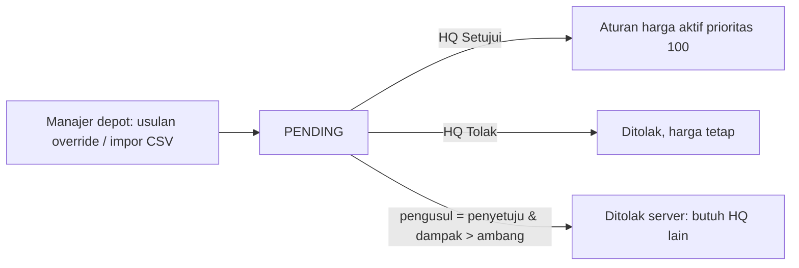

| Komponen | Isi |
|---|---|
| 1. Tujuan | Mengubah harga depot dengan kendali jaringan. |
| 2. Pemicu | Manajer depot mengusulkan di konsol depot atau mengimpor CSV harga. |
| 3. Aktor | Manajer (`depotAdmin`) pengusul; Head office, Direktur, Super admin memutuskan (`priceOverrideDecide`). |
| 4. Prasyarat | Produk ada di katalog; usulan menunggu. |
| 5. Data/dokumen | Produk, jenis penyesuaian (persen/tetap/absolut), nilai, catatan; harga dasar jaringan. |
| 6. Status awal | PENDING ("Override menunggu"). |
| 7. Langkah | (1) Usulan dibuat. (2) HQ buka `/hq/pricing`, baca harga "Sekarang" dan "Usulan". (3) **Setujui** atau **Tolak** — tanpa dialog dan tanpa alasan. (4) Setuju membuat aturan harga aktif (prioritas 100). Catatan: Kepala depot dapat mengisi "Harga khusus depot" langsung di Inventory tanpa persetujuan **[V]** (jalur berbeda dari usulan). |
| 8. Jalur setuju/tolak | Final. Aturan empat mata: pengusul yang menyetujui sendiri ditolak bila dampak > batas auto-pass (bawaan Rp100.000): "Usulan ini Anda sendiri yang mengajukan dan nilainya di atas batas auto-pass. Persetujuan harus dari HQ." |
| 9. Transisi status | PENDING → APPROVED / REJECTED. |
| 10. Notifikasi | Tidak ada. |
| 11. Pengecualian | "This price-override proposal has already been approved or rejected."; hanya 50 produk pertama tampil **[B]**; perubahan harga dasar katalog tidak melewati persetujuan. |
| 12. Status akhir | Aturan harga aktif atau usulan ditolak. |
| 13. Jejak audit/pelaporan | Audit mencatat dampak (IDR); Jejak audit depot (chip Harga). |

### F12 — Admin undang staf → peran → akses → nonaktifkan/hapus

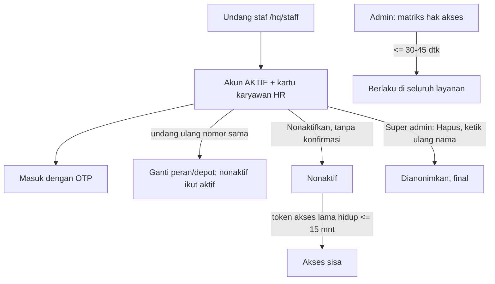

| Komponen | Isi |
|---|---|
| 1. Tujuan | Memberi akses staf sesuai peran minimum dan mencabutnya dengan benar. |
| 2. Pemicu | Karyawan baru, perubahan tugas, keluar, atau indikasi penyalahgunaan. |
| 3. Aktor | Super admin (12 peran); Head office (6 peran: Staf depot, Kepala depot, Asisten SPV, SPV, Pemilik waralaba, Head office); HR (Manajer lewat jabatan); hanya Super admin menghapus dan mengubah matriks. |
| 4. Prasyarat | Nomor telepon Indonesia; depot untuk Staf depot dan Kepala depot; Posisi, Tanggal masuk, Status kepegawaian, Gaji > 0 (kecuali Pemilik waralaba). |
| 5. Data/dokumen | Formulir "Undang / tetapkan peran staf"; persetujuan tertulis pemilik untuk peran bernilai tinggi (praktik yang disarankan di luar sistem). |
| 6. Status awal | Nomor belum punya akun, atau sudah punya akun (dipromosikan). |
| 7. Langkah | (1) **Undang staf**. (2) Akun langsung AKTIF; kartu karyawan dibuat di HR. (3) Beri tahu orangnya lewat saluran lain (SMS undangan **Tidak tersedia**). (4) Ubah peran: undang ulang nomor yang sama (tombol "ubah peran" **Tidak tersedia**). (5) Atur hak di `/hq/access` (Simpan; berlaku ±30–45 detik). (6) **Nonaktifkan** (tanpa konfirmasi). (7) **Hapus**: ketik ulang nama/nomor; identitas dianonimkan, token penyegar dihapus, kartu HR dianonimkan. (8) Hierarki Asisten SPV → SPV → Manajer di `/hq/hierarchy` menentukan depot terlihat (berlaku ≤ 60 detik). |
| 8. Jalur setuju/tolak | Tidak ada persetujuan bertingkat di sistem. Aturan pemberian peran (RESTRICTED_GRANTS): Manajer hanya oleh Super admin atau HR; Direktur, Finance, HR, Marketing, Super admin hanya oleh Super admin. Matriks yang disimpan menolak pencabutan Super admin dari `accessMatrixWrite`. |
| 9. Transisi status | Akun: AKTIF ↔ Nonaktif (SUSPENDED); → DELETED (final). |
| 10. Notifikasi | Tidak ada pesan undangan; tidak ada notifikasi saat nonaktif. |
| 11. Pengecualian | `"X" is not a valid Indonesian mobile number.`; "Peran staf depot wajib terikat ke satu depot."; "Peran {ROLE} hanya boleh diberikan oleh {A atau B}."; "Akun sendiri tidak bisa dihapus."; "Ini super admin terakhir…"; "hr-service belum dikonfigurasi…"; nomor salah ketik dapat mengubah akun orang lain; menonaktifkan diri sendiri atau Admin terakhir tidak dijaga **[B]**; layar `/dashboard/staff` kemungkinan ditolak validasi **[B]**; token akses lama bertahan ≤ 15 menit; memaksa keluar perangkat orang lain: **Tidak tersedia**. |
| 12. Status akhir | Akun aktif dengan peran baru, nonaktif, atau dihapus/dianonimkan. |
| 13. Jejak audit/pelaporan | `/hq/audit` (mutasi berhak istimewa, `staff.account.deleted`, perubahan matriks); tanpa filter di layar, ekspor XLSX penuh **[B]**. |

### F13 — HR: karyawan → akun → peran → offboarding → pencabutan akses

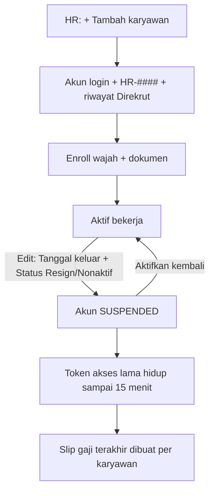

| Komponen | Isi |
|---|---|
| 1. Tujuan | Menyatukan data kepegawaian dan akses login, serta menutup hubungan kerja dengan gaji dan akses berhenti pada tanggal yang benar. |
| 2. Pemicu | Perekrutan, mutasi, resign/pemutusan. |
| 3. Aktor | HR dan pemegang `hrAdmin` (Head office, Direktur, Super admin); Admin untuk penghapusan akun. |
| 4. Prasyarat | Nomor HP, jabatan (login), depot (kecuali Asisten SPV/SPV/Manajer), tanggal masuk, tipe dan nominal gaji. |
| 5. Data/dokumen | Formulir "Tambah Karyawan"; dokumen (KTP, KK, Kontrak, NPWP, Sertifikat, SIM; jpeg/png/webp/pdf ≤ 5 MB); persetujuan wajah (dicentang). |
| 6. Status awal | Belum ada kartu karyawan. |
| 7. Langkah | (1) **Tambah Karyawan**; bila nomor sudah dipakai akun lain, konfirmasi "Ya, gunakan akun itu". (2) Server memeriksa duplikat, membuat/mempromosikan akun, mencatat "Direkrut". (3) **Enroll Wajah** (1–3 foto + persetujuan). (4) Mutasi: ubah depot (dicatat mutasi permanen). (5) Offboarding: **Edit** → isi **Tanggal keluar** → Status **Resign**/**Nonaktif** → **Simpan Perubahan**; tidak ada tombol/wizard "terminate" **[V]**. (6) Buat slip terakhir dengan **Generate** per karyawan (batch hanya karyawan Aktif). (7) Kembalikan aset; tinjau pinjaman/tunjangan; batalkan penugasan lintas depot terbuka. |
| 8. Jalur setuju/tolak | Tidak ada persetujuan atas perubahan kepegawaian. Pemberian Manajer ditolak bagi Head office/Direktur. |
| 9. Transisi status | Karyawan: Aktif ↔ Nonaktif; → Resign (tidak ditimpa penyalaan balik). Akun login ikut: Aktif ↔ SUSPENDED. |
| 10. Notifikasi | Tidak ada ke karyawan. |
| 11. Pengecualian | "Karyawan berstatus RESIGNED tanpa tanggal keluar…" (payroll menolak); "Nomor telepon ini sudah dipakai karyawan lain"; "NIK harus 16 digit angka."; "Karyawan ini punya penugasan depot yang terjadwal atau berjalan…"; layanan autentikasi menolak → seluruh simpan gagal; pesan auth tidak diteruskan jelas **[B]**; token akses terbit tetap berlaku ≤ 15 menit dan token penyegar gagal saat disegarkan ("This account has been suspended."). Status Resign tidak menghentikan gaji; yang dibaca payroll adalah Tanggal keluar. |
| 12. Status akhir | Karyawan Resign/Nonaktif, login ditangguhkan; data dianonimkan oleh sapuan retensi (biometrik, absensi, kinerja dihapus; payroll disimpan tanpa pemilik 10 tahun). |
| 13. Jejak audit/pelaporan | "Riwayat Kepegawaian" (status, jabatan, peran login, depot, gaji); Log Audit HR (`/hr/audit`, menampilkan 8 karakter awal ID pelaku); `/hq/audit`. |

### F14 — Absensi wajah

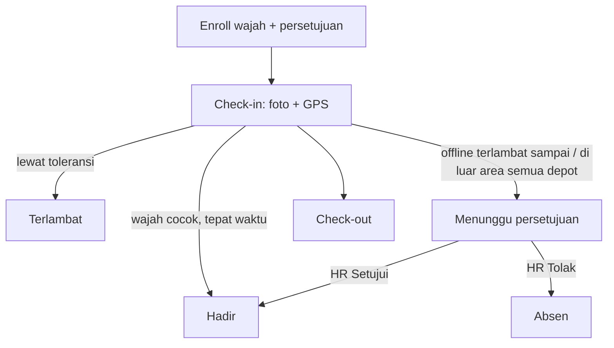

| Komponen | Isi |
|---|---|
| 1. Tujuan | Mencatat kehadiran sebagai dasar gaji. |
| 2. Pemicu | Karyawan membuka **Absen Sekarang**. |
| 3. Aktor | Karyawan (kurir, Kepala depot, Asisten SPV, SPV, Super admin punya `canPunchAttendance`); HR (`hrAdmin`) memutuskan absen tertahan dan mengoreksi. |
| 4. Prasyarat | Akun tertaut ke karyawan aktif; wajah terdaftar; izin kamera dan GPS. |
| 5. Data/dokumen | Foto wajah, koordinat GPS, alasan koreksi (wajib, ≤ 200). |
| 6. Status awal | Belum ada catatan hari itu. |
| 7. Langkah | (1) Pilih Check-in/Check-out, **Ambil Foto** (uji kehidupan sederhana dua bingkai). (2) Server mencocokkan wajah (ambang 0,62 bawaan **[K]**), menghitung keterlambatan (toleransi 15 menit **[K]**). (3) Geofence hanya bila depot mengaturnya. (4) Offline: tersimpan di perangkat dan dikirim ulang; > 10 menit → Menunggu persetujuan; > 24 jam ditolak. (5) HR memutuskan di kartu "Absen menunggu persetujuan" setelah melihat skor kecocokan dan foto. Check-in shift kurir (layanan pengiriman) **tidak** terhubung ke absen karyawan **[B]**. |
| 8. Jalur setuju/tolak | HR **Setujui** (→ Hadir atau Terlambat) atau **Tolak** (→ Absen, potongan absen berlaku). Karyawan tidak bisa membantah di aplikasi **[B]**. Absen untuk hari tanpa catatan: HR entri manual; koreksi: alasan wajib. |
| 9. Transisi status | Hadir / Terlambat / Menunggu persetujuan → Hadir, Terlambat, Absen; Cuti dan Libur dari cuti disetujui/kalender. |
| 10. Notifikasi | Tidak ada. |
| 11. Pengecualian | "Wajah tidak cocok"; "Wajah belum di-enroll"; "Sudah check-in hari ini"; "Belum check-in hari ini"; "Di luar area absen depot ({m} m dari titik)…"; "Absen offline sudah terlalu lama. Minta entri manual ke HR."; "Wajah ini sudah terdaftar untuk karyawan lain". Tidak ada sapuan otomatis penanda Absen; Absen dari entri manual/impor **[V]**. |
| 12. Status akhir | Catatan kehadiran final per hari. |
| 13. Jejak audit/pelaporan | Riwayat koreksi per baris; `/hr/attendance`; "Absensi Saya". |

### F15 — Cuti dua tahap

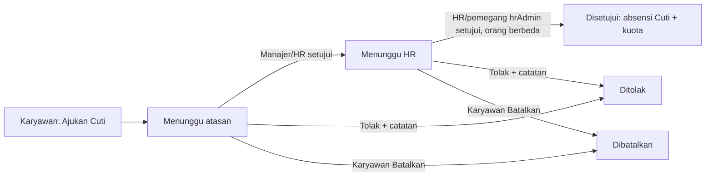

| Komponen | Isi |
|---|---|
| 1. Tujuan | Memberi cuti dengan dua pemeriksa. |
| 2. Pemicu | Karyawan mengajukan, atau HR mengajukan atas nama ("Ajukan cuti untuk karyawan"). |
| 3. Aktor | Karyawan; tahap 1 Manajer atau HR (`leaveApprove`, tercakup depot); tahap 2 pemegang `hrAdmin` (HR, Head office, Direktur, Super admin) — Head office/Direktur hanya terlihat "Menunggu keputusan HR" di layar **[B]**. |
| 4. Prasyarat | Kuota cukup untuk Cuti tahunan/Izin (bawaan 12 hari **[K]**); rentang memuat hari kerja; tidak bentrok. |
| 5. Data/dokumen | Jenis (Cuti tahunan, Sakit, Izin, Darurat), Mulai, Selesai, Alasan (≤ 300); lampiran surat dokter: **Tidak tersedia**. |
| 6. Status awal | Menunggu atasan (PENDING_MANAGER). |
| 7. Langkah | (1) Pengajuan. (2) Tahap 1 **Setujui**/**Tolak**. (3) Tahap 2 oleh orang berbeda. (4) Disetujui: absensi "Cuti" ditulis untuk tiap hari kerja, kuota terpotong (hanya tahunan dan izin). Cuti disetujui tidak bisa dibatalkan sendiri; minta HR **[B]**. |
| 8. Jalur setuju/tolak | Tolak wajib catatan ("Alasan penolakan wajib diisi"). Pemohon tidak bisa memutuskan cuti sendiri; pemutus tahap 2 ≠ pemutus tahap 1: HR sendirian tidak dapat menyelesaikan kedua tahap. Kepala depot tidak menyetujui cuti kurir. |
| 9. Transisi status | Menunggu atasan → Menunggu HR → Disetujui; Ditolak/Dibatalkan dari kedua status menunggu. |
| 10. Notifikasi | Pengajuan masuk (ke penyetuju), Cuti disetujui, Cuti ditolak. |
| 11. Pengecualian | "Sisa kuota cuti {n} hari, pengajuan {m} hari"; "Sudah ada pengajuan cuti pada rentang tanggal tersebut"; "Rentang tanggal tidak memuat hari kerja"; "Tidak bisa memutuskan pengajuan cuti Anda sendiri"; "Tahap kedua harus diputuskan orang lain, bukan pemutus tahap pertama". |
| 12. Status akhir | Disetujui, Ditolak, atau Dibatalkan. |
| 13. Jejak audit/pelaporan | Antrean `/hr/leave` dengan filter status; saldo cuti; impor saldo cuti awal. |

### F16 — Kasbon

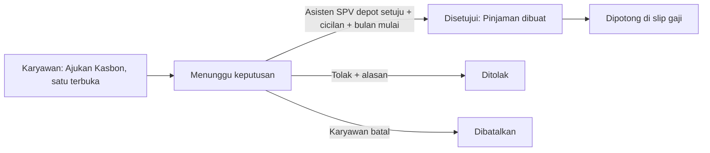

| Komponen | Isi |
|---|---|
| 1. Tujuan | Memberi uang muka gaji yang dipotong bulanan. |
| 2. Pemicu | Karyawan menekan **Ajukan Kasbon**. |
| 3. Aktor | Karyawan; penyetuju: bila depot punya Asisten SPV tercatat, hanya dia; bila tidak, Manajer atau HR (`kasbonApprove`). Kepala depot dan SPV tidak. |
| 4. Prasyarat | Akun terhubung ke satu depot (Asisten SPV/SPV/Manajer tanpa depot: "Ajukan lewat HR"); tidak ada pengajuan terbuka lain. |
| 5. Data/dokumen | Nominal (bulat > 0), Alasan (≤ 300); penyetuju mengisi Cicilan per bulan dan Mulai potong (YYYY-MM). Batas nominal di kode: tidak ada **[K]**. |
| 6. Status awal | Menunggu keputusan (PENDING). |
| 7. Langkah | (1) Pengajuan. (2) Notifikasi ke Asisten SPV. (3) Keputusan di `/hr/loans/requests`. (4) Pinjaman dibuat; cicilan dipotong di payroll (dikecilkan atau ditunda bila gaji bersih negatif). Pencairan uang kasbon tidak dilacak di sistem **[D]**. HR dapat juga mencatat pinjaman langsung tanpa persetujuan (`hrAdmin`). Asisten SPV/Manajer/SPV tidak punya menu ke halaman ini selain URL **[D]**. |
| 8. Jalur setuju/tolak | Tolak wajib alasan. "Kasbon sendiri tidak bisa Anda setujui."; "Kasbon ini diputuskan oleh asisten supervisor depotnya." (Manajer dan HR ditolak bila asisten ada). |
| 9. Transisi status | Menunggu keputusan → Disetujui / Ditolak / Dibatalkan. |
| 10. Notifikasi | Pengajuan masuk (ke Asisten SPV); Disetujui; Ditolak (tanpa judul di kamus **[B]**). |
| 11. Pengecualian | "Masih ada pengajuan kasbon yang belum diputuskan."; "Pengajuan ini sudah dijawab orang lain. Muat ulang daftarnya."; layanan depot tidak terjangkau → 503 (gagal-tertutup). |
| 12. Status akhir | Disetujui (pinjaman Berjalan → Lunas/Dihentikan), Ditolak, atau Dibatalkan. |
| 13. Jejak audit/pelaporan | Daftar `/hr/loans`; slip gaji (baris "Cicilan pinjaman"). |

### F17 — Payroll DRAFT → APPROVED → PAID

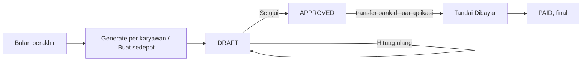

| Komponen | Isi |
|---|---|
| 1. Tujuan | Menghitung, menyetujui, dan mencatat pembayaran gaji bulanan. |
| 2. Pemicu | Tanggal 1 bulan berikutnya (slip bulan M baru bisa dibuat setelah bulan M berakhir). |
| 3. Aktor | HR, Finance, Super admin (`hrPayroll`); Manajer/SPV/Asisten SPV/Head office/Direktur hanya membaca (`hrView`); karyawan membaca slip sendiri. |
| 4. Prasyarat | Absensi bulan itu diputuskan; cuti, kasbon, bonus, potongan, tunjangan masuk; karyawan Resign punya Tanggal keluar. |
| 5. Data/dokumen | Slip (gaji pokok, tunjangan, bonus, lembur, potongan, cicilan, BPJS, PPh 21); PDF slip. Tabel TER PPh 21 kosong sampai dimuat dan belum ditandatangani akuntan **[K]**. |
| 6. Status awal | Tidak ada slip periode itu. |
| 7. Langkah | (1) **Generate** atau **Buat sedepot** (hanya karyawan Aktif, maks 500, hanya DRAFT). (2) Tinjau, peringatan hari kehadiran belum diputuskan tidak memblokir. (3) **Hitung ulang** bila data berubah. (4) **Setujui**. (5) Transfer gaji di bank (sistem tidak memindahkan uang). (6) **Tandai Dibayar**. |
| 8. Jalur setuju/tolak | Tidak ada penolakan atau batal setuju. **Tidak ada maker-checker**: akun yang sama boleh membuat, menyetujui, dan menandai dibayar **[V][K]**. |
| 9. Transisi status | DRAFT → APPROVED → PAID. |
| 10. Notifikasi | Tidak ada ke karyawan; slip Draft sudah terlihat oleh karyawan **[B]**. |
| 11. Pengecualian | "Periode {YYYY-MM} belum selesai…"; "Payroll {periode} sudah {STATUS}, tidak bisa dibuat ulang"; "Hanya payroll DRAFT yang bisa dihitung ulang/disetujui"; "Hanya payroll APPROVED yang bisa dibayar"; "Penugasan depot karyawan ini berubah setelah slip dihitung…"; "Payroll yang sudah dibayar tidak bisa dialokasikan ulang." |
| 12. Status akhir | PAID. Riwayat impor langsung PAID. |
| 13. Jejak audit/pelaporan | Detail slip, "Disetujui"/"Dibayar" bertanggal, laporan beban BPJS perusahaan, Log Audit HR. |

### F18 — Penugasan/pinjam karyawan lintas depot (fitur mati secara bawaan)

> `DEPOT_ASSIGNMENT_ENABLED` bawaan **false**; saat mati seluruh alur menjawab 404 "Penugasan lintas depot belum diaktifkan". Status di produksi: **[K]**.

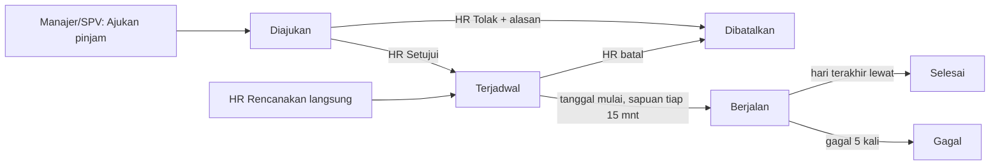

| Komponen | Isi |
|---|---|
| 1. Tujuan | Meminjamkan karyawan ke depot lain atau memindahkan permanen. |
| 2. Pemicu | Kekurangan staf di depot tujuan. |
| 3. Aktor | Manajer dan SPV mengajukan (`employeeAssignRequest`; Asisten SPV dan Kepala depot tidak); HR, Head office, Direktur, Super admin memutuskan/merencanakan (`employeeAssign`); mutasi permanen hanya HR. |
| 4. Prasyarat | Fitur aktif; karyawan aktif, punya akun login, punya depot asal, jabatan staf depot sampai manajer; tujuan ≠ asal dan depot tujuan aktif. |
| 5. Data/dokumen | Kode karyawan (format `HR-####`; hint layar "EMP-0012" salah **[B]**), Depot tujuan, Mulai, Sampai (hari terakhir, wajib untuk pinjaman), Catatan (≤ 300). |
| 6. Status awal | Diajukan (permintaan) atau Terjadwal (rencana HR). |
| 7. Langkah | (1) Ajukan di `/hr/depot-requests`. (2) HR memutuskan pada kartu "Penugasan lintas depot" karyawan (tidak ada kotak masuk global; cara HR diberi tahu tidak diketahui **[B][K]**). (3) Pada tanggal mulai akun dipindah; Kepala depot yang dipinjamkan menjadi Staf depot di tujuan. (4) Berakhir: kembali ke depot asal. |
| 8. Jalur setuju/tolak | HR Setujui / Tolak (alasan 3–300 karakter). |
| 9. Transisi status | Diajukan → Terjadwal → Berjalan → Selesai; Dibatalkan; Gagal. |
| 10. Notifikasi | Tidak ditemukan. |
| 11. Pengecualian | 13 pesan validasi (jabatan, akun login, aktif, depot asal, tanggal, bentrok, depot tutup); mundur tanggal maksimal 92 hari dan ditolak bila payroll bulan itu Disetujui/Dibayar. Payroll terbagi per depot bila aktif. |
| 12. Status akhir | Selesai / Dibatalkan / Gagal. |
| 13. Jejak audit/pelaporan | Riwayat penugasan di kartu karyawan; "Alokasi per depot" pada slip. |

### F19 — UU PDP: ekspor atau hapus data (SLA 72 jam)

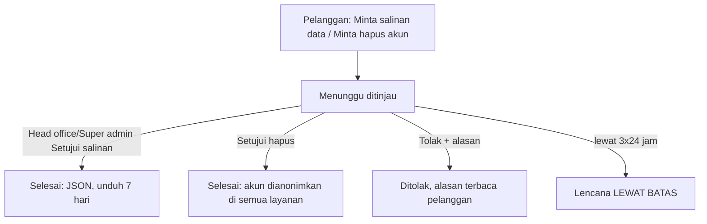

| Komponen | Isi |
|---|---|
| 1. Tujuan | Memenuhi hak subjek data dalam batas waktu. |
| 2. Pemicu | Pelanggan menekan **Minta salinan data** / **Minta hapus akun**; atau lewat surel privasi (alamat perlu diverifikasi, MX belum ada pada 2026-09-25 **[K]**). |
| 3. Aktor | Pelanggan; Head office dan Super admin (`pdpRequests`; Direktur dan Finance sengaja tidak). Staf: penghapusan oleh Admin, bukan layar ini. |
| 4. Prasyarat | Pelanggan masuk; satu permintaan terbuka per jenis. |
| 5. Data/dokumen | Alasan penolakan (wajib). Ekspor: JSON akun, profil, alamat, riwayat persetujuan (tanpa pesanan, pembayaran, saldo loyalti). |
| 6. Status awal | Menunggu (PENDING). |
| 7. Langkah | (1) Pelanggan kirim; dialog konfirmasi untuk hapus. (2) HQ buka `/hq/pdp` (antrean: menunggu lebih dulu, terlama dulu). (3) Setujui/Tolak. (4) Salinan: pelanggan **Unduh salinan data** dalam 7 hari. (5) Hapus: tidak dapat dibatalkan; data pribadi dihapus/disamarkan, langganan dibatalkan; pesanan dan pembayaran disimpan 10 tahun tanpa pemilik; foto bukti antar ≤ 12 bulan. |
| 8. Jalur setuju/tolak | Setujui atau Tolak (final). |
| 9. Transisi status | Menunggu → Selesai / Ditolak. Penghapusan gagal di tengah: tetap Menunggu dan dapat diulang. Akun pelanggan: Aktif → Dihapus. |
| 10. Notifikasi | **Tidak ada** notifikasi saat diputuskan **[B]**; tidak ada peringatan otomatis untuk yang terlambat. |
| 11. Pengecualian | "Permintaan sejenis masih diproses."; "Ekspor data belum disetujui…"; "Persetujuan ekspor sudah lewat 7 hari…"; "Permintaan ini sudah diputuskan."; sistem tidak memeriksa pesanan aktif sebelum hapus **[B]**; batas 72 jam dihitung sejak permintaan dibuat, halaman publik menjanjikan "sejak diverifikasi" **[B]**. |
| 12. Status akhir | Selesai atau Ditolak. |
| 13. Jejak audit/pelaporan | Audit: permintaan dibuat, diekspor, dianonimkan, ditolak; cakupan penghapusan (ERASED/EXEMPT/UNENFORCED/FAILED) di metadata audit; kartu "Ketertinggalan persetujuan". |

### F20 — Klaim pengeluaran kurir

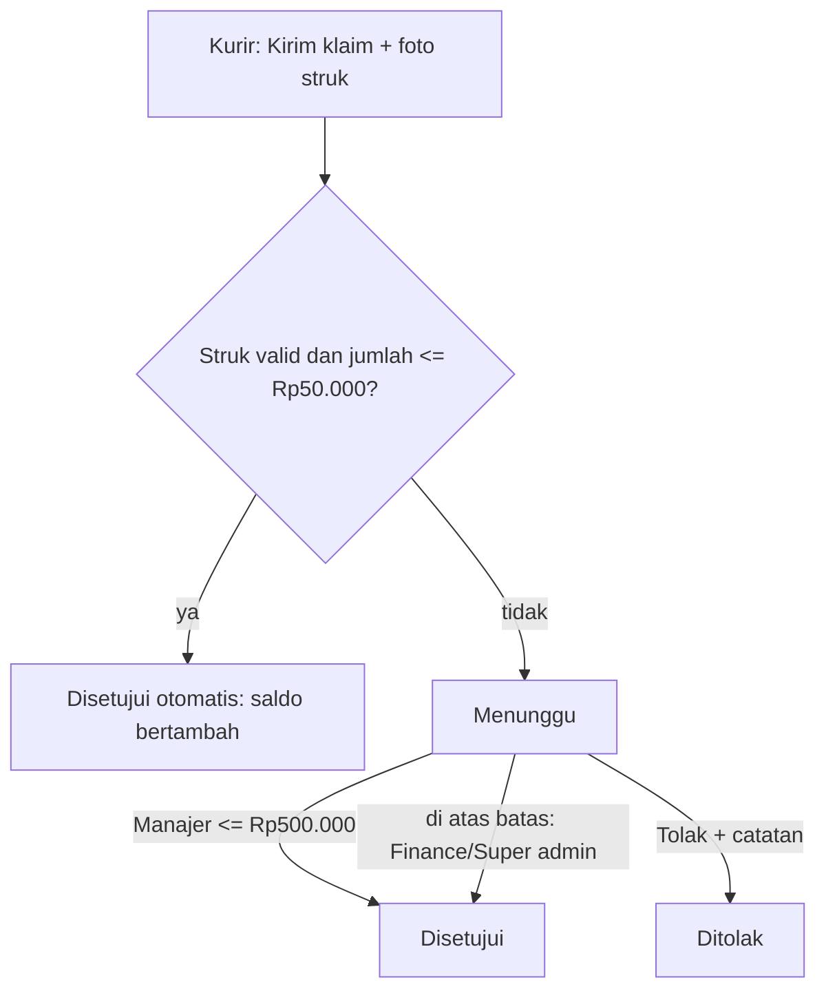

| Komponen | Isi |
|---|---|
| 1. Tujuan | Mengganti biaya bensin, parkir/tol, servis kendaraan. |
| 2. Pemicu | Kurir menekan **Kirim klaim**. |
| 3. Aktor | Kurir; Manajer, Finance, Super admin (`expenseApprove`). Kepala depot tidak menyetujui. |
| 4. Prasyarat | Akun kurir (`courierPayout`); foto struk dianjurkan. |
| 5. Data/dokumen | Jenis, Jumlah (> 0), Keterangan (wajib, ≤ 280), Foto struk. |
| 6. Status awal | Menunggu (PENDING). |
| 7. Langkah | Kirim → bila struk valid dan jumlah ≤ ambang (Rp50.000 bawaan, depot hanya boleh menurunkan **[K]**) otomatis disetujui dan saldo ditambah; selain itu menunggu penyetuju. Klaim tidak masuk antrean offline, tidak bisa diedit/ditarik. |
| 8. Jalur setuju/tolak | Manajer menyetujui sampai Rp500.000 (bawaan **[K]**), di atasnya Finance/Super admin ("Klaim di atas Rp{limit} harus disetujui FINANCE."); Manajer tetap boleh menolak. |
| 9. Transisi status | Menunggu → Disetujui / Ditolak (final). |
| 10. Notifikasi | Tidak ada; kurir melihat status di riwayat klaim. |
| 11. Pengecualian | "Only a pending expense claim can be approved or rejected."; kredit gagal → klaim kembali Menunggu; bantuan menyebut "persetujuan depot" padahal Manajer/Finance **[B]**. |
| 12. Status akhir | Disetujui (saldo bertambah) / Ditolak. |
| 13. Jejak audit/pelaporan | Riwayat klaim kurir; riwayat penghasilan (Penyesuaian "Klaim pengeluaran disetujui"); kolom "Klaim biaya" di `/hq/pnl`. |

### F21 — Penarikan saldo kurir

| Komponen | Isi |
|---|---|
| 1. Tujuan | Mencairkan upah per antar, bonus, dan penyesuaian. |
| 2. Pemicu | Kurir menekan **Tarik saldo**. |
| 3. Aktor | Kurir; Finance/Super admin (verifikasi rekening, Lunas/Gagal). |
| 4. Prasyarat | Saldo > 0; rekening terverifikasi. Aturan upah (tarif dasar, bonus) adalah data Finance/Super admin; tanpa aturan upah tidak tercatat tanpa pemberitahuan **[K]**. |
| 5. Data/dokumen | Nama bank, nomor, nama pemilik; jumlah penarikan. |
| 6. Status awal | Rekening "Menunggu verifikasi kantor pusat". |
| 7. Langkah | Daftarkan rekening → Finance Verifikasi/Tolak → **Tarik** (saldo langsung berkurang, "Diproses") → Finance **Lunas** (Terkirim) atau **Gagal** (saldo kembali). Jadwal pencairan otomatis: tidak ditemukan **[K]**; FAQ saling bertentangan **[B]**. |
| 8. Jalur setuju/tolak | Verifikasi/Tolak rekening (alasan tidak dikirim). Tidak ada persetujuan sebelum saldo dipotong. |
| 9. Transisi status | Rekening PENDING → VERIFIED / REJECTED. Penarikan PROCESSING → PAID / FAILED. |
| 10. Notifikasi | Tidak ada. |
| 11. Pengecualian | "Jumlah melebihi saldo tersedia."; "Withdrawal amount must be greater than zero."; "Belum ada rekening tujuan yang terverifikasi…". |
| 12. Status akhir | Terkirim (PAID) atau Gagal (saldo kembali "Penarikan gagal, saldo dikembalikan"). |
| 13. Jejak audit/pelaporan | Riwayat penghasilan (Upah, Bonus, Potongan, Selisih setoran, Penarikan, Penyesuaian); kartu "Penarikan menunggu jawaban bank" di `/hq/payments`. |

### F22 — Pekerjaan otomatis terjadwal

Penjadwal (kontainer `scheduler`, busybox `crond`) memanggil rute internal dengan kunci layanan bersama; satu kunci per tugas mencegah tumpang tindih; batas waktu 600 detik; kegagalan memicu ping ke webhook peringatan dan setiap sapuan mencatat detak jantung yang tampil di `/hq/health` ("Sapuan terjadwal", termasuk "Belum pernah jalan"). **[V]**

```mermaid
flowchart LR
  C[crond WIB] --> S[sweep.sh + kunci + timeout]
  S --> R[Rute internal layanan]
  R --> H[Detak jantung ke admin-service]
  S -->|gagal| W[Peringatan webhook ops]
```

| Waktu (WIB) | Pekerjaan | Dampak bagi pengguna |
|---|---|---|
| Tiap jam :00 | Proses langganan jatuh tempo | Pesanan langganan dibuat otomatis (F08) |
| Tiap jam :00 | Terapkan perubahan harga/status agen terjadwal | Harga agen berubah pada tanggal berlaku |
| Tiap jam :05 | Batalkan pesanan terbengkalai | Dipesan > 60 menit, atau Dikonfirmasi/Disiapkan > 24 jam → Dibatalkan, stok dilepas, pembayaran dibalik lebih dulu **[K]** |
| Tiap jam :25 | Gagalkan pembayaran non-tunai PENDING | > 24 jam menjadi Gagal; tunai tidak disentuh **[K]** |
| Tiap jam :17 | Jalankan laporan terjadwal | Berkas dibuat, diunduh di HQ › Ekspor; tidak dikirim email |
| Tiap 2 menit | Kirim kampanye berstatus mengirim | Kotak masuk + push pelanggan |
| Tiap 5 menit | Kirim webhook mitra | Percobaan ulang 1m, 5m, 25m… lalu DEAD |
| Tiap 10 menit | Antrean efek pesanan | Poin, referral, stok, kredit waralaba dicoba ulang |
| Tiap 10 menit | Peringatan SLA pengiriman | Satu peringatan per pengiriman terlambat; tidak memindahkan kurir |
| Tiap 10 menit | Permintaan ulasan | 30 menit setelah tiba, sampai 72 jam |
| Tiap 15 menit | Publikasi pengumuman HR terjadwal | Pengumuman terkirim |
| Tiap 15 menit | Terapkan penugasan lintas depot jatuh tempo | Tidak berefek bila fitur mati (F18) |
| 07:00 | Poin ulang tahun | Sekali per pelanggan per tahun |
| 08:00 | Pengingat isi ulang | "Saatnya isi ulang?" |
| 09:00 | Pengingat galon belum kembali | Maksimal sekali per 7 hari **[K]** |
| 11:10 | Pemindaian fraud | Menandai pelanggan dengan ≥ 3 refund dalam 30 hari; hanya menandai |
| 13:00 dan 21:00 | Laporan penjualan siang/sore | Notifikasi ke depot |
| 03:30 | Sapuan retensi | Menghapus data lewat masa simpan (termasuk foto bukti antar); tidak menyentuh data keuangan |
| 03:45 | Kedaluwarsa poin | **Mati** sampai pengaturan `pointExpirySweepEnabled`=1 **[K]** |
| Malam (host) | Backup basis data 03:00 dan uji restore mingguan | Dilaporkan di `/hq/retention` |

Penutupan shift kurir lama (tanpa check-out) **bukan** pekerjaan terjadwal: shift ditutup otomatis pada waktu akhir yang diharapkan saat kurir berikutnya check-in. Tidak ada sapuan yang menandai karyawan Absen otomatis. **[V]**

| Komponen | Isi |
|---|---|
| 1–3. Tujuan, pemicu, aktor | Menjalankan pekerjaan berkala tanpa tindakan manusia; pemicu jam di tabel; aktor sistem, dipantau Admin/Head office di `/hq/health`. |
| 4–6. Prasyarat, data, status awal | Kontainer penjadwal berjalan dan kunci layanan terpasang; data sesuai tabel. |
| 7–9. Langkah, persetujuan, transisi | Tidak ada persetujuan; transisi status ada di alur terkait. |
| 10. Notifikasi | Lihat kolom Dampak. |
| 11. Pengecualian | "ok=false" hanya bila satu putaran gagal dan tidak menyelesaikan apa pun; kegagalan sebagian tetap ok. Sapuan lambat tidak tumpang tindih; kunci basi dihapus setelah 2× batas waktu. `/hq/health` menandai "Gagal", "Terlambat", "Belum pernah jalan". |
| 12–13. Status akhir, jejak | Detak jantung per sapuan; log penjadwal; peringatan webhook (hanya tim ops; pengingat diulang tiap 4 jam bila tak dijawab; tidak ada eskalasi otomatis). |

### F23 — Fraud dan risiko

```mermaid
flowchart LR
  A[Pemindaian harian 11:10] --> B[Terbuka]
  B -->|Tinjau| C[Ditinjau]
  C -->|Blokir| D[Diblokir: akun SUSPENDED]
  C -->|Tandai aman| E[Aman: akun aktif lagi]
  D -->|Tandai aman| E
```

| Komponen | Isi |
|---|---|
| 1. Tujuan | Menandai pola refund berulang untuk ditinjau manusia. |
| 2. Pemicu | Pelanggan dengan ≥ 3 refund selesai dalam 30 hari (≥ 5 = Tinggi **[K]**). |
| 3. Aktor | Sistem (pemindai); Head office, Direktur, Super admin (`fraudReview`). |
| 4. Prasyarat | Pemindaian berjalan; kasus yang sudah terbuka dilewati. |
| 5. Data/dokumen | Jenis (Pesanan/Akun), referensi, tingkat risiko, skor, sinyal. |
| 6. Status awal | Terbuka. |
| 7. Langkah | Buka `/hq/fraud`, baca Sinyal, **Tinjau** / **Blokir** / **Tandai aman**. Tanpa konfirmasi, tanpa alasan. |
| 8. Jalur setuju/tolak | Satu pengambil keputusan; konfirmasi ke Direktur dianjurkan sebelum Blokir. |
| 9. Transisi status | Terbuka → Ditinjau → Diblokir / Aman. Blokir akun → login ditolak ("Akun ini tidak aktif…"). |
| 10. Notifikasi | Tidak ada ke pelanggan. |
| 11. Pengecualian | Pemindaian tidak pernah memblokir sendiri; akun tetap diblokir bila ada blokir lain atas akun yang sama. |
| 12. Status akhir | Aman atau Diblokir. |
| 13. Jejak audit/pelaporan | Antrean `/hq/fraud` dengan filter status; Log audit. |

---

## 5. Tabel cakupan proses (alur × peran)

Tanda: **P** pemrakarsa · **X** pelaksana · **R** pemeriksa (meninjau/memverifikasi) · **D** pengambil keputusan · **–** tidak terlibat. Satu orang bisa membawa lebih dari satu tanda.

| Alur | Pelanggan | Kurir (Staf depot) | Kepala depot | Asisten SPV | SPV | Manajer | Pemilik waralaba | HR | Kantor pusat | Direktur | Finance | Marketing | Admin |
|---|---|---|---|---|---|---|---|---|---|---|---|---|---|
| F01 Pesanan–selesai | P | X | X, R (setoran) | R | R | R, X | – | – | R (baca) | R (baca) | R (setoran, bila diberi hak) | – | X |
| F02 Batal & refund | P | X (gagal) | X | – | – | P (Ajukan refund) | – | – | R (baca antrean) | R (baca) | D | – | D |
| F03 Retur galon | – | P, X | X | – | – | D | – | – | R (baca) | R (baca) | – | – | D |
| F04 Kasir & tutup buku | – | – | P, X | – | R (baca) | X, R | – | – | D (buka kembali) | R | R | – | D |
| F05 Opname & approval | – | – | P, X | – | – | D | – | – | R (ambang) | – | – | – | D |
| F06 Pengadaan | – | – | – | – | – | P, X, D | – | – | – | – | – | – | X |
| F07 Insiden & sengketa | P (komplain) | P (lapor) | P, X | – | X | X | – | – | D (tiket/insiden HQ) | D | – | – | X |
| F08 Langganan | P, X | – | – | – | – | X (depot) | – | – | R (baca) | R | – | – | X |
| F09 Voucher/poin/hadiah | P, X | – | X (serah hadiah) | – | – | P (voucher) | – | – | R (baca) | R | – | P, X | X |
| F10 Waralaba | P (calon mitra) | – | – | – | – | X (buat depot) | X (rekening, tarik) | – | P, R, D (lamaran) | D (rilis), R | X, R (verifikasi, Lunas) | – | X, D |
| F11 Usulan harga | – | – | – | – | – | P | – | – | D | D | – | – | D |
| F12 Undang staf | – | – | – | – | – | – | – | X (via jabatan) | X, P | – | – | – | X, D |
| F13 HR → offboarding | – | R (karyawan) | – | – | – | – | – | P, X, D | X | X | – | – | X |
| F14 Absensi | – | P, X | P, X | P, X | P, X | – | – | R, D (tertahan) | – | – | – | – | P, X |
| F15 Cuti | – | P | P | P | P | R, D (tahap 1) | – | R, D (tahap 1/2) | D (tahap 2) | D (tahap 2) | – | – | D |
| F16 Kasbon | – | P | P | D | P | D (bila tanpa asisten) | – | D (bila tanpa asisten) | – | – | – | – | D |
| F17 Payroll | R (slip sendiri) | R | R | R | R | R | – | P, X, D | R | R | X, D | – | X, D |
| F18 Pinjam lintas depot | – | – | – | – | P | P | – | D | D | D | – | – | D |
| F19 UU PDP | P | – | – | – | – | – | – | – | D | – | – | – | D |
| F20 Klaim pengeluaran | – | P | – | – | – | D (≤ batas) | – | – | – | – | D | – | D |
| F21 Tarik saldo kurir | – | P | – | – | – | – | – | – | – | – | X, D | – | X |
| F22 Pekerjaan terjadwal | R (dampak) | – | R | – | – | – | – | – | R (health) | R | – | – | R |
| F23 Fraud | – | – | – | – | – | – | – | – | D | D | – | – | D |

Catatan: tanda mengikuti nilai bawaan hak akses; kolom Finance pada beberapa layar HQ perlu verifikasi di lingkungan nyata **[B][D]**.

---

## 6. Langkah dari skenario ilustrasi yang tidak sesuai kode

Tabel ini mendaftar langkah yang lazim dibayangkan dalam skenario bisnis ilustrasi tetapi **tidak ada atau berbeda** di sistem.

| No | Langkah pada skenario ilustrasi | Kenyataan di kode | Alur | Bukti |
|---|---|---|---|---|
| 1 | Pelanggan mengajukan refund sendiri | Pelanggan tidak bisa; refund mengikuti pembatalan atau diproses petugas (`refundIssue`: Finance, Manajer, Super admin) | F02 | [V] |
| 2 | Status refund terlihat dan ada notifikasi saat selesai | Tidak ada tampilan status refund pelanggan dan tidak ada notifikasi | F02 | [V][B] |
| 3 | Kepala depot membatalkan pesanan di antrean | Tidak ada tombol; hanya "Batalkan pengiriman" pada pesanan yang sudah ditugaskan | F01/F02 | [V][B] |
| 4 | Kepala depot membuka antrean approval untuk melihat hasil opname | Kepala depot tidak punya akses `approvals` | F05 | [V] |
| 5 | Kurir tidak bisa menyelesaikan antar tanpa menerima uang | Dijaga tampilan aplikasi saja; server tidak mengecek | F01 | [V][B] |
| 6 | Kurir wajib tanda tangan pelanggan | Tanda tangan opsional; server mewajibkan foto, nama penerima, koordinat | F01 | [V][B] |
| 7 | Tutup buku mensyaratkan COD terverifikasi | Hanya shift kasir terbuka yang memblokir | F04 | [V][B] |
| 8 | Persetujuan Manajer atas kurang setoran COD | Jenis COD_VARIANCE tidak pernah dibuat; Kepala depot memutuskan sendiri apakah selisih dibebankan | F01 | [V] |
| 9 | Selisih kas shift butuh persetujuan | Tidak ada; hanya tercatat | F04 | [V] |
| 10 | Persetujuan Manajer menahan perubahan stok opname | Stok langsung berubah; persetujuan hanya peninjauan sesudahnya | F05 | [V] |
| 11 | Pembatalan PO atau pembayaran ke pemasok di sistem | Tidak tersedia | F06 | [V] |
| 12 | Eskalasi insiden/sengketa otomatis dengan tenggat | Tidak tersedia; hanya Darurat dari kurir yang diteruskan | F07 | [V] |
| 13 | Notifikasi balasan komplain atau keputusan PDP ke pelanggan | Tidak ada | F07/F19 | [V][B] |
| 14 | Permintaan voucher depot disetujui HQ | Dihapus (2026-09-04); depot membuat voucher sendiri | F09 | [V] |
| 15 | Pelanggan mengunggah dokumen waralaba dan melihat status lamaran | Tidak ada unggahan dan tidak ada halaman status; hanya nomor tanda terima | F10 | [V] |
| 16 | Persetujuan lamaran otomatis membuat akun pemilik dan depot | Hanya mengubah tahap; undang pemilik dan onboard depot dilakukan manual (oleh peran berbeda) | F10 | [V] |
| 17 | Persetujuan HQ sebelum pemilik waralaba menarik saldo | Penarikan pemilik langsung memotong saldo (PROCESSING); persetujuan empat mata hanya pada jalur "Ajukan rilis" oleh HQ | F10 | [V] |
| 18 | Rilis payout otomatis tanggal 15 | "Jatuh tempo" hanya informasi; tidak ada pekerjaan yang merilis | F10 | [D] |
| 19 | Pemilik melihat status penarikan di layar | Daftar penarikan tidak tampil | F10 | [V][B] |
| 20 | Maker-checker pada refund | Tidak ada pengecekan pemohon ≠ penyetuju | F02 | [V][B] |
| 21 | Maker-checker pada payroll | Tidak ada; satu akun dapat membuat, menyetujui, menandai dibayar | F17 | [V] |
| 22 | "Tandai Dibayar" memindahkan uang | Hanya mencatat status; transfer dilakukan di bank di luar aplikasi | F17 | [V] |
| 23 | Undangan staf mengirim SMS/pesan | Tidak ada pesan undangan | F12 | [D] |
| 24 | Tombol "ubah peran" | Tidak ada; undang ulang nomor yang sama | F12 | [V] |
| 25 | Nonaktifkan akun memutus akses seketika, dan Admin dapat memaksa keluar perangkat | Token akses hidup hingga 15 menit; memaksa keluar perangkat orang lain tidak tersedia | F12/F13 | [V] |
| 26 | Wizard offboarding / tombol terminate | Tidak ada; ubah Status dan isi Tanggal keluar | F13 | [V] |
| 27 | Status Resign menghentikan gaji | Payroll membaca Tanggal keluar, bukan status | F13 | [V] |
| 28 | Absen otomatis ditandai Absen oleh sapuan | Tidak ada sapuan; Absen dari entri manual atau potongan payroll | F14 | [V] |
| 29 | Check-in shift kurir otomatis menjadi absen | Dua sistem terpisah | F14 | [V][B] |
| 30 | HR dapat menyelesaikan kedua tahap cuti sendirian | Dilarang; tahap 2 ≠ tahap 1 | F15 | [V] |
| 31 | Kepala depot menyetujui cuti atau kasbon kurir | Tidak; Manajer/HR (cuti) dan Asisten SPV (kasbon) | F15/F16 | [V] |
| 32 | Permintaan pinjam karyawan masuk kotak masuk HR | Tidak ada kotak masuk; hanya kartu per karyawan | F18 | [V][B] |
| 33 | Penugasan lintas depot aktif | Mati secara bawaan | F18 | [V][K] |
| 34 | Pelanggan menandatangani persetujuan PDP baru dan mencabut persetujuan wajib | Persetujuan layanan/privasi tidak bisa dicabut selama akun aktif | F19 | [V] |
| 35 | Email/WhatsApp sebagai saluran notifikasi atau OTP | Tidak tersedia; SMS (OTP), kotak masuk, dan push saja | Semua | [V] |
| 36 | Laporan terjadwal dikirim lewat email | Tidak; berkas diunduh dari HQ › Ekspor | F22 | [V] |
| 37 | Kedaluwarsa poin otomatis | Mati sampai pengaturan diisi | F09/F22 | [V][K] |
| 38 | Penagihan otomatis pesanan langganan | Pembayaran tidak dimulai otomatis | F08 | [D] |
| 39 | Pembukaan bulan oleh Head office | Hak `depotFinance` bukan bawaan Head office | F04 | [B][D] |

---

## 7. Catatan celah dan hal yang perlu dikonfirmasi

| No | Celah | Tanda |
|---|---|---|
| G1 | Nilai ambang (refund Rp100.000, auto-pass approval, klaim Rp50.000/Rp500.000, radius, SLA, dsb.) berasal dari data/pengaturan produksi | [K] |
| G2 | Cara Kepala depot melihat status approval yang ia ajukan (tidak ada akses) | [B] |
| G3 | Status penggunaan fitur penugasan lintas depot di produksi | [K] |
| G4 | Halaman HQ yang kemungkinan galat bagi Finance (Pembayaran, Waralaba, Rekonsiliasi, Skema komisi) | [B][D] |
| G5 | Kebijakan pemisahan tugas payroll dan refund dipegang kebiasaan kerja, bukan sistem | [K] |
| G6 | Alamat surel privasi belum tentu dapat menerima surat | [K] |
| G7 | Cara pemohon waralaba dihubungi dan menyerahkan dokumen | [K] |
| G8 | Batas jumlah jadwal ulang pengantaran tidak ditemukan | [D] |
| G9 | Pelaporan sengketa setoran COD yang bisa diselesaikan server tetapi tombolnya tidak ada di UI | [B] |
| G10 | PPN/faktur dan tabel PPh 21 TER belum disahkan akuntan | [K] |

Rujukan lebih lanjut: Bab 17 (Pertanyaan terbuka) dan Bab 15 (Matriks uji).
